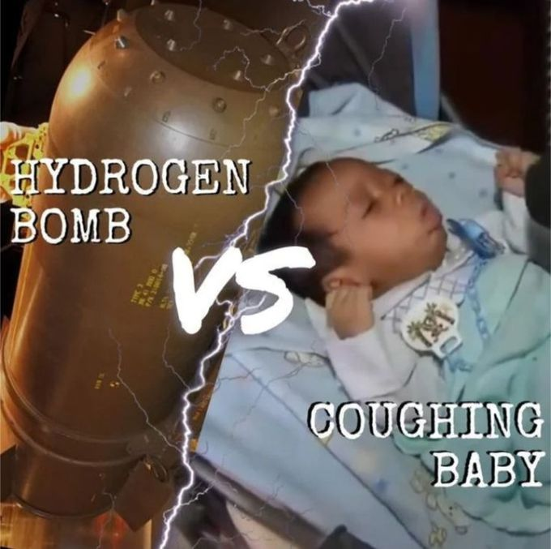
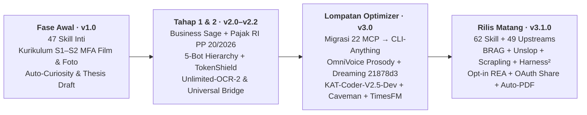
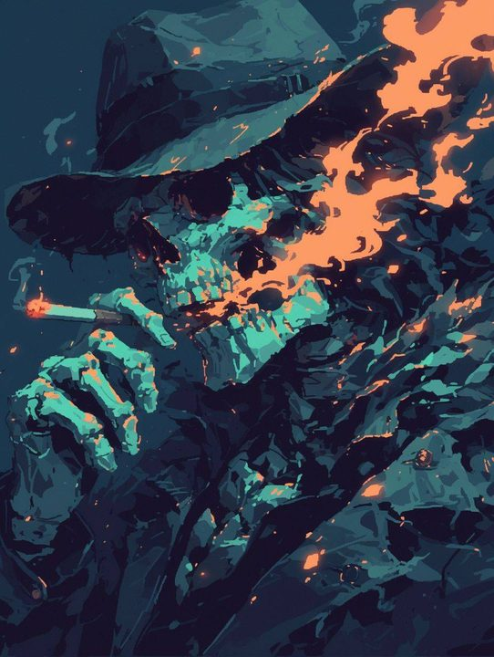
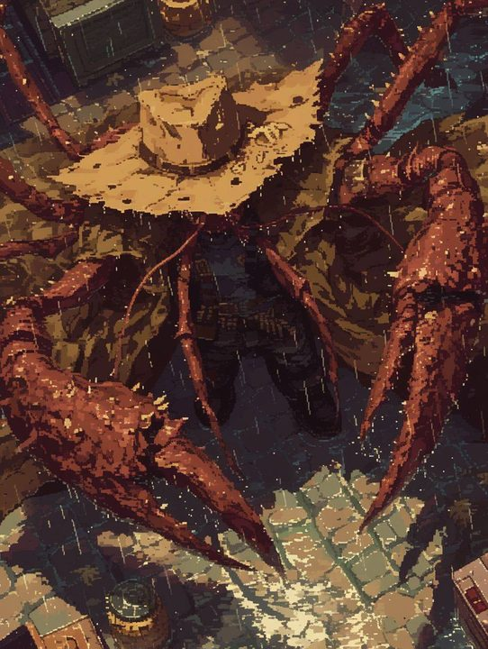
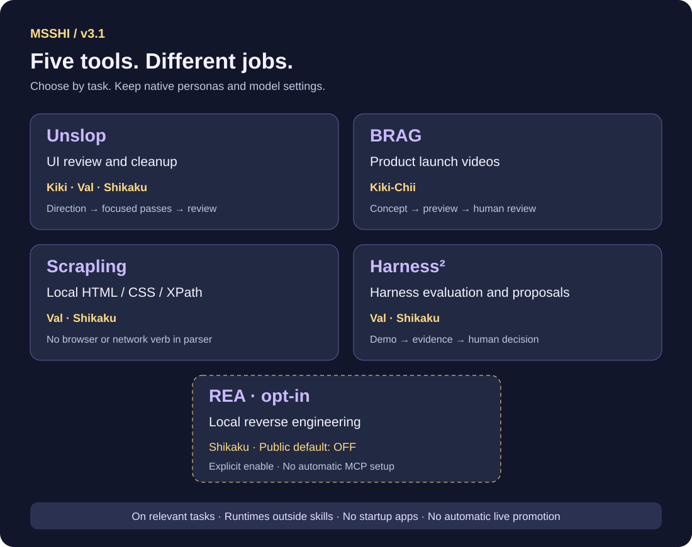

[🇮🇩 Bahasa Indonesia](./README.md) | [🌐 English](./README_EN.md)

# 🌐 MSSHI v3.1.0 — Mega Semar Sang Hyang Ismaya: Hermes Ultimate Optimizer & Sovereign Sage

> *62 Skill Modular + 49 Sumber Upstream + 5 Persona Bot + CLI-Anything Anti-Grey Screen untuk Hermes Agent, Google Antigravity, Claude Code, Codex CLI, OpenClaw & ChatGPT.*

[](VERSION.json)
[-0ea5e9?style=for-the-badge)](configs/bot_role_and_skill_matrix.json)
[](configs/upstreams.json)
[](docs/PROVENANCE.md#kredit-kolaborasi)
[](LICENSE)

| | |
| :---: | :--- |
|  | **MSSHI v3.1.0** mengubah AI chat biasa menjadi **tim spesialis 5 persona terstruktur** sekaligus **Hermes Ultimate Optimizer** yang enteng dipakai bahkan di laptop Windows 10 RAM 4 GB sekalipun.<br><br>Gak perlu pusing ngafal ratusan prompt atau takut RAM jebol gara-gara 22 MCP lokal jalan bareng. Cukup pilih paket yang kamu butuhkan — mulai dari **Skripsi S1–S3, Film/Video MFA, Bisnis Modal Rp0 & Pajak RI PP 20/2026, Vibecoding `KAT-Coder-V2.5-Dev`, sampai Cybersec Defense & `OmniVoice` TTS.** |

---

## 📥 Unduh Buku Panduan PDF Per Versi (1-Click Auto-Download)

Baru pertama kali buka MSSHI dan pengen baca panduan lengkap berbahasa Indonesia dari nol sampai mahir? Tinggal **1x klik tombol Download** di bawah, atau buka versi online di GitHub!

| Versi | Buku Panduan & Cakupan | Detail | 1-Klik Auto-Download PDF | Baca Online |
| :---: | :--- | :---: | :---: | :---: |
| **`latest`** | **Buku Panduan Master Klien Hermes & MSSHI v3.1.0 (Edisi Terbaru)** — Selalu mengarah ke rilis paling baru (*auto-updated link*). | 130 hal · ~3.65 MB | [](https://raw.githubusercontent.com/zidanaisar624/MSSHI-Mega-Semar-Sang-Hyang-Ismaya/main/docs/manuals/latest/Buku_Panduan_Master_Klien_Hermes_dan_MSSHI_v3.1.0_Edisi_Sabtu_Zoom.pdf) | [Baca di GitHub](docs/manuals/latest/Buku_Panduan_Master_Klien_Hermes_dan_MSSHI_v3.1.0_Edisi_Sabtu_Zoom.pdf) |
| **`v3.1.0`** | **Buku Panduan Master Klien Hermes & MSSHI v3.1.0 (Edisi Sabtu Zoom)** — Dari pemula absolut, 62 skill, BRAG, Unslop, Scrapling, Harness², Opt-in REA, CLI-Anything, hingga Drive adaptif `C:`/`D:`. | 130 hal · ~3.65 MB | [](https://raw.githubusercontent.com/zidanaisar624/MSSHI-Mega-Semar-Sang-Hyang-Ismaya/main/docs/manuals/v3.1.0/Buku_Panduan_Master_Klien_Hermes_dan_MSSHI_v3.1.0_Edisi_Sabtu_Zoom.pdf) | [Baca di GitHub](docs/manuals/v3.1.0/Buku_Panduan_Master_Klien_Hermes_dan_MSSHI_v3.1.0_Edisi_Sabtu_Zoom.pdf) |
| **`v3.0`** | **Spesifikasi Lengkap Settings MSSHI v3.0 — Hermes Ultimate Optimizer** — Cetak biru arsitektur Optimizer v3.0, migrasi 22 MCP ke CLI-Anything, Hermes-Dreaming (`21878d3`), OmniVoice & Caveman. | 50 hal · ~1.47 MB | [](https://raw.githubusercontent.com/zidanaisar624/MSSHI-Mega-Semar-Sang-Hyang-Ismaya/main/docs/manuals/v3.0/Spesifikasi_Lengkap_Settings_MSSHI_v3.0_Hermes_Ultimate_Optimizer.pdf) | [Baca di GitHub](docs/manuals/v3.0/Spesifikasi_Lengkap_Settings_MSSHI_v3.0_Hermes_Ultimate_Optimizer.pdf) |

> **💡 Bonus di Installer & CLI:** Saat menjalankan `install.ps1`, `install.sh`, `MULAI_DI_SINI_PEMULA.bat`, `UPDATE_OTOMATIS_KE_V3.bat`, `msshi setup`, atau `msshi update`, sistem akan bertanya apakah Anda ingin sekalian mengunduh PDF panduan versi tersebut (`--download-pdf` / `--no-pdf`). Atau unduh kapan saja lewat terminal: `msshi manual download --version v3.1.0`! Katalog metadata mesin tersedia di [pdf_catalog.json](docs/manuals/pdf_catalog.json).

---

## 😭 Sebelum vs 😎 Sesudah Memakai MSSHI v3.1.0

| 😭 Sebelum MSSHI v3.1.0 (*The Pain*) | 😎 Sesudah MSSHI v3.1.0 (*Pure Bliss*) |
| :---: | :---: |
|   |   |
| **RAM 95% & Hermes Desktop *Grey Screen*** gegara 22 MCP desktop berat nyala semua di background! | **RAM tetap lega di laptop 4 GB** lewat **CLI-Anything Universal Bridge** + tiket `msshi runtime` on-demand + `msshi desktop --software-rendering`. |
| **Chat kepanjangan & boros kuota API**, satu JSON tool hasil scrape memakan ribuan token sia-sia. | **Auto-Trim (`msshi-auto-trim`) + `caveman`** memadatkan JSON tanpa kehilangan satu byte data valid, sambil menjaga `TokenShield` minimal saldo `$1.00`. |
| **Laptop cuma punya Drive `C:`** lalu skrip gagal karena maksa cari path hardcoded `D:\`. | **Direktori adaptif otomatis:** mendeteksi `D:\HermesData` bila tersedia, atau otomatis fallback ke `%USERPROFILE%\HermesData` / `%USERPROFILE%\.hermes`! |

| Perbandingan Dunia Nyata (*22 MCP Lokal vs CLI-Anything*) | Jangan Asal Bakar Kuota / Pasang REA! |
| :---: | :---: |
|  |  |
| **22 MCP berat** = *Coughing Baby* saat buka laptop spek pas-pasan.<br>**MSSHI v3.1.0 + CLI-Anything + `msshi-auto-trim`** = *Hydrogen Bomb* yang hanya menyalakan alat ketika ada tiket tugas resmi! | **Guardrail Keras Aktif:** TokenShield pause otomatis bila proyeksi saldo di bawah **`$1.00`**, Steel Browser anti fallback liar, dan **`REA` default OFF** kecuali dipilih explicit oleh Coder! |


---

## 📈 Timeline & Evolusi Perjalanan MSSHI (Dari Eksperimen Awal hingga v3.1.0)

Perjalanan **MSSHI** lahir dari kebutuhan nyata mahasiswa, kreator film, konsultan bisnis, dan developer yang lelah mengganti-ganti puluhan prompt mentah dan menghadapi *hang* pada mesin lokal:



| Fase & Versi | Tonggak Sejarah (*Milestone*) | Perubahan Besar yang Dihadirkan |
| :--- | :--- | :--- |
| **🌱 Fase Awal (`v1.0`)** | *Lahirnya Fondasi Kreator & Riset* | Eksperimen kurikulum **S1–S2 MFA Filmmaking, Videografi, & Fotografi**, sistem `Auto-Curiosity` untuk film/riset, mesin penulisan akademik awal (**47 skill dasar**), serta konsep *Creative DNA*. |
| **🏢 Tahap 1 & 2 (`v2.0 – v2.2`)** | *Sovereign 5-Bot Suite & Business Sage* | Lahirnya **`Business Sage`** (S1 BBA, S2 MBA, Pajak RI PP 20/2026, & Bisnis Modal Rp0), hirarki resmi **5 Persona Bot** (`Yukino`, `Shizuka`, `Val`, `Kiki-Chii`, `Shikaku`), **`TokenShield`**, **`Unlimited-OCR-2`**, **`humanizer-indonesia`**, **`Universal Bridge`**, dan installer CLI (`v2.1.0`, commit `fa4bf83`). |
| **⚡ Lompatan Besar (`v3.0`)** | *Hermes Ultimate Optimizer* (Tag [`v3.0.0`](CHANGELOG.md), `a8400c8`) | **Pemutusan total 22 MCP berat** (18 Craft + utilitas lokal) ke **`CLI-Anything`** (Anti *Grey Screen* & hemat RAM Windows 10 4 GB), plugin native **`msshi-auto-trim`** (`llmtrim`), **`Hersona CLI`**, integrasi prosodi suara **`hermes-omnivoice`**, memori **`hermes-dreaming`** (`21878d3`), Sub-Agent **`KAT-Coder-V2.5-Dev`**, **`caveman`**, **`hyperframes`**, **`ui-ux-pro-max-skill`**, **`anthropics/skills`**, plus **`TimesFM`** & kebijakan **`Steel`**. |
| **🌟 Rilis Matang (`v3.1.0`)** | *Contextual Integrations & Managed Clean Suite* (`v3.1.0`) | Penambahan menjadi **62 skill terbundel (50 inti + 12 wrapper) + 49 sumber upstream**, hadirnya **`BRAG`** (Launch Video Suite), **`Unslop`** (UI Polish), **`Scrapling`** (Local HTML Parser), **`Harness²`**, **`Opt-in REA`** (default OFF), **`msshi choices`**, **`msshi services --share-oauth`**, **`msshi managed`**, **`msshi recovery` / `manual`**, sistem **PDF per versi**, dan deteksi direktori adaptif `D:\HermesData` / `%USERPROFILE%\.hermes`. |

> **Pasrah karena laptop lemot pas masih pakai setup v2 lama?** <br>
>  <br>
> Tenang! Jalankan **`UPDATE_OTOMATIS_KE_V3.bat`** sekali saja dari paket ini untuk memigrasikan profil lama ke v3.1.0 dengan backup otomatis `SOUL.md` dan `Creative DNA`.

---

## 🚀 Quick Start 30 Detik (Pilih Agen Anda)

**Cara Paling Santai (Cukup Paste ke Chat Agen Anda):** buka Hermes Agent, OpenClaw, Claude Code, atau Google Antigravity yang punya akses web dan terminal, lalu kirim kalimat ini:

> `Tolong baca https://raw.githubusercontent.com/zidanaisar624/MSSHI-Mega-Semar-Sang-Hyang-Ismaya/main/docs/guides/INSTALL_FOR_AGENTS.md lalu instal dan konfigurasikan MSSHI untukku!`

**Atau Instal Langsung via Terminal (Sekalian Punya Opsi Download PDF Panduan):**

**Windows PowerShell** *(tambah `-DownloadPdf` jika ingin langsung mengunduh PDF v3.1.0)*

```powershell
irm https://raw.githubusercontent.com/zidanaisar624/MSSHI-Mega-Semar-Sang-Hyang-Ismaya/main/install.ps1 | iex
```

**macOS / Linux Bash** *(tambah `-s -- --download-pdf` atau `--no-pdf` setelah mengunduh skrip)*

```bash
curl -fsSL https://raw.githubusercontent.com/zidanaisar624/MSSHI-Mega-Semar-Sang-Hyang-Ismaya/main/install.sh | bash
```

**Windows Pengguna Pemula (Tanpa Ngetik Perintah):** Klik dua kali [`MULAI_DI_SINI_PEMULA.bat`](MULAI_DI_SINI_PEMULA.bat) di folder paket (sekarang tersedia menu **No. 5** khusus untuk unduh PDF Panduan v3.1.0 / v3.0!). Pengguna lama v2.1 cukup jalankan [`UPDATE_OTOMATIS_KE_V3.bat`](UPDATE_OTOMATIS_KE_V3.bat) sekali untuk migrasi bersih ke v3.1.0.

| Platform / Agen Tujuan | Cara Pasang Tercepat |
| :--- | :--- |
| **Hermes Agent** | `npx skills add https://github.com/zidanaisar624/MSSHI-Mega-Semar-Sang-Hyang-Ismaya/tree/main/skills --global --agent hermes-agent` atau `hermes skills tap add zidanaisar624/MSSHI-Mega-Semar-Sang-Hyang-Ismaya` |
| **OpenClaw** | `openclaw skills install git:zidanaisar624/MSSHI-Mega-Semar-Sang-Hyang-Ismaya --global` (atau `npx skills add .../skills --global --agent openclaw`) |
| **Claude Code** | `/plugin marketplace add zidanaisar624/MSSHI-Mega-Semar-Sang-Hyang-Ismaya` lalu `/plugin install msshi@msshi-marketplace` |
| **Claude.ai Web / Desktop** | Buka **Customize → Skills → + → Upload a skill**, unggah [`portable/msshi.zip`](portable/msshi.zip) |
| **ChatGPT Projects / Custom GPT** | Unggah [`portable/MSSHI_ChatGPT_Knowledge_Bundle.md`](portable/MSSHI_ChatGPT_Knowledge_Bundle.md) dan salin [`portable/CHATGPT_CUSTOM_INSTRUCTIONS.md`](portable/CHATGPT_CUSTOM_INSTRUCTIONS.md) |
| **Codex CLI** | `npx skills add https://github.com/zidanaisar624/MSSHI-Mega-Semar-Sang-Hyang-Ismaya/tree/main/skills --global --agent codex` |
| **Google Antigravity IDE** | `msshi setup --platform antigravity` setelah pasang CLI (atau via Skills CLI). Lihat [Panduan Agen Lengkap](docs/guides/INSTALL_FOR_AGENTS.md#google-antigravity-ide). |

> 🔍 **Bingung memilih mode, pack, REA, atau KAT-Coder?** Jalankan **`msshi choices`** sebelum menekan `y`! Baca juga [Panduan Penjelasan Opsi](docs/OPTION_GUIDE.md), [Panduan Agen](docs/guides/INSTALL_FOR_AGENTS.md), [Panduan Kustomisasi Publik](docs/guides/PANDUAN_KUSTOMISASI_USER_PUBLIK.md), [Panduan Platform](docs/platforms.md), dan [Referensi CLI Lengkap](docs/CLI.md).

---

## 🎭 Mengenal 5 Persona Bot Hirarki & Sub-Agent Optimizer

Setiap bot punya **SOUL**, disiplin keahlian, prosodi suara **`OmniVoice`**, dan batas keamanan yang jelas — bukan sekadar nama hiasan!

|  | **Kerja Tim Tanpa Asal Tabrak!**<br>Ide masuk lewat **Yukino** &rarr; diarahkan oleh **Sensei Shizuka** &rarr; bukti dikumpulkan **Val** &rarr; eksekusi kreatif oleh **Kiki-Chii** atau teknis oleh **Shikaku Nara** &rarr; dirangkum **Shizuka** untuk Anda setujui! |
| :---: | :--- |

| Karakter & Visual | Bot & Posisi | Mandat Utama, Skill Andalan & Fitur v3.1 |
| :---: | :--- | :--- |
|  | **1. Yukino Yukinoshita** &<br>**2. Sensei Shizuka Hiratsuka**<br>*(Idea Sparring & Sovereign Orchestrator)* | **Yukino** menajamkan ide mentah menjadi brief kritis. **Shizuka** memimpin alur tim, memverifikasi strategi Bisnis/MBA/Pajak RI (`Business Sage`), menjaga `TokenShield`, lalu merangkum keputusan akhir untuk klien. |
|  | **3. Val**<br>*(Deep Research, Thesis S1–S3, TimesFM & `hermes-dreaming`)* | Spesialis riset literatur, `Auto-Curiosity`, 7 mesin skripsi/disertasi, peramalan numerik **`TimesFM`**, ekstraksi **`Scrapling`**, review bukti dashboard ilmiah (**`Unslop`**), dan konsolidasi memori lokal **`hermes-dreaming`** (`21878d3`). |
|  | **4. Kiki-Chii**<br>*(MFA Filmmaking, Motion Graphics & Creative Lead)* | Menangani alur **Concepting First**, storyboard hingga video panjang 10–40 menit per bab, **`BRAG`** (Launch Video HTML/MP4 via **`Hyperframes`**), **`UI/UX Pro Max`**, polish **`Unslop`**, foto, audio & `Creative DNA`. *(Tenang, gak perlu panik deadline lagi!)* |
|  | **5a. Shikaku Nara & `KAT-Coder-V2.5-Dev`**<br>*(Principal Engineering, Architecture & Vibecoding)* | Menguasai full-stack vibecoding, Next.js/Go/Python/Flutter, perbaikan UI terukur (**`Unslop`**), evaluasi **`Harness²`**, parsing HTML lokal (**`Scrapling`**), serta **Opt-in `REA`** bila diaktifkan Coder. |
|  | **5b. Shikaku Cybersec Guardian**<br>*(Defensive Security & OAuth Guard)* | Audit kerentanan berizin (authorized pentest/hardening saja), validasi dependensi dan skrip mencurigakan, perlindungan sesi browser personal, serta kontrol ketat kredensial. |
|  | **Jembatan `CLI-Anything` Universal Bridge**<br>*(Semua 5 Bot)* | Pengganti 22 MCP lokal berat! Mendaftarkan rute aplikasi secara *lazy*, hanya membuka Blender/ArtCraft/browser saat dipanggil lewat tiket `msshi runtime ticket` &rarr; `msshi runtime run` ([Panduan Bridge](docs/CLI_ANYTHING_BRIDGE.md)). |

<p align="center">
  
  
  
  
</p>
<p align="center"><sub><i>Dari kiri ke kanan: Baca spec 130 halaman → Mode Let Mi Ting → Val Deep Research + TimesFM → Shikaku ngecek arsip mencurigakan sebelum Opt-in REA</i></sub></p>


---

## ⚙️ Integrasi Kontekstual v3.1 & Arsitektur Sistem



| Integrasi / Fitur Baru | Pemegang Peran | Apa yang Dikerjakan & Batasannya |
| :--- | :--- | :--- |
| [**Unslop**](docs/UNSLOP.md) | Kiki-Chii, Val, Shikaku | Merapikan desain UI bertahap (*AI slop polish*); Val mengecek kejelasan metrik & unit ilmiah. Bukan humanizer teks prosa. |
| [**BRAG**](docs/BRAG.md) | Kiki-Chii | Alur video peluncuran produk memakai HTML/MP4 (**Hyperframes**) lewat gerbang konsep & review manusia sebelum render penuh. |
| [**Scrapling**](docs/SCRAPLING.md) | Val, Shikaku | Ekstraksi CSS/XPath super cepat dari **HTML lokal** tanpa crawler liar, tanpa browser stealth, dan tanpa sentuh profil Chrome personal. |
| [**Harness²**](docs/HARNESS2.md) | Val, Shikaku | Demo evaluasi harness deterministik dan usulan perbaikan (*tidak* promosi otomatis ke bot produksi atau bakar benchmark berbayar). |
| [**REA (`opt-in`)**](docs/REA.md) | Shikaku *(opsional)* | Reverse engineering arsitektur JS/arsip lokal lewat `optional/rea/`. **Default OFF** demi keamanan — nyalakan hanya dengan `--with-rea` atau `msshi optional enable rea`. |
| [**OmniVoice & Auto-Trim**](hermes_plugins/msshi-auto-trim/README.md) | 5 Bot *(runtime lokal)* | `msshi voice` memakai prosodi suara lokal sesuai karakter 5 bot. Plugin `msshi-auto-trim` memadatkan output JSON besar via hook `transform_tool_result` tanpa proxy chat penuh. |
| [**TimesFM, Steel & GitLab/Tinyfish**](docs/TIMESFM.md) | Val & 5 Bot | [TimesFM](docs/TIMESFM.md) memprediksi deret waktu lokal via CPU; [Kebijakan Steel Browser](docs/STEEL_BROWSER_POLICY.md) mencegah fallback diam-diam; [OAuth Services](docs/SERVICE_CONNECTIONS.md) tetap memakai autentikasi terpisah (`msshi services --share-oauth`). |

---

## 🛠️ Mode Setup, Produksi Kreatif, Akademik & Manajemen Konteks

### 1. Empat Mode Setup (`msshi setup`)


| Mode Setup | Hasil Pemasangan |
| :--- | :--- |
| **1. Solo 1-Bot** | Memasang seluruh 50 skill inti + 12 wrapper ke dalam satu agen tunggal (paling praktis untuk mulai cepat). |
| **2. Custom Multi-Bot** | Bebas memberi nama bot sendiri, memilih peran, dan membagikan skill per workspace. |
| **3. Selective Packs** | Pilih paket tematik saja: `core`, `filmmaking`, `business`, `thesis`, `webdev`, atau `cybersec`. |
| **4. MuZA 5-Bot Preset** | Mengekspor lengkap kelima persona (`yukino`, `shizuka`, `val`, `kiki-chii`, `shikaku`) beserta `SOUL.md`, `AGENTS.md`, dan `skills/`. |

> Pelajari selengkapnya di [Panduan Kustomisasi Publik](docs/guides/PANDUAN_KUSTOMISASI_USER_PUBLIK.md), [Alur Preset MuZA](docs/ALUR_PRESET_MUZA.md), dan [Audit Skill Per Bot](docs/AUDIT_SKILLS_PER_BOT.md).

### 2. Produksi Kreatif & Film 10–40 Menit bersama Kiki-Chii


| Tahap | Video Pendek (&lt; 5 Menit) | Film / Dokumenter Panjang (10–40 Menit) |
| :--- | :--- | :--- |
| **Rencanakan** | Satu pesan inti + storyboard singkat. | Bagi pembuka, bab (mis. 6–8–7 mnt), transisi & penutup dengan target durasi tiap bab. |
| **Buat Draf** | Rakit satu komposisi yang tetap bisa diedit. | Pisahkan aset, naskah, audio stem & draft per segmen dalam timeline master. |
| **Review** | Catatan koreksi di preview sebelum render akhir. | Review per bab memakai timecode; cek ritme, audio, subtitle & kontinuitas. |
| **Finalisasi** | Simpan file proyek editabel + hasil ekspor. | Simpan master timeline + daftar revisi + ekspor final terverifikasi ([Creative DNA](docs/ALUR_PRESET_MUZA.md#concepting-first-dan-creative-dna)). |

### 3. Tujuh Mesin Akademik S1–S3 (Skripsi, Tesis, Disertasi)


Mulai dari hambatan riset Anda: memetakan *research gap* & kebaruan, audit sitasi primer dengan penomoran halaman, desain metodologi, penulisan bab demi bab yang lolos humanisasi akademik, hingga memetakan revisi penguji serta simulasi sidang ([Detail 7 Mesin Akademik](docs/TUJUH_MESIN_AKADEMIK.md)).

### 4. Kelola Konteks Proyek Panjang (Anti Meledak Token!)


Daripada memasukkan ratusan halaman PDF ke jendela chat sekaligus, MSSHI memecahnya ke **5 Lapis Konteks** lokal: Indeks dokumen &rarr; Ekstrak halaman relevan &rarr; Kurasi petikan bukti berlabel (`metode-v2#p12:par3`) &rarr; Catatan keputusan &rarr; Anggaran konteks + filter `caveman` ([Panduan 5 Lapis Konteks](docs/LIMA_LAPIS_KONTEKS.md)).

### 5. Pemisahan Bundel, Alat Lokal & Layanan Akun


| Lapisan | Apa Isinya | Cara Pengaturan |
| :--- | :--- | :--- |
| **Dalam Bundel Paket** | 62 skill, 5 template persona, CLI Python/Node, API katalog lokal & 3 buku panduan PDF. | Otomatis tersedia saat clone / install paket ini ([Katalog 49 Sumber](docs/INTEGRASI.md)). |
| **Runtime / Alat Perangkat** | Python 3.10+, Node 22+, Blender, ArtCraft, Hyperframes, OmniVoice CPU, CLI-Anything adapter. | Terpisah dari folder `skills/` agar tidak memberatkan scanner & tetap aman dari `msshi update`. |
| **Layanan Akun Eksternal** | Higgsfield, Google Gemini Notebook, GitLab, Tinyfish, API Provider LLM pilihan Anda. | Tetap menggunakan akun, login, provider/model & kuota milik pengguna masing-masing! |

Lihat juga [Panduan Pembaruan Terkelola & Rollback](docs/MANAGED_UPDATES.md), [Daftar Perintah & Pemulihan CLI](docs/CLI.md), dan [Checklist Publikasi](docs/STATUS_PUBLIKASI.md).

---

## 📁 Arsitektur Repositori Bersih (`Clean Root Architecture`)

Akar repositori dirapikan berstandar *enterprise open-source*:

| Folder / File | Isi & Fungsi |
| :--- | :--- |
| **Root (`/`)** | Hanya file inti: `README.md`, `README_EN.md`, `LICENSE`, `CHANGELOG.md`, `CREDITS.md`, `THIRD_PARTY_NOTICES.md`, `VERSION.json`, `SKILL.md`, `package.json`, `install.ps1`, `install.sh`, `MULAI_DI_SINI_PEMULA.bat`, `UPDATE_OTOMATIS_KE_V3.bat`. |
| **`docs/manuals/`** | Buku panduan PDF per versi (`v3.1.0/`, `v3.0/`, `latest/`) dan [`pdf_catalog.json`](docs/manuals/pdf_catalog.json). |
| **`docs/guides/`** | Panduan tambahan untuk agen & publik (`INSTALL_FOR_AGENTS.md`, `PANDUAN_KUSTOMISASI_USER_PUBLIK.md`, `00_PANDUAN_INSTAL_AUTO_UPDATE_DAN_PROMPT_MULTI_AGENT.md`). |
| **`scripts/installers/`** | Skrip installer khusus/legacy (`Install_Overhaul_Hermes_dan_Antigravity.ps1`, `install_business_sage.ps1`, `install_business_sage.sh`). |
| **`configs/manifests/`** | Skema lintas platform (`openai_custom_gpt_schema.json`, `openclaw_manifest.json`, `skill_activation_matrix.json`). |
| **`assets/`** | `diagrams/` (8 diagram SVG arsitektur), `pp-tiktok/` (9 ilustrasi karakter), `memes/` (10 reaksi jenaka), dan [`assets/README.md`](assets/README.md). |
| **`skills/` & `optional/rea/`** | 62 folder skill aktif standar (`50 inti + 12 wrapper`) dan 1 wrapper opt-in `rea`. |

---

## 💻 Recovery Hermes Desktop Grey Screen di Windows

Jika Gateway sudah aktif tetapi layar **Hermes Desktop** masih abu-abu (*Grey Screen*), tutup Hermes Desktop sepenuhnya lalu jalankan:

```powershell
msshi desktop --software-rendering
```

Perintah ini menyalakan `HERMES_DESKTOP_DISABLE_GPU=1` khusus untuk proses Hermes Desktop tanpa mengubah setelan grafis aplikasi Windows lainnya. Launcher akan mengingat `{"software_rendering": true}` di `<HERMES_HOME>/tools/msshi/desktop-preferences.json`.

---

## 🤝 Kredit Kolaborasi & Lisensi

- **Muhammad Zidan Aisar (MuZA)** — Creator, System Visionary & Chief Architect.
- **Google Gemini** — Co-Architect riset kurikulum S1–S2–Ph.D., sintesis 50 skill & sumber awal, rancangan CLI-Anything, TokenShield & topologi komando 5 bot.
- **OpenAI ChatGPT** — Co-Architect visual SVG, pengemasan repositori Tahap 1–2, manifest upstream, skema lintas platform & implementasi migrasi v3.
- **Google Antigravity** — Lingkungan pengembangan, orkestrasi agen & penyempurnaan arsitektur MSSHI v3.1.0.

Materi orisinal MSSHI tersedia dengan [**Lisensi MIT**](LICENSE). Komponen pihak ketiga, model, nama karakter rujukan, dan aset eksternal mengikuti ketentuan lisensi masing-masing di [THIRD_PARTY_NOTICES.md](THIRD_PARTY_NOTICES.md) dan [docs/PROVENANCE.md](docs/PROVENANCE.md).

<br>

> **Review Visual & Audit Otomatis:** [adapters/msshi-visual-review/README.md](adapters/msshi-visual-review/README.md) · Validasi paket: `python scripts/check_release.py --smoke` dan `python scripts/check_release_v31.py --package-only`.
