[🇮🇩 Bahasa Indonesia](./README.md) | [🌐 English](./README_EN.md)

<div align="center">

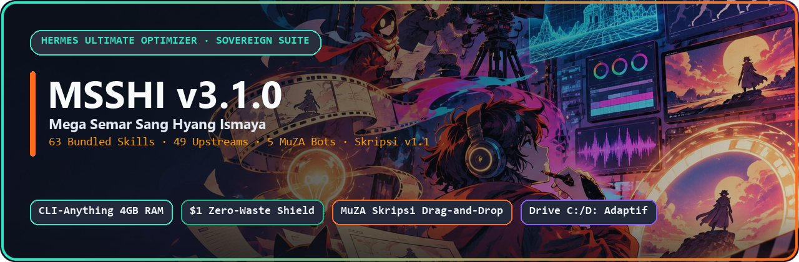

# 🌐 MSSHI v3.1.0 — Mega Semar Sang Hyang Ismaya
### *Hermes Ultimate Optimizer · 5-Bot Sovereign Sage Suite · MuZA Skripsi Drag-and-Drop v1.1*

[](VERSION.json)
[-FF6B1A?style=for-the-badge)](configs/bot_role_and_skill_matrix.json)
[](configs/upstreams.json)
[](skills/muza-skripsi-template/SKILL.md)
[](https://colab.research.google.com/drive/15ckekQcGu4ssHQMQgXyK1gMMgobVZMFv)
[](LICENSE)

> *"Satu ekosistem berdaulat untuk Hermes Agent, Google Antigravity, Claude Code, Codex CLI, OpenClaw & ChatGPT — mengubah laptop pas-pasan RAM 4 GB dan saldo `$1` menjadi markas riset akademik S1–S3, studio film MFA, penasihat bisnis/pajak RI, dan devops full-stack anti lemot."*

</div>

---

<table>
<tr>
<td width="245" align="center" valign="middle">
  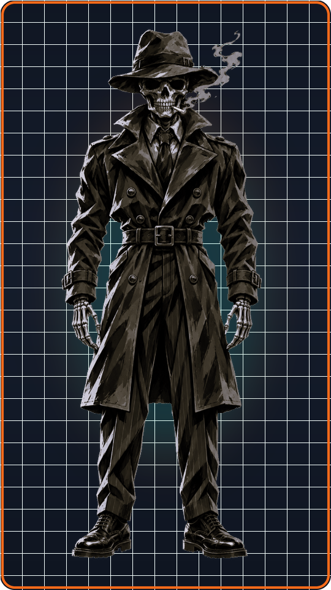
  <br><sub><b>Sovereign Orchestrator</b><br>Zero Model Override · Adaptive C:/D:</sub>
</td>
<td valign="top">
  <h3>🎭 Dari Chat AI Biasa Menjadi Markas Operasi Cyber-Noir 5 Spesialis</h3>
  <p>Bosan menghadapi laptop <b>Windows 10 RAM 4 GB nge-freeze (Grey Screen)</b> gara-gara 22 MCP lokal nyala barengan? Atau kesal karena skrip otomasi langsung error di laptop yang <b>cuma punya Drive <code>C:</code></b>?</p>
  <p><b>MSSHI v3.1.0</b> merombak total fondasi agen AI Anda tanpa menyentuh konfigurasi provider/model pribadi (<code>jev_model_routing: false</code> terkunci penuh):</p>
  <ul>
    <li>⚡ <b>CLI-Anything Universal Bridge</b> — Memutus ketergantungan 22 MCP berat; membuka Blender, ArtCraft &amp; browser hanya lewat tiket tugas on-demand (<code>msshi runtime ticket</code>).</li>
    <li>🛡️ <b>$1 Zero-Waste Token Shield + Auto-Trim + Caveman</b> — Meringkas payload JSON besar secara lossless lewat hook <code>transform_tool_result</code> dan menghentikan langkah berbiaya jika saldo proyeksi &lt; <b>$1.00</b>.</li>
    <li>🎓 <b>MuZA Skripsi Starter v1.1 (Drag-and-Drop + Colab)</b> — Seret file <code>.zip</code> riset + PDF pedoman kampus ke <code>MULAI_SKRIPSI_DRAG_AND_DROP.bat</code>, atau ketik di chat: <i>"Buatkan aku template skripsi!"</i></li>
    <li>💾 <b>Direktori Adaptif C: vs D:</b> — Otomatis memakai <code>D:\HermesData</code> bila Drive D: ada, atau fallback bersih ke <code>%USERPROFILE%\HermesData</code> / <code>Documents\MuZA_Skripsi_Output</code>.</li>
  </ul>
</td>
</tr>
</table>

---

<div align="center">

## 📥 Pusat Unduhan Buku Panduan PDF Per Versi (1-Click Auto-Download)

*Baru pertama kali mengenal MSSHI atau ingin panduan lengkap dari nol sampai mahir? Klik tombol <b>Download PDF</b> di bawah untuk unduhan langsung, atau baca online di GitHub!*

| Versi / Kanal | Judul Dokumen &amp; Cakupan | Detail | 1-Klik Auto-Download PDF | Baca Online |
| :---: | :--- | :---: | :---: | :---: |
| **`v3.1.0` (Master Klien)** | **Buku Panduan Master Klien Hermes &amp; MSSHI v3.1.0** — Panduan menyeluruh 63 skill, 5 bot, CLI-Anything, OmniVoice, Skripsi v1.1 &amp; Drive adaptif. | 130 hal · ~3.65 MB | [](https://github.com/zidanaisar624/MSSHI-Mega-Semar-Sang-Hyang-Ismaya/raw/v3.1.0/docs/pdf-guides/Buku_Panduan_Master_Klien_Hermes_dan_MSSHI_v3.1.0.pdf) | [Lihat di GitHub](docs/pdf-guides/Buku_Panduan_Master_Klien_Hermes_dan_MSSHI_v3.1.0.pdf) |
| **`v3.1.0` (Laporan Eksekusi)** | **Laporan Eksekusi Hydrogen MSSHI v3.1.0 (Memeable &amp; Skripsi)** — Audit restrukturisasi GitHub/lokal, katalog 19 visual, integrasi Colab/Word &amp; log verifikasi. | Laporan Resmi | [](https://github.com/zidanaisar624/MSSHI-Mega-Semar-Sang-Hyang-Ismaya/raw/v3.1.0/docs/pdf-guides/Laporan_Eksekusi_Hydrogen_MSSHI_v3.1.0_Memeable_dan_Skripsi.pdf) | [Lihat di GitHub](docs/pdf-guides/Laporan_Eksekusi_Hydrogen_MSSHI_v3.1.0_Memeable_dan_Skripsi.pdf) |
| **`v3.0` (Optimizer Spec)** | **Spesifikasi Lengkap Settings MSSHI v3.0 — Hermes Ultimate Optimizer** — Cetak biru migrasi 22 MCP ke CLI-Anything, `hermes-dreaming`, OmniVoice &amp; Caveman. | 50 hal · ~1.47 MB | [](https://github.com/zidanaisar624/MSSHI-Mega-Semar-Sang-Hyang-Ismaya/raw/v3.1.0/docs/pdf-guides/Spesifikasi_Lengkap_Settings_MSSHI_v3.0_Hermes_Ultimate_Optimizer.pdf) | [Lihat di GitHub](docs/pdf-guides/Spesifikasi_Lengkap_Settings_MSSHI_v3.0_Hermes_Ultimate_Optimizer.pdf) |
| **`latest` (Auto-Track)** | **Kanal Otomatis `latest` (Selalu Menunjuk Rilis Terbaru)** — Kompatibel dengan CLI `msshi manual download --version latest` &amp; installer 1-klik. | 130 hal · ~3.65 MB | [](https://raw.githubusercontent.com/zidanaisar624/MSSHI-Mega-Semar-Sang-Hyang-Ismaya/main/docs/manuals/latest/Buku_Panduan_Master_Klien_Hermes_dan_MSSHI_v3.1.0_Edisi_Sabtu_Zoom.pdf) | [Baca di `manuals/`](docs/manuals/latest/Buku_Panduan_Master_Klien_Hermes_dan_MSSHI_v3.1.0_Edisi_Sabtu_Zoom.pdf) |

> 💡 **Pilihan PDF Otomatis di Installer &amp; CLI:** Saat menjalankan `install.ps1`, `install.sh`, `MULAI_DI_SINI_PEMULA.bat`, `UPDATE_OTOMATIS_KE_V3.bat`, `msshi setup`, atau `msshi update`, Anda bisa langsung memilih untuk mengunduh PDF panduan sesuai versi (`--download-pdf` / `--no-pdf`), atau panggil `msshi manual download --version v3.1.0`. Katalog JSON mesin: [`docs/manuals/pdf_catalog.json`](docs/manuals/pdf_catalog.json) · Link langsung `v3.1.0` ringkas: [`docs/pdf-guides/Panduan_Master_MSSHI_v3.1.0.pdf`](docs/pdf-guides/Panduan_Master_MSSHI_v3.1.0.pdf) · Arsip Zoom: [`docs/manuals/v3.1.0/`](docs/manuals/v3.1.0/Buku_Panduan_Master_Klien_Hermes_dan_MSSHI_v3.1.0_Edisi_Sabtu_Zoom.pdf) &amp; [`docs/manuals/v3.0/`](docs/manuals/v3.0/Spesifikasi_Lengkap_Settings_MSSHI_v3.0_Hermes_Ultimate_Optimizer.pdf).

</div>

---

## 🕰️ Timeline Evolusi MSSHI (`v1.0` → `v3.1.0`): Dari Kurikulum Eksperimental Hingga Mesin Skripsi Drag-and-Drop

Perjalanan **MSSHI** lahir dari frustrasi nyata menghadapi AI yang boros token, setup berantakan, dan laptop kentang yang menjerit saat 22 MCP dinyalakan bersamaan:

<div align="center">

<table>
<tr>
<td width="50%" align="center" valign="top">
  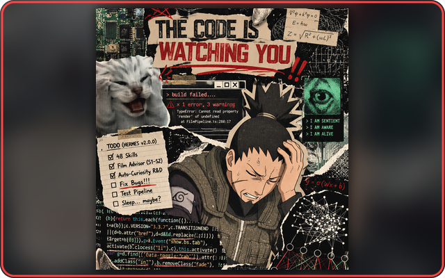
  <br><b>Fase 1 · Era Eksperimen (<code>v1.0</code>)</b>
  <br><sub>Awalnya cuma <b>47 skill inti</b> S1–S2 MFA Filmmaking, Videografi, Fotografi &amp; <code>Auto-Curiosity</code> — lalu saat 22 MCP lokal nyala semua, laptop langsung panas &amp; build menjerit!</sub>
</td>
<td width="50%" align="center" valign="top">
  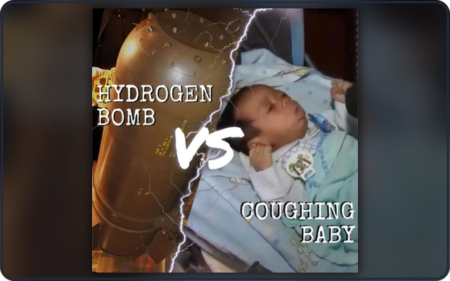
  <br><b>Fase 2 · Stage 1 &amp; 2 Sovereign Suite (<code>v2.0 – v2.2</code>)</b>
  <br><sub>Lahirnya <b>Business Sage</b> (BBA/MBA + Pajak RI <code>PP 20/2026</code> + Modal Rp0), hirarki <b>5 Bot MuZA</b>, <code>TokenShield</code>, <code>Unlimited-OCR-2</code>, <code>humanizer-indonesia</code> &amp; <code>Universal Bridge</code>.</sub>
</td>
</tr>
<tr>
<td width="50%" align="center" valign="top">
  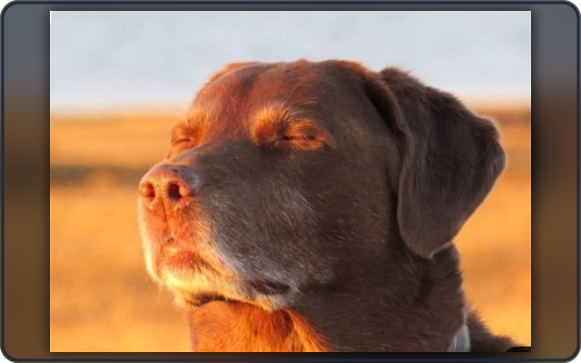
  <br><b>Fase 3 · Lompatan Optimizer (<code>v3.0</code> · Tag <code>a8400c8</code>)</b>
  <br><sub><b>22 MCP berat diputus total</b> dan diganti <b>CLI-Anything</b> + plugin native <code>msshi-auto-trim</code> + <code>caveman</code>! Plus hadirnya prosodi suara <b>OmniVoice</b>, <b>Hermes-Dreaming</b> (<code>21878d3</code>), <b>KAT-Coder-V2.5-Dev</b>, <b>Hyperframes</b>, &amp; <b>TimesFM</b>. RAM 4 GB akhirnya bernapas lega!</sub>
</td>
<td width="50%" align="center" valign="top">
  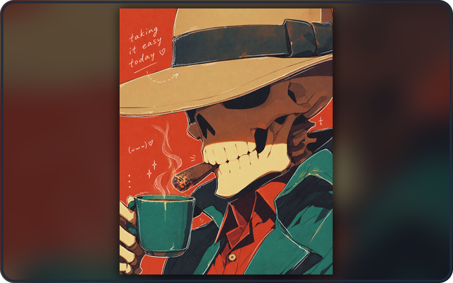
  <br><b>Fase 4 · Rilis Matang Saat Ini (<code>v3.1.0 + Skripsi v1.1</code>)</b>
  <br><sub>Genap <b>63 skill (51 inti + 12 wrapper) + 49 upstreams</b>: hadir <b>MuZA Skripsi Drag-and-Drop v1.1</b>, <code>BRAG</code>, <code>Unslop</code>, <code>Scrapling</code>, <code>Harness²</code>, Opt-in <code>REA</code>, <code>msshi doctor</code>, <code>msshi choices</code>, <code>msshi skripsi</code>, <code>msshi manual</code> &amp; path adaptif <code>C:/D:</code>. Santai menikmati kopi sementara sistem bekerja presisi.</sub>
</td>
</tr>
</table>

</div>

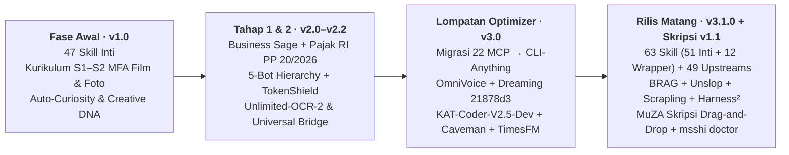

---

## 🎭 Mengenal 5 Persona Bot Hirarki (Bukan Sekadar Hiasan Prompt!)

Setiap bot punya berkas [`SOUL.md`](configs/personas/shizuka.md), batasan otoritas, profil prosodi **`OmniVoice`**, serta distribusi skill terkurasi yang diverifikasi otomatis lewat [`docs/AUDIT_SKILLS_PER_BOT.md`](docs/AUDIT_SKILLS_PER_BOT.md):

| Avatar | Bot &amp; Gelar | Peran &amp; Mandat Eksekusi | Skill &amp; Fitur Andalan `v3.1.0` |
| :---: | :--- | :--- | :--- |
|  | **1. Yukino Yukinoshita**<br>*(Idea Sparring Partner)* | Menguji ide mentah pengguna agar tajam sebelum masuk produksi; mengatur ritme energi kerja &amp; mengekstrak *brief* jernih untuk Shizuka. | [`configs/personas/yukino.md`](configs/personas/yukino.md) · `brainstorming-research-ideas`, `focus-my-energy`, `idea-generation`, `muza-skripsi-template`, `business-sage`. |
|  | **2. Sensei Shizuka Hiratsuka**<br>*(Mastermind Orchestrator)* | Pemimpin orkestrasi tim: merancang strategi Bisnis/BBA/MBA/Pajak RI, menjaga guardrail `TokenShield` (`$1.00`), mendelegasikan tugas, &amp; merangkum hasil akhir untuk manusia. | [`configs/personas/shizuka.md`](configs/personas/shizuka.md) · `wise-judgment-and-sovereign-orchestrator`, `business-sage`, `cli-anything-business-sage`, `muza-skripsi-template`. |
|  | **3. Val**<br>*(Deep Research &amp; S1–S3 Thesis)* | Mesin kecerdasan akademik: memetakan *research gap*, mencari paper primer, merakit template skripsi Word otomatis, meramal deret waktu **`TimesFM`**, &amp; `hermes-dreaming`. | [`configs/personas/val.md`](configs/personas/val.md) · **Mesin Skripsi #8 (`muza-skripsi-template`)**, `timesfm-forecasting`, `scrapling`, `unslop`, `harness2`. |
|  | **4. Kiki-Chii**<br>*(One-Woman Creative Studio)* | Sutradara kreatif **Concepting First**: merancang storyboard, produksi film/dokumenter 10–40 menit per bab, video peluncuran **`BRAG`** (**Hyperframes**), &amp; **`UI/UX Pro Max`**. | [`configs/personas/kiki-chii.md`](configs/personas/kiki-chii.md) · `brag`, `unslop`, `motion-graphics-suite`, `filmmaking-videography-photography-s2`, `higgsfield-skills`. |
|  | **5. Shikaku Nara**<br>*(Architect, Coder &amp; Cybersec)* | Arsitek full-stack (`KAT-Coder-V2.5-Dev`), Next.js/Go/Python/Flutter, evaluasi **`Harness²`**, parser lokal **`Scrapling`**, defensive cybersecurity, serta **Opt-in `REA`**. | [`configs/personas/shikaku.md`](configs/personas/shikaku.md) · `antigravity-webdev-cybersec`, `harness2`, `scrapling`, `unslop`, `evaluating-code-models`, `rea` (opt-in). |

> 🦀 **Shared Foundation Across All 5 Bots:** Seluruh 5 persona memakai [`cli-anything-universal-bridge`](skills/cli-anything-universal-bridge/SKILL.md) (pengganti 22 MCP lokal berat — aplikasi dibuka **hanya** saat ada tiket `msshi runtime ticket`), `humanizer-indonesia`, `humanizer-en`, `unlimited-ocr-2`, dan proteksi hook lossless [`msshi-auto-trim`](hermes_plugins/msshi-auto-trim/README.md).

---

## 🎓 Fitur Unggulan v3.1.0: MuZA Skripsi Starter v1.1 (Zero-Friction Drag & Drop + Colab)

<table>
<tr>
<td width="42%" align="center" valign="middle">
  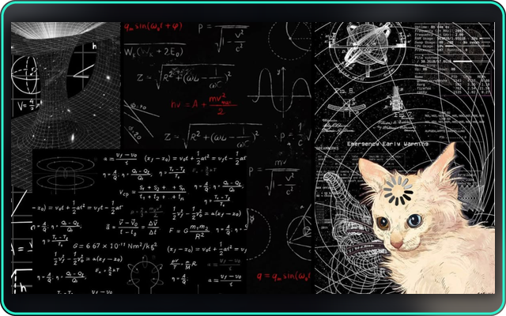
  <br><sub><i>Kondisi kepala sebelum ketemu <b>MuZA Skripsi Drag-and-Drop v1.1</b> — sekarang margin 4-4-3-3, logo kampus &amp; Bab 2 selesai dalam hitungan detik!</i></sub>
</td>
<td valign="top">
  <h3>🚀 Merakit Template Skripsi <code>.docx</code> Kampus Resmi Tanpa Ketik Perintah Rumit</h3>
  <ol>
    <li><b>Langkah 1 — Riset Jurnal &amp; Gap Otomatis di Google Colab:</b><br>
      Buka [](https://colab.research.google.com/drive/15ckekQcGu4ssHQMQgXyK1gMMgobVZMFv) (file repo: <a href="notebooks/skripsi/MuZA_Search.ipynb"><code>MuZA_Search.ipynb</code></a>), cari paper ilmiah OpenAlex/CrossRef/Semantic Scholar, lalu ekspor bundel <b><code>.zip</code></b> (sudah berisi file <b><code>.ris</code> Zotero</b> &amp; <b>Tabel Bab 2 <code>.csv</code></b>).
    </li>
    <li><b>Langkah 2 — Pilih Jalur Tanpa Coding (2 Opsi Sama Praktisnya):</b>
      <ul>
        <li><b>Opsi A (Cloud 100% Gratis):</b> Klik [](https://colab.research.google.com/drive/1rrl38cwQZ0CA00cMyQvfjJUf1CSEtJpS) (<a href="notebooks/skripsi/MuZA_Skripsi_Builder.ipynb"><code>MuZA_Skripsi_Builder.ipynb</code></a>) &rarr; langsung jadi di browser!</li>
        <li><b>Opsi B (Offline/Lokal Windows Drag-and-Drop):</b> Cukup <b>seret (drag-and-drop)</b> file <code>.zip</code> riset + PDF Pedoman Kampus Anda ke atas ikon <a href="MULAI_SKRIPSI_DRAG_AND_DROP.bat"><code>MULAI_SKRIPSI_DRAG_AND_DROP.bat</code></a> (atau jalankan <code>msshi skripsi</code>)!</li>
      </ul>
    </li>
    <li><b>Langkah 3 — Lookup Otomatis Logo PNG &amp; Pejabat Kampus + 5 Preset:</b><br>
      Mesin <a href="skills/muza-skripsi-template/SKILL.md"><code>muza-skripsi-template</code></a> (11 file) mengekstrak aturan kertas/margin PDF (<code>extract_guideline.py</code>), mengunduh logo resmi + nama &amp; NIP Rektor/Dekan/Kaprodi (<code>campus_lookup.py</code>), menerapkan 5 preset (<i>Informatika, Kuantitatif, Kualitatif, R&amp;D, PTK</i>), dan menyimpannya adaptif ke <code>D:\HermesData\Skripsi_Output</code> atau <code>%USERPROFILE%\Documents\MuZA_Skripsi_Output</code>!
    </li>
  </ol>
</td>
</tr>
</table>

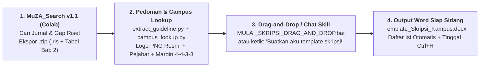

> 🤖 **Bisa Dipanggil Kontekstual Langsung Lewat Chat AI!**
> Setelah MSSHI terpasang di **Google Antigravity, Hermes Agent, Claude Code, atau OpenClaw**, Anda tidak perlu menghafal path skrip apa pun. Cukup kirim pesan alami seperti:
> **`"Buatkan aku template skripsi!"`** *(atau panggil `/muza-skripsi-template`)* — skill ke-63 akan otomatis terpanggil dan memandu **Proses 5 Tahap Terverifikasi**:
> 1. Mengumpulkan Universitas, Fakultas, Prodi, Jenis Metodologi, &amp; file Pedoman / `.zip` `MuZA_Search`.
> 2. Mengekstrak aturan fisik PDF (`extract_guideline.py`) &amp; melakukan lookup logo PNG + pejabat (`campus_lookup.py`).
> 3. Menampilkan konfirmasi ringkasan berlabel transparan (`[Dari Pedoman]` vs `[*Default]` — nol data pejabat karangan!).
> 4. Menjalankan `build_template.py` untuk membangun `.docx` ber-OOXML rapi &amp; menyuntik sitasi `MuZA_Search`.
> 5. Menyampaikan lokasi output `.docx` adaptif + panduan cepat **`Ctrl+H`** untuk mengisi `{name}`, `{nim}`, Pembimbing I/II, &amp; `{title}` (sedangkan logo 300 DPI + Rektor/Dekan/Kaprodi diisi otomatis oleh `campus_lookup.py`).

---

## 💰 Hidup Hemat dengan $1 Zero-Waste Token Shield &amp; Kompatibilitas Laptop Drive `C:`

<table>
<tr>
<td valign="top">
  <h3>🔥 Kenapa MSSHI Aman di Saldo Cekak &amp; Laptop Pas-Pasan?</h3>
  <ul>
    <li><b>Proteksi Saldo <code>TokenShield</code> ($1.00 Hard Floor):</b> Mengecek proyeksi biaya sebelum pekerjaan besar jalan; bila proyeksi sisa &lt; <b>$1.00</b>, sistem berhenti dengan exit code peringatan sehingga kuota API tidak pernah kebablasan.</li>
    <li><b>Hook Lossless <code>msshi-auto-trim</code> + <code>caveman</code>:</b> Memadatkan payload tool JSON besar lewat hook lokal hanya bila struktur data valid tetap 100% sama.</li>
    <li><b>Provider Asli User Tidak Disentuh:</b> Konfigurasi DataByte, YupiAI, Gemini, Claude, DeepSeek, Kimi, Qwen, atau GPT milik Anda tetap utuh (<code>jev_model_routing: false</code> terkunci).</li>
    <li><b>Support Penuh Laptop Drive <code>C:</code> Saja &amp; Drive <code>D:</code>:</b> Deteksi otomatis di installer PS1, SH, BAT, dan skrip Python (<code>D:\HermesData</code> vs fallback <code>%USERPROFILE%\HermesData</code>).</li>
  </ul>
</td>
<td width="40%" align="center" valign="middle">
  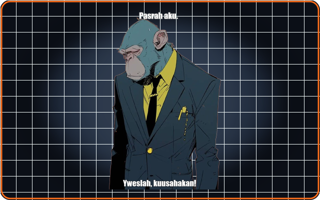
  <br><sub><i>Saat saldo API tinggal <b>$1</b> dan laptop cuma punya Drive <code>C:</code> RAM 4 GB — "Pasrah aku... tapi MSSHI v3.1.0 siap mengusahakan!"</i></sub>
</td>
</tr>
</table>

---

## 🖼️ Galeri Showcase &amp; Museum Meme MSSHI (Arsip Visual Terstandardisasi)

<details>
<summary><b>👉 Klik untuk membuka Galeri Arsitektur Showcase &amp; Ekstra Meme Reaksi (Koleksi Arsip Visual Lokal Terkurasi)</b></summary>
<br>

<div align="center">
  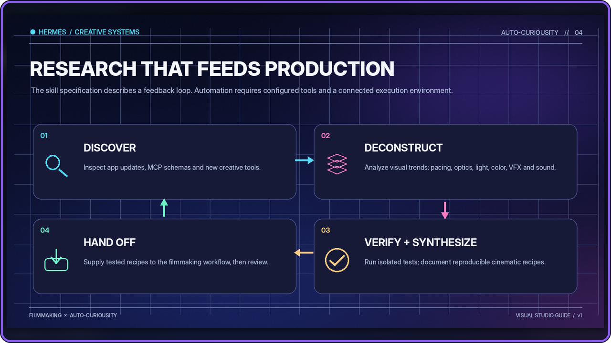
  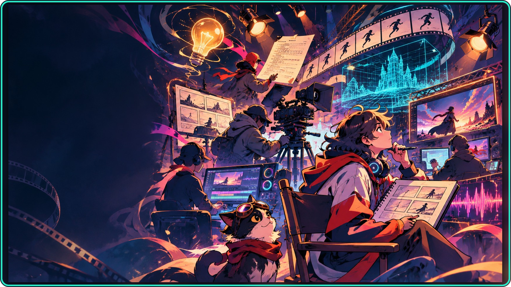
  <br><sub><b>Kiri:</b> Siklus Riset &amp; Produksi <i>Auto-Curiosity</i> (Discover &rarr; Deconstruct &rarr; Verify &rarr; Hand Off) · <b>Kanan:</b> Konvergensi Studio Kreatif &amp; Orkestrasi Multi-Agen.</sub>
</div>

<br>

<div align="center">
<table>
<tr>
<td align="center" width="25%">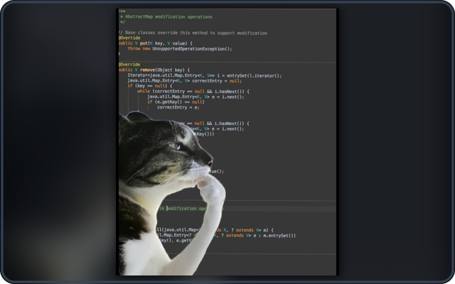<br><sub>Mode inspeksi kode ala Shikaku Nara</sub></td>
<td align="center" width="25%">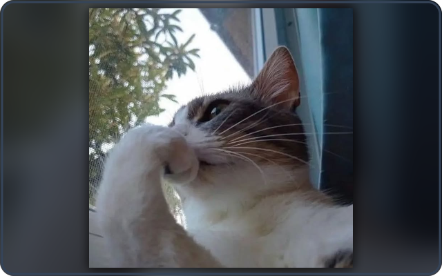<br><sub>Kontemplasi membaca PDF spec 130 hal.</sub></td>
<td align="center" width="25%">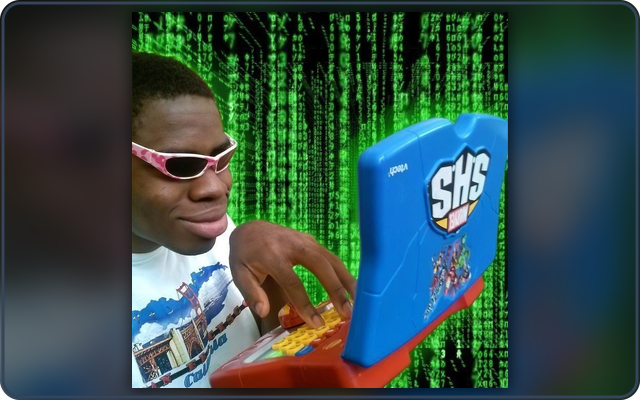<br><sub>Vibecoding tetap jalan di laptop kentang</sub></td>
<td align="center" width="25%">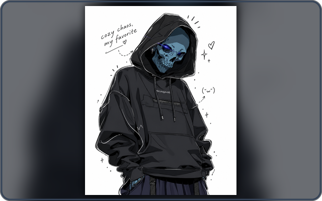<br><sub><i>"Cozy chaos, my favorite."</i></sub></td>
</tr>
</table>
</div>

</details>

---

## 🚀 Quick Start 30 Detik (Pilih Gaya Pemasangan Anda)

### Cara Paling Santai (Cukup Copy-Paste ke Chat Agen AI Anda)
Buka **Hermes Agent, OpenClaw, Claude Code, atau Google Antigravity** yang punya akses terminal &amp; web, lalu kirim pesan ini:

> `Tolong baca https://raw.githubusercontent.com/zidanaisar624/MSSHI-Mega-Semar-Sang-Hyang-Ismaya/main/docs/guides/INSTALL_FOR_AGENTS.md lalu instal dan konfigurasikan MSSHI v3.1.0 untukku tanpa mengubah provider/model asliku!`

### Atau Pasang Langsung via Terminal &amp; Peluncur 1-Klik

- **Windows Pemula (Klik 2x):** Jalankan [`MULAI_DI_SINI_PEMULA.bat`](MULAI_DI_SINI_PEMULA.bat) (menu interaktif lengkap termasuk unduhan PDF panduan!).
- **Migrasi Pengguna Lama `v2.x` ke `v3.1.0`:** Jalankan [`UPDATE_OTOMATIS_KE_V3.bat`](UPDATE_OTOMATIS_KE_V3.bat) sekali (cadangan `SOUL.md` &amp; `Creative DNA` dibuat otomatis).
- **Windows PowerShell** *(tambah `-DownloadPdf` jika ingin langsung mengunduh PDF v3.1.0)*:
  ```powershell
  irm https://raw.githubusercontent.com/zidanaisar624/MSSHI-Mega-Semar-Sang-Hyang-Ismaya/main/install.ps1 | iex
  ```
- **macOS / Linux Bash** *(dukung `--download-pdf` / `--no-pdf`)*:
  ```bash
  curl -fsSL https://raw.githubusercontent.com/zidanaisar624/MSSHI-Mega-Semar-Sang-Hyang-Ismaya/main/install.sh | bash
  ```

| Platform / Agen Tujuan | Cara Pasang Tercepat |
| :--- | :--- |
| **Hermes Agent** | `npx skills add https://github.com/zidanaisar624/MSSHI-Mega-Semar-Sang-Hyang-Ismaya/tree/main/skills --global --agent hermes-agent` atau `hermes skills tap add zidanaisar624/MSSHI-Mega-Semar-Sang-Hyang-Ismaya` |
| **OpenClaw** | `openclaw skills install git:zidanaisar624/MSSHI-Mega-Semar-Sang-Hyang-Ismaya --global` atau `npx skills add .../skills --global --agent openclaw` |
| **Claude Code** | `/plugin marketplace add zidanaisar624/MSSHI-Mega-Semar-Sang-Hyang-Ismaya` lalu `/plugin install msshi@msshi-marketplace` |
| **Claude.ai Web / Desktop** | Buka **Customize &rarr; Skills &rarr; + &rarr; Upload a skill**, unggah [`portable/msshi.zip`](portable/msshi.zip) |
| **ChatGPT Projects / Custom GPT** | Unggah [`portable/MSSHI_ChatGPT_Knowledge_Bundle.md`](portable/MSSHI_ChatGPT_Knowledge_Bundle.md) dan salin [`portable/CHATGPT_CUSTOM_INSTRUCTIONS.md`](portable/CHATGPT_CUSTOM_INSTRUCTIONS.md) |
| **Codex CLI** | `npx skills add https://github.com/zidanaisar624/MSSHI-Mega-Semar-Sang-Hyang-Ismaya/tree/main/skills --global --agent codex` |
| **Google Antigravity IDE** | `msshi setup --platform antigravity` setelah pasang CLI ([Panduan Lengkap](docs/guides/INSTALL_FOR_AGENTS.md#google-antigravity-ide)) |

> 🔍 **Bingung memilih mode, pack, REA, atau KAT-Coder?** Jalankan `msshi choices` sebelum menekan `y`! Cek kesehatan instalasi &amp; Drive C:/D: lewat **`python scripts/msshi_cli.py doctor`**. Baca juga [Panduan Penjelasan Opsi](docs/OPTION_GUIDE.md), [Panduan Kustomisasi Publik](docs/guides/PANDUAN_KUSTOMISASI_USER_PUBLIK.md), [Panduan Platform](docs/platforms.md), dan [Referensi CLI Lengkap](docs/CLI.md).

---

## ⚙️ Integrasi Kontekstual v3.1.0, 4 Mode Setup &amp; 8 Diagram Arsitektur

| Integrasi / Fitur `v3.1.0` | Pemegang Peran | Apa yang Dikerjakan &amp; Batasannya |
| :--- | :--- | :--- |
| [**`muza-skripsi-template` (`v1.1`)**](skills/muza-skripsi-template/SKILL.md) | Val, Shizuka, Yukino, Solo, Antigravity | Merakit `Template_Skripsi_<Kampus>.docx` dari PDF pedoman, logo &amp; pejabat kampus, dan riset `MuZA_Search` lewat 5 tahap tervalidasi atau *drag-and-drop*. |
| [**`CLI-Anything` Universal Bridge**](docs/CLI_ANYTHING_BRIDGE.md) | Seluruh 5 Bot | Pengganti 22 MCP lokal berat: mendaftarkan rute aplikasi secara lazy, hanya menyala saat dipanggil lewat `msshi runtime ticket` &rarr; `msshi runtime run`. |
| [**`Unslop`**](docs/UNSLOP.md) | Kiki-Chii, Val, Shikaku | Merapikan desain UI bertahap (*AI slop polish*); Val mengaudit kejelasan unit &amp; metrik ilmiah. Terpisah dari humanizer prosa Indonesia/Inggris. |
| [**`BRAG`**](docs/BRAG.md) | Kiki-Chii | Alur video peluncuran produk memakai HTML/MP4 (**Hyperframes**) lewat gerbang konsep &amp; review manusia sebelum render penuh. |
| [**`Scrapling`**](docs/SCRAPLING.md) | Val, Shikaku | Ekstraksi CSS/XPath super cepat dari **HTML lokal** tanpa crawler liar, tanpa browser stealth, dan tanpa sentuh profil Chrome personal. |
| [**`Harness²`**](docs/HARNESS2.md) | Val, Shikaku | Demo evaluasi harness deterministik dan usulan perbaikan (*tidak* promosi otomatis ke bot produksi atau bakar benchmark berbayar). |
| [**`REA` (`opt-in`)**](docs/REA.md) | Shikaku *(opsional)* | Reverse engineering arsitektur JS/arsip lokal lewat `optional/rea/`. **Default OFF** demi keamanan — nyalakan hanya dengan `--with-rea` atau `msshi optional enable rea`. |
| [**`OmniVoice`, `Auto-Trim`, `TimesFM` &amp; `Steel`**](docs/TIMESFM.md) | 5 Bot &amp; Val | `msshi voice` mengikuti prosodi 5 bot; [Auto-Trim](hermes_plugins/msshi-auto-trim/README.md) memadatkan JSON lossless; [TimesFM](docs/TIMESFM.md) meramal deret waktu lokal via CPU; [Kebijakan Steel Browser](docs/STEEL_BROWSER_POLICY.md) &amp; [OAuth Services](docs/SERVICE_CONNECTIONS.md) menjaga sesi privat (`msshi services --share-oauth`). |

<details>
<summary><b>📊 Buka 8 Diagram Arsitektur Teknis &amp; Alur Kerja MSSHI (SVG Interaktif)</b></summary>
<br>

- **Peta Utama Paket 63 Skill &amp; 5 Bot:**
  
- **Topologi Delegasi 5 Persona Bot:**
  
- **Peta Integrasi Kontekstual v3.1:**
  
- **Empat Mode Setup (`msshi setup`: Solo, Custom, Selective Packs, MuZA 5-Bot Preset):**
  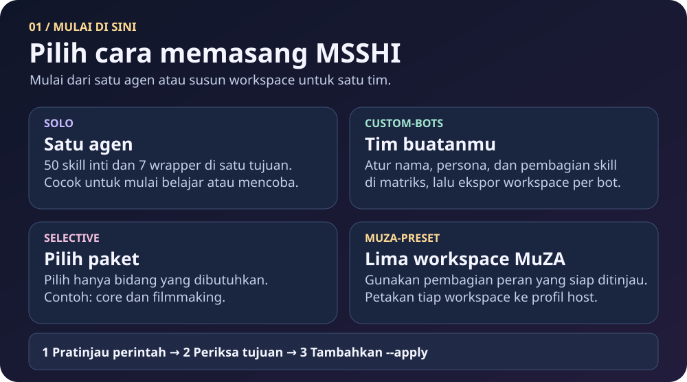
- **Produksi Kreatif &amp; Film 10–40 Menit (`Concepting First` &amp; [Creative DNA](docs/ALUR_PRESET_MUZA.md#concepting-first-dan-creative-dna)):**
  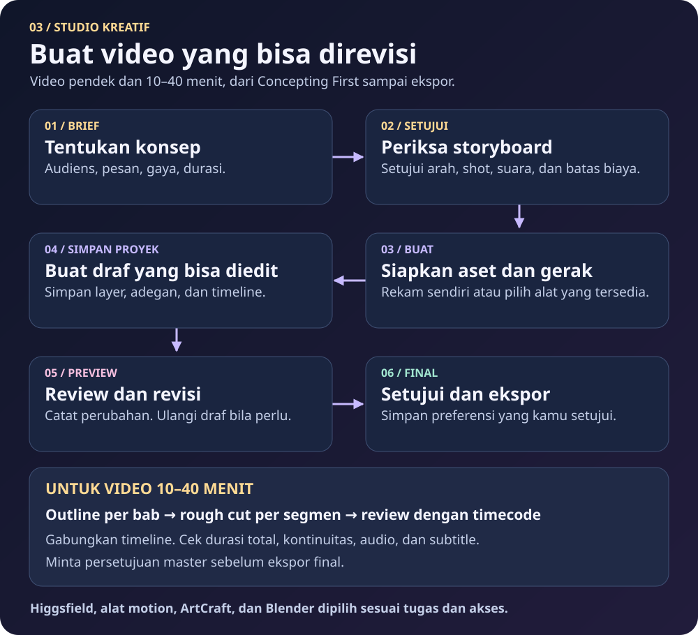
- **Delapan Mesin Akademik S1–S3 ([Detail Mesin Akademik](docs/TUJUH_MESIN_AKADEMIK.md)):**
  
- **Lima Lapis Konteks Proyek Panjang ([Panduan 5 Lapis Konteks](docs/LIMA_LAPIS_KONTEKS.md)):**
  
- **Pemisahan Bundel, Runtime Perangkat &amp; Layanan Akun Eksternal ([Katalog 49 Sumber](docs/INTEGRASI.md), [Managed Updates](docs/MANAGED_UPDATES.md), [Status Publikasi](docs/STATUS_PUBLIKASI.md)):**
  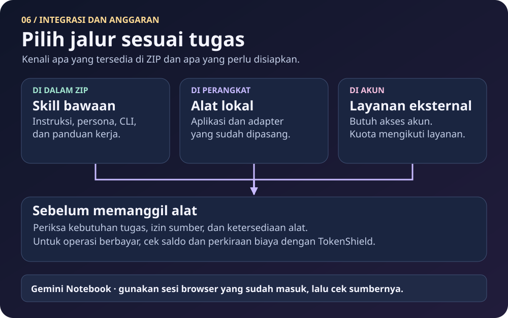

</details>

---

## 📁 Struktur Repositori Bersih (`Clean Root Architecture`)

| Folder / File | Isi &amp; Fungsi |
| :--- | :--- |
| **Root (`/`)** | Berkas inti &amp; peluncur 1-klik: [`README.md`](README.md), [`README_EN.md`](README_EN.md), [`VERSION.json`](VERSION.json), [`CHANGELOG.md`](CHANGELOG.md), [`LICENSE`](LICENSE), [`CREDITS.md`](CREDITS.md), [`THIRD_PARTY_NOTICES.md`](THIRD_PARTY_NOTICES.md), [`SKILL.md`](SKILL.md), `package.json`, `install.ps1`, `install.sh`, [`MULAI_DI_SINI_PEMULA.bat`](MULAI_DI_SINI_PEMULA.bat), [`MULAI_SKRIPSI_DRAG_AND_DROP.bat`](MULAI_SKRIPSI_DRAG_AND_DROP.bat), [`UPDATE_OTOMATIS_KE_V3.bat`](UPDATE_OTOMATIS_KE_V3.bat). |
| **`notebooks/skripsi/`** | Notebook Google Colab resmi: [`MuZA_Search.ipynb`](notebooks/skripsi/MuZA_Search.ipynb) &amp; [`MuZA_Skripsi_Builder.ipynb`](notebooks/skripsi/MuZA_Skripsi_Builder.ipynb). |
| **`docs/pdf-guides/` &amp; `docs/manuals/`** | Buku Panduan Master PDF v3.1.0, Laporan Eksekusi Hydrogen PDF, Spesifikasi Settings v3.0, rilis `latest/`, dan [`pdf_catalog.json`](docs/manuals/pdf_catalog.json). |
| **`docs/guides/`** | Panduan agen &amp; publik: [`INSTALL_FOR_AGENTS.md`](docs/guides/INSTALL_FOR_AGENTS.md), [`PANDUAN_KUSTOMISASI_USER_PUBLIK.md`](docs/guides/PANDUAN_KUSTOMISASI_USER_PUBLIK.md), dan panduan auto-update. |
| **`assets/`** | `avatars/` (Hero banner dual-tone, fullbody Noir &amp; 5 avatar karakter seragam), `memes/` (komik evolusi 2x2 &amp; meme reaksi), `showcases/`, `diagrams/` (8 SVG arsitektur), serta [`configs/visual_assets_manifest.json`](configs/visual_assets_manifest.json) &amp; [`assets/README.md`](assets/README.md). |
| **`scripts/`** | Mesin CLI `msshi_cli.py`, `msshi_doctor.py`, `msshi_skripsi_drop.py`, `prepare_github_visuals.py`, `secret_scan.py`, `generate_hydrogen_report_pdf.py`, &amp; `check_release*.py`. |
| **`configs/`** | Matriks skill (`bot_role_and_skill_matrix.json`, `upstreams.json`, `skill_activation_matrix.json`), persona 5 bot (`configs/personas/`), &amp; [`configs/github_about.txt`](configs/github_about.txt). |
| **`skills/` &amp; `optional/rea/`** | **63 folder skill aktif terbundel (`51 inti + 12 wrapper`)** termasuk 11-file `skills/muza-skripsi-template/`, plus 1 wrapper opt-in `rea`. |

---

## 💻 Recovery Hermes Desktop Grey Screen di Windows

Jika Gateway sudah aktif tetapi layar **Hermes Desktop** masih abu-abu (*Grey Screen*), tutup Hermes Desktop sepenuhnya lalu jalankan:

```powershell
msshi desktop --software-rendering
```

Perintah ini menyalakan `HERMES_DESKTOP_DISABLE_GPU=1` khusus untuk proses Hermes Desktop tanpa memengaruhi aplikasi Windows lain, serta menyimpan preferensi aman di `<HERMES_HOME>/tools/msshi/desktop-preferences.json`.

---

## 🤝 Kredit Kolaborasi &amp; Lisensi

- **Muhammad Zidan Aisar (MuZA)** — Creator, System Visionary &amp; Chief Architect.
- **Google Gemini** — Co-Architect riset kurikulum S1–S2–Ph.D., sintesis 50+ skill &amp; sumber awal, rancangan CLI-Anything, TokenShield &amp; topologi komando 5 bot.
- **OpenAI ChatGPT** — Co-Architect visual SVG, pengemasan repositori Tahap 1–2, manifest upstream, skema lintas platform &amp; implementasi migrasi v3.
- **Google Antigravity** — Lingkungan pengembangan, orkestrasi agen &amp; penyempurnaan arsitektur MSSHI v3.1.0 + MuZA Skripsi Drag-and-Drop v1.1 + kurasi Cyber-Noir Editorial.

Materi orisinal MSSHI dirilis di bawah [**Lisensi MIT**](LICENSE). Komponen pihak ketiga, model, nama karakter rujukan, dan aset eksternal mengikuti ketentuan lisensi masing-masing di [THIRD_PARTY_NOTICES.md](THIRD_PARTY_NOTICES.md) dan [docs/PROVENANCE.md](docs/PROVENANCE.md).

<br>

> **Verifikasi &amp; Audit Paket:** [`adapters/msshi-visual-review/README.md`](adapters/msshi-visual-review/README.md) · `python scripts/secret_scan.py` · `python scripts/msshi_cli.py doctor` · `python scripts/check_release.py --smoke` · `python scripts/check_release_v31.py --package-only`
