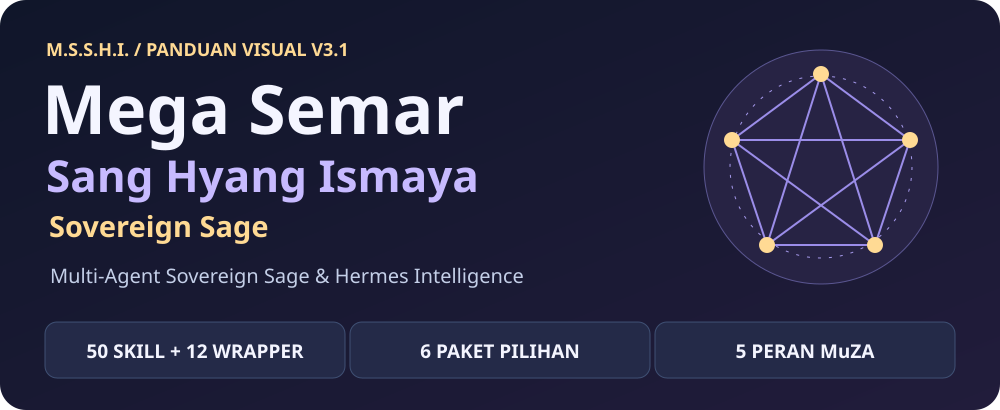
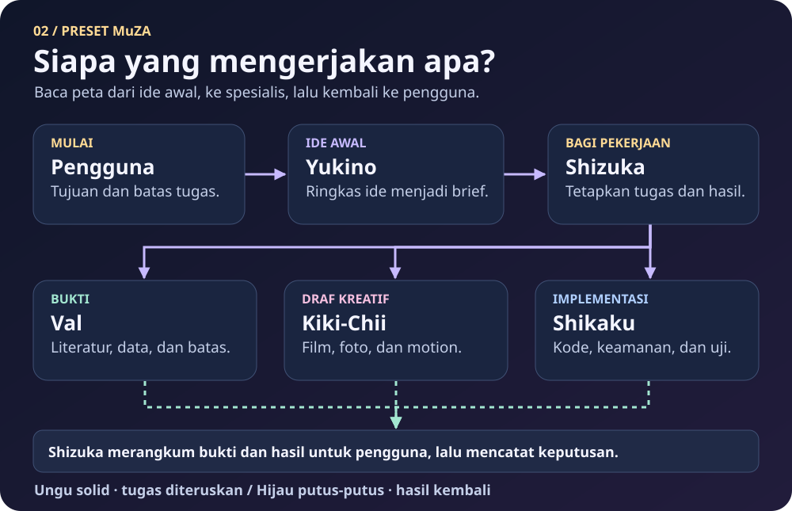
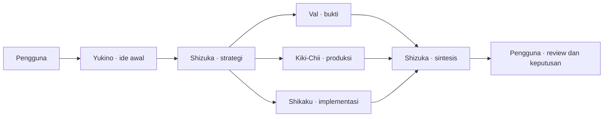
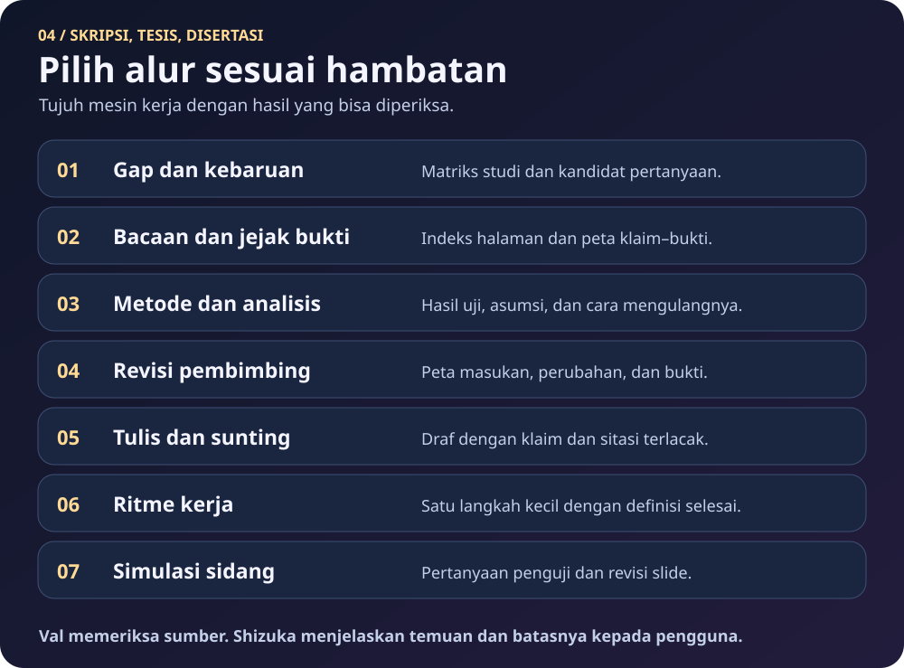
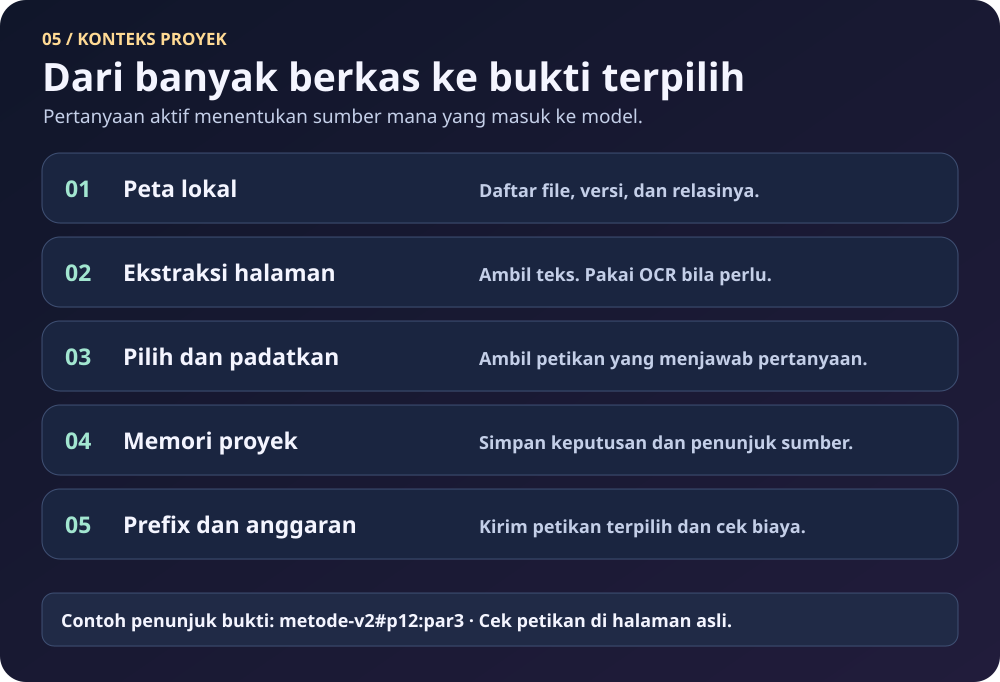

[🇮🇩 Bahasa Indonesia](./README.md) | [🌐 English](./README_EN.md)

# MSSHI — Mega Semar Sang Hyang Ismaya: Sovereign Sage

[](docs/PROVENANCE.md#kredit-kolaborasi)

**MSSHI v2.1 adalah Multi-Agent Skill Suite & Persona Framework lintas platform.** Isinya 50 skill inti berbentuk direktori `SKILL.md`, tujuh wrapper integrasi, preset satu atau lima peran, dan CLI opsional untuk mengelola pemasangan. Claude Code bisa membacanya sebagai plugin. ChatGPT web memakai panduan dan instruksi portabel. Aplikasi eksternal, akun, model, dan kredit disiapkan sesuai alat yang dipilih.

## 🚀 Quick Start 30 Detik (Pilih Agen Anda)

**Paling mudah lewat chat agen.** Salin kalimat ini ke Hermes Agent, OpenClaw, Claude Code, atau Antigravity yang dapat mengakses web, terminal, dan folder skill lokal.

> Tolong baca https://raw.githubusercontent.com/zidanaisar624/MSSHI-Mega-Semar-Sang-Hyang-Ismaya/main/INSTALL_FOR_AGENTS.md lalu instal dan konfigurasikan MSSHI untukku!

| Agen | Cara mulai |
| --- | --- |
| Hermes Agent | `npx skills add https://github.com/zidanaisar624/MSSHI-Mega-Semar-Sang-Hyang-Ismaya/tree/main/skills --global --agent hermes-agent`. Atau daftarkan katalog dengan `hermes skills tap add zidanaisar624/MSSHI-Mega-Semar-Sang-Hyang-Ismaya`, lalu pilih skill yang akan dipasang. |
| OpenClaw | `openclaw skills install git:zidanaisar624/MSSHI-Mega-Semar-Sang-Hyang-Ismaya --global` memasang pintu masuk. Untuk semua skill, pakai `npx skills add https://github.com/zidanaisar624/MSSHI-Mega-Semar-Sang-Hyang-Ismaya/tree/main/skills --global --agent openclaw`. |
| Claude Code | `/plugin marketplace add zidanaisar624/MSSHI-Mega-Semar-Sang-Hyang-Ismaya`, lalu `/plugin install msshi@msshi-marketplace`. Alternatif `npx skills add https://github.com/zidanaisar624/MSSHI-Mega-Semar-Sang-Hyang-Ismaya/tree/main/skills --global --agent claude-code`. |
| Claude.ai Web/Desktop | Buka **Customize → Skills → + → Upload a skill** dan unggah [MSSHI Skill ZIP](portable/msshi.zip). |
| ChatGPT Projects / Custom GPT | Unggah [Knowledge Bundle](portable/MSSHI_ChatGPT_Knowledge_Bundle.md), lalu salin [Instructions](portable/CHATGPT_CUSTOM_INSTRUCTIONS.md) ke Project atau Custom GPT. |
| Codex CLI | `npx skills add https://github.com/zidanaisar624/MSSHI-Mega-Semar-Sang-Hyang-Ismaya/tree/main/skills --global --agent codex` |
| Google Antigravity IDE | `msshi setup --platform antigravity` setelah memasang CLI. [Opsi Skills CLI dan lokasi folder IDE](INSTALL_FOR_AGENTS.md#google-antigravity-ide). |

**Windows PowerShell**

```powershell
irm https://raw.githubusercontent.com/zidanaisar624/MSSHI-Mega-Semar-Sang-Hyang-Ismaya/main/install.ps1 | iex
```

**macOS/Linux**

```bash
curl -fsSL https://raw.githubusercontent.com/zidanaisar624/MSSHI-Mega-Semar-Sang-Hyang-Ismaya/main/install.sh | bash
```

Installer PowerShell atau Bash memasang perintah `msshi` untuk akun pengguna dan membuka wizard setup. Siapkan Git dan Python 3.10+. Buka terminal baru bila perintah belum muncul. Jalur `npx` memerlukan Node.js 22.20+ dan npm. URL `main` mulai menyediakan v2.1 setelah perubahan ini dipublikasikan.

`msshi check` atau `msshi status` membandingkan versi, menampilkan changelog, dan merangkum rute aplikasi. `msshi update` memperbarui pemasangan terkelola dan cache 37 sumber. `msshi select` memilih paket atau skill. `msshi connect` membuka menu aplikasi. `msshi setup` membuka empat mode pemasangan.

[Panduan chat agen](INSTALL_FOR_AGENTS.md) · [Jalur per platform dan ZIP OpenClaw](docs/platforms.md) · [CLI dan pemulihan](docs/CLI.md) · [Koneksi aplikasi CLI-Anything](docs/CLI_ANYTHING_BRIDGE.md)



MSSHI membantu agen menyusun ide, menelusuri bukti, mengerjakan bagian teknis atau kreatif, dan menyerahkan hasil yang bisa kamu periksa. Kamu bisa memakai satu agen untuk seluruh alur atau membagi tugas di antara beberapa bot. Skill bawaan berbentuk instruksi kerja. Alat seperti Blender, ArtCraft, Higgsfield, dan Gemini Notebook tersedia sesuai pemasangan dan akses masing-masing.

**Langsung ke** [setup](#1-pilih-mode-setup) · [peta lima bot](#2-lihat-cara-lima-bot-bekerja) · [video dan produksi](#3-produksi-bersama-kiki-chii) · [riset](#4-skripsi-tesis-dan-disertasi) · [konteks](#5-kelola-konteks-proyek-panjang) · [integrasi dan biaya](#6-integrasi-dan-biaya) · [audit skill](#7-audit-skill-dan-kustomisasi)

## 1. Pilih mode setup


Ekstrak paket, lalu buka terminal di folder yang berisi `README.md`. Gunakan **Python 3.10 atau lebih baru**. Python 3.12 disarankan. Jika perintah `python` tidak tersedia, pakai `python3` pada macOS/Linux atau `py -3` pada Windows bila launcher tersebut sudah terpasang. Jalankan pemeriksaan rilis dan pratinjau **solo** untuk Hermes:

```sh
python --version
python scripts/check_release.py
python scripts/install_msshi.py --mode solo --platform hermes
```

| Kebutuhanmu | Mode | Hasil |
| --- | --- | --- |
| Satu agen untuk semua bidang | `solo` | Semua 50 skill inti dan tujuh wrapper masuk ke satu folder tujuan. |
| Tim dengan nama dan peran sendiri | `custom-bots` | Workspace per bot berdasarkan matriks kustom. |
| Hanya bidang tertentu | `selective --packs core,filmmaking` | Hanya skill bawaan dari paket yang dipilih. Pilihan lain tersedia untuk bisnis, akademik, web, dan keamanan. |
| Ikuti pembagian peran MuZA | `muza-preset` | Lima workspace berisi persona, aturan kerja, dan skill masing-masing. |

Periksa daftar file dan tujuan sebelum mengulang perintah installer dengan `--apply`. Jika ingin mencoba di folder lokal terlebih dahulu, gunakan `--platform manual --target-dir ./msshi-demo-skills`. Installer menyalin skill baru dan mempertahankan file yang sudah ada. Pada mode tim, pasangkan setiap workspace dengan profil host agar persona dan skill bisa dipakai. Untuk Claude Code, OpenClaw, Antigravity, dan ChatGPT, ikuti jalur host masing-masing. [Panduan setup publik](PANDUAN_KUSTOMISASI_USER_PUBLIK.md) · [Panduan platform](docs/platforms.md).

## 2. Lihat cara lima bot bekerja



Contoh permintaan **“Aku ingin membuat video edukasi tentang satu metode riset”**. Yukino membantu mengubah ide menjadi brief. Shizuka meminta Val memeriksa literatur dan Kiki-Chii menyiapkan storyboard. Shikaku membantu jika diperlukan kode, otomasi, atau pengujian. Shizuka membawa naskah, bukti, dan keputusan yang masih terbuka kembali kepadamu.

| Bot | Tugas | Keluaran yang dapat diperiksa |
| --- | --- | --- |
| **Yukino Yukinoshita** | Menggali ide, tujuan, dan batas awal | Brief singkat dan pilihan langkah berikut |
| **Sensei Shizuka Hiratsuka** | Membagi kerja dan menyintesis hasil | Penjelasan, keputusan yang menunggu persetujuan, dan tindak lanjut |
| **Val** | Mencari bukti, menganalisis data, dan memeriksa metode | Catatan sumber, hasil, dan batas kepastian |
| **Kiki-Chii** | Merancang dan memproduksi film, video pendek maupun 10–40 menit, foto, dan motion | Storyboard, aset, draf yang bisa diedit, dan preview |
| **Shikaku Nara** | Menangani kode, evaluasi, dan keamanan | Perubahan, hasil uji, dan risiko yang masih terbuka |

Di mode **solo**, satu agen berganti peran secara berurutan. Di mode **tim**, delegasi langsung mengikuti dukungan host. Kamu juga bisa menyerahkan brief dan hasil secara manual dengan format yang sama. [Contoh serah terima](docs/ALUR_PRESET_MUZA.md).

<details>
<summary>Alur serah terima dalam Mermaid</summary>



</details>

## 3. Produksi bersama Kiki-Chii


Kiki-Chii memulai dengan **Concepting First**. Tentukan audiens, pesan, durasi, rasa visual, dan keluaran. Setujui arah sebelum memilih Higgsfield, alat motion, ArtCraft, Blender, atau alat lain yang sudah tersedia.

| Langkah | Video pendek | Video 10–40 menit |
| --- | --- | --- |
| Rencanakan | Tentukan satu pesan utama dan satu storyboard ringkas. | Bagi pembuka, bab, transisi, dan penutup. Tetapkan durasi target tiap bab. |
| Buat draf | Rakit satu komposisi yang bisa diedit. | Buat naskah, aset, dan draf per segmen. Pertahankan folder, penamaan, dan timeline master. |
| Review | Beri catatan di preview sebelum ekspor. | Review per bab memakai timecode. Setelah digabung, cek ritme, kontinuitas visual, audio, subtitle, dan durasi total. |
| Finalisasi | Simpan file proyek dan ekspor yang disetujui. | Simpan timeline master yang bisa diedit, daftar revisi, dan ekspor final yang disetujui. |

Contoh target **24 menit**. Alokasikan 1 menit pembuka, tiga bab masing-masing 6–8–7 menit, dan 2 menit penutup. Angka ini contoh perencanaan. Sesuaikan setelah melihat rough cut dan catat preferensi yang kamu setujui di salinan lokal `user_creative_dna.json`. [Alur kreatif dan Creative DNA](docs/ALUR_PRESET_MUZA.md#concepting-first-dan-creative-dna).

## 4. Skripsi, tesis, dan disertasi



Mulai dari hambatan yang sedang kamu hadapi. Jika masalahnya klaim kebaruan, Val membandingkan studi terdekat dan menyusun matriks bukti. Jika masalahnya revisi, petakan komentar ke bagian naskah dan tentukan bukti bahwa perbaikannya sudah dilakukan. Periksa sumber, nomor halaman, dan angka sebelum memakai hasil. [Masukan, langkah, dan keluaran tujuh alur](docs/TUJUH_MESIN_AKADEMIK.md).

## 5. Kelola konteks proyek panjang



Untuk membandingkan dua definisi dari banyak PDF, buat indeks file, ambil halaman yang relevan, pilih dua petikan, lalu simpan keputusan istilah di catatan proyek. Sertakan penunjuk seperti `metode-v2#p12:par3` sehingga pembaca bisa kembali ke sumber asli. Kapasitas dan biaya tetap mengikuti model dan host yang digunakan. [Lima lapis konteks](docs/LIMA_LAPIS_KONTEKS.md).

## 6. Integrasi dan biaya


| Jalur | Contoh | Yang perlu disiapkan |
| --- | --- | --- |
| **Di dalam ZIP** | Skill, persona, CLI, API katalog lokal | Pilih mode dan folder tujuan. |
| **Di perangkat** | Blender, ArtCraft, CLI-Anything, OCR lokal | Pasang aplikasi atau adapter yang relevan dan periksa izin akses file. |
| **Di akun** | Higgsfield, Gemini Notebook | Gunakan akun dan akses yang sesuai. Kuota mengikuti layanan. |

Untuk riset di **Gemini Notebook**, buka sesi Google yang sudah masuk, pilih notebook dan sumber yang relevan, lalu cocokkan petikan dengan dokumen asli. Di Hermes, akses melalui browser bergantung pada pengaturan profil bot. Simpan referensi pribadi di workspace privat. [Bantuan Gemini Notebook](https://support.google.com/gemininotebook/) · [Panduan platform](docs/platforms.md).

Sebelum menjalankan operasi berbayar, TokenShield menghitung proyeksi saldo dari nilai yang kamu masukkan. CLI-Anything Universal Bridge menyiapkan koneksi dengan Auto-Reconnect atau pilihan satu per satu. Aplikasi dibuka melalui `--open` dan harness dijalankan melalui `--run` sesuai tugas. Hermes memakai tool native untuk rute MCP. [Panduan koneksi](docs/CLI_ANYTHING_BRIDGE.md). Gunakan `msshi update` untuk rilis terkelola. Gunakan skrip `msshi_update.py` untuk membandingkan atau menerapkan dua folder rilis lokal yang telah kamu tinjau. [Perintah CLI dan cadangan](docs/CLI.md).

[Katalog 37 sumber](docs/INTEGRASI.md) mengelompokkan sumber berdasarkan tugas, dengan status, prasyarat, dan catatan lisensi. [Manifest sumber](configs/upstreams.json) memuat data lengkap untuk skrip dan audit.

## 7. Audit skill dan kustomisasi

Buat salinan [matriks bot](configs/bot_role_and_skill_matrix.json) untuk mengubah nama, peran, dan pembagian skill. Edit templat persona sebelum ekspor atau `SOUL.md` dalam workspace bot setelah ekspor. Simpan Voice Card di lokasi privat. Pakai [panduan setup publik](PANDUAN_KUSTOMISASI_USER_PUBLIK.md) untuk memilih tujuan pemasangan.

Empat wrapper fondasi (Humanizer EN, Humanizer Indonesia, Unlimited-OCR-2, dan CLI-Anything Universal Bridge) masuk ke semua profil preset. Kiki-Chii mendapat wrapper Higgsfield dan motion graphics. Shikaku mendapat wrapper Antigravity WebDev/Cybersec. Skill penyuntingan, keamanan, konteks, dan anggaran dipanggil sesuai mandat serta alat yang tersedia. Nama lama `auto-curiousity-for-film-making` tetap dipakai di folder skill agar instalasi lama tetap dikenali. `auto-curiosity-for-film-making` adalah alias pada pemilihan MSSHI.

[Audit lengkap per bot](docs/AUDIT_SKILLS_PER_BOT.md) mencantumkan setiap slug, fungsi, status, dan kelompok distribusinya.

## Kredit kolaborasi

- **Muhammad Zidan Aisar (MuZA)** — Creator, System Visionary & Chief Architect.
- **Google Gemini** — Co-Architect untuk riset kurikulum S1–S2–Ph.D., sintesis 50 skill dan 37 sumber, rancangan CLI-Anything dan TokenShield, serta topologi komando lima bot.
- **OpenAI ChatGPT** — Co-Architect untuk visual SVG, pengemasan repositori Tahap 1 dan Tahap 2, manifest upstream, serta skema lintas platform.

Kredit ini mencatat peran dalam pengerjaan MSSHI. [Asal materi dan cakupan atribusi](docs/PROVENANCE.md).

## Lisensi

Materi orisinal MSSHI yang haknya dimiliki para kontributor tersedia dengan [Lisensi MIT](LICENSE). Siapa pun boleh memakai, mengubah, dan mendistribusikannya, termasuk untuk penggunaan komersial, dengan menyertakan pemberitahuan hak cipta dan lisensi pada salinan atau bagian substansial yang dibagikan.

Nama karakter rujukan, merek, aplikasi, model, dan proyek eksternal mengikuti hak atau ketentuan masing-masing. [Asal materi dan cakupan lisensi](docs/PROVENANCE.md).

[Sumber SVG dan panduan perawatan](assets/README.md) · [MSSHI Visual Review untuk Plugin Creator](adapters/msshi-visual-review/README.md) · [Checklist sebelum publikasi](docs/STATUS_PUBLIKASI.md)
