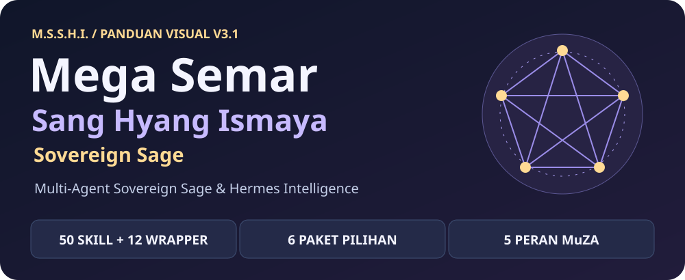
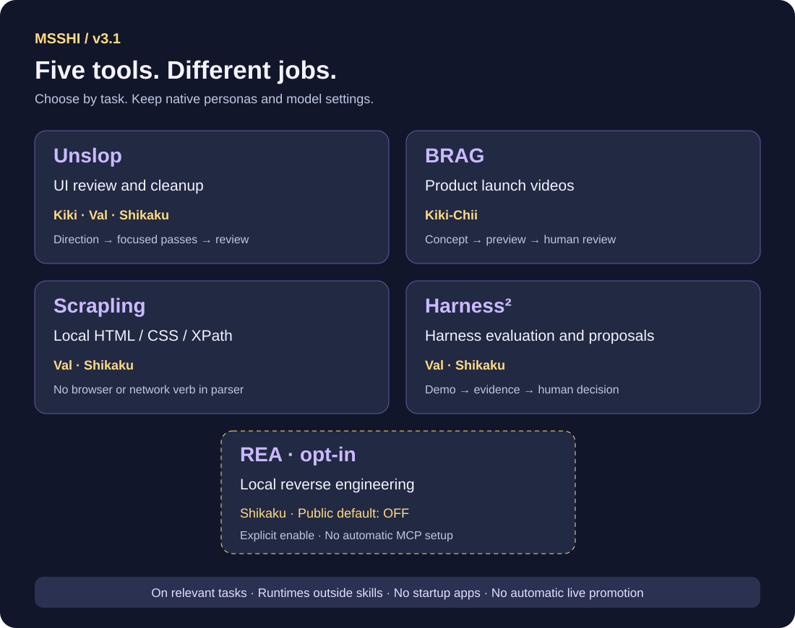
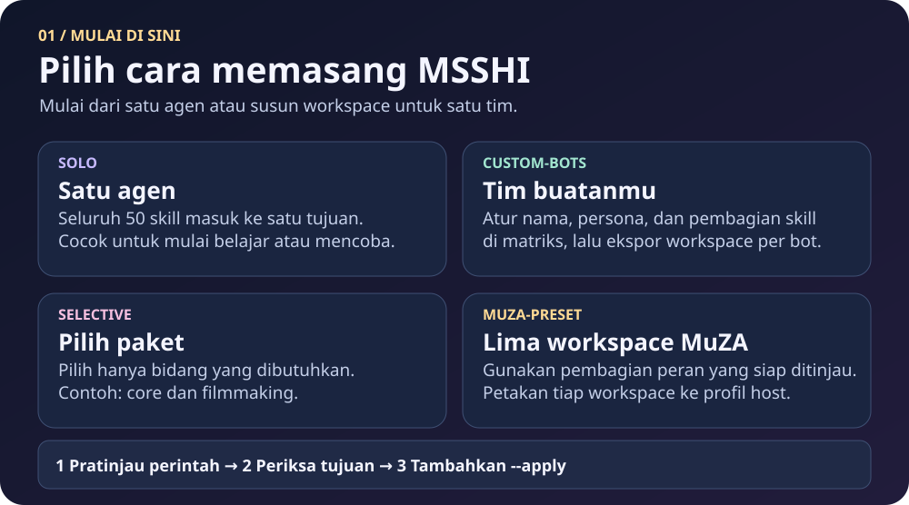
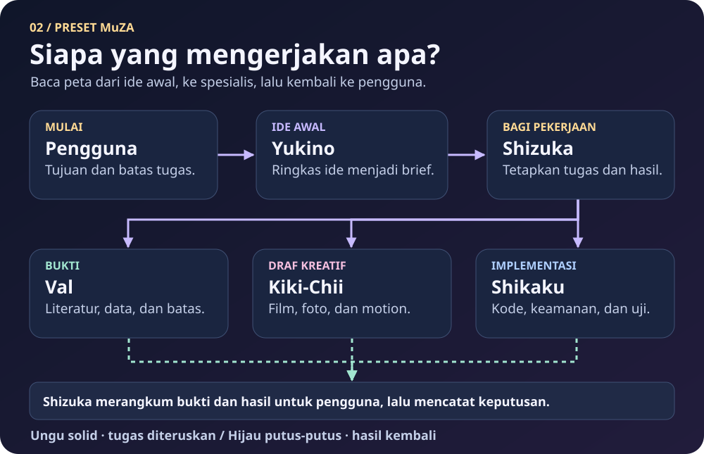
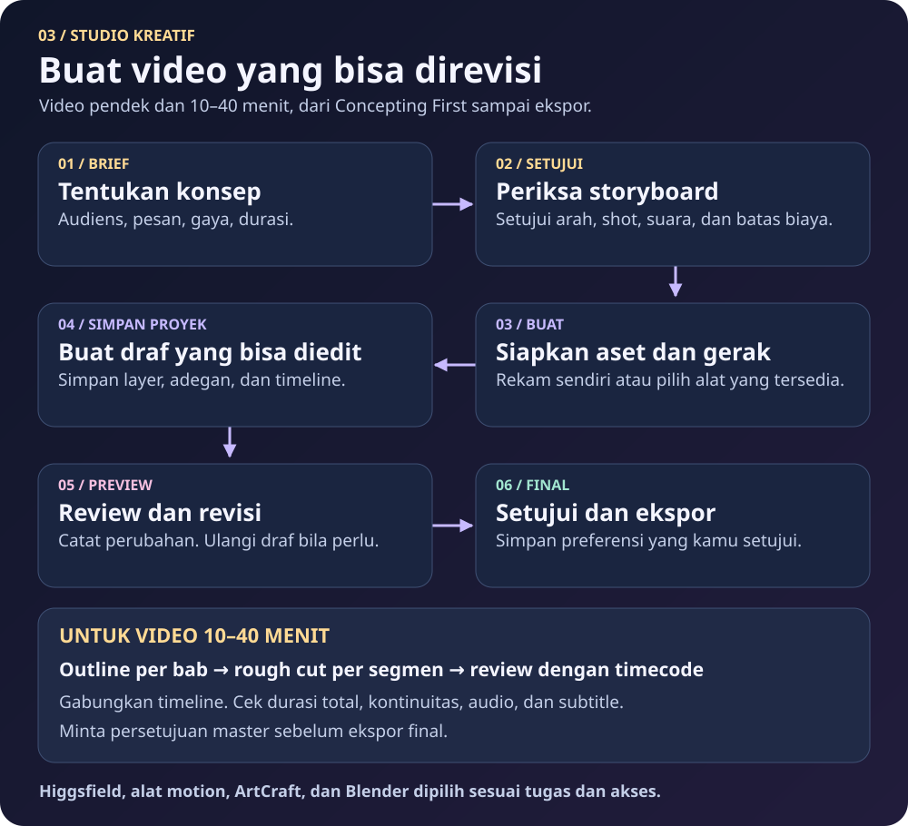
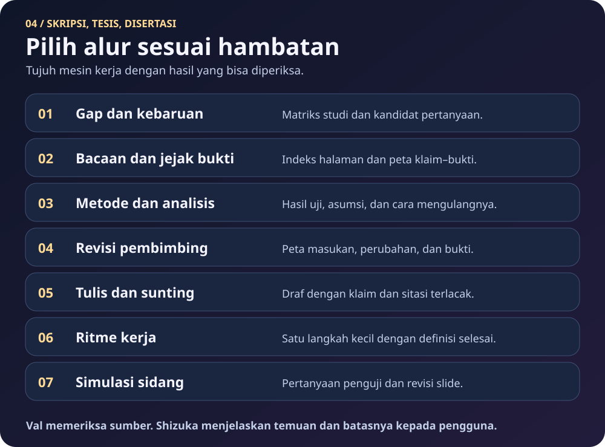
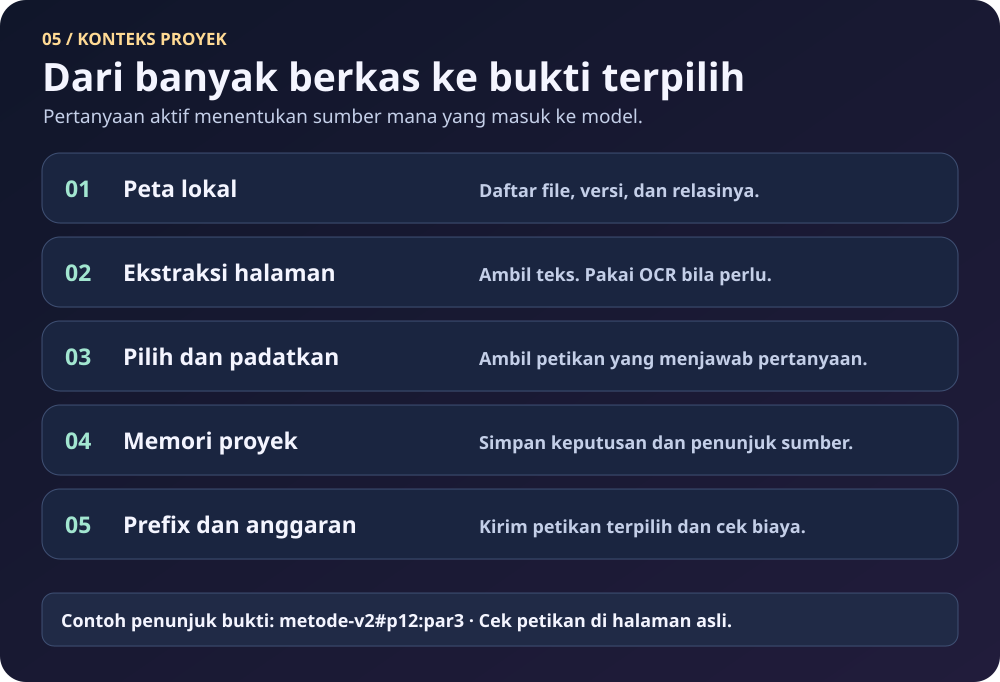
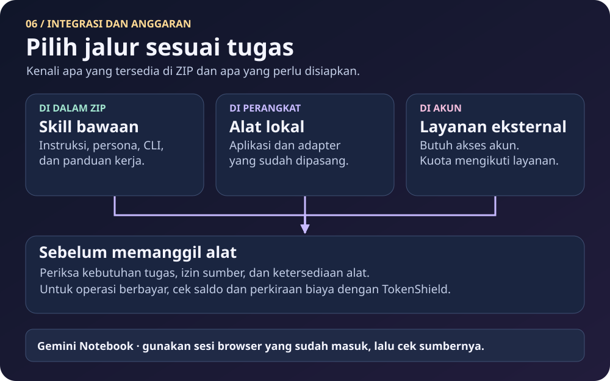

[🇮🇩 Bahasa Indonesia](./README.md) | [🌐 English](./README_EN.md)

# MSSHI — Mega Semar Sang Hyang Ismaya: Sovereign Sage

[](docs/PROVENANCE.md#kredit-kolaborasi)

**MSSHI v3.1 is a cross-platform Multi-Agent Skill Suite & Persona Framework.** It includes 50 core `SKILL.md` folders, twelve integration wrappers, solo and team presets, and an optional installation CLI. Claude Code can load it as a plugin. ChatGPT web uses portable instructions and reference material. External apps, accounts, models, and credits are set up through their respective services.

**v3.0 adds Hermes Ultimate Optimizer.** Profile migration, task tickets, Desktop recovery, and optional integrations run through local commands. The audit reports actual readiness and missing runtime requirements. Start with MULAI_DI_SINI_PEMULA.bat or read the [migration guide](docs/V3_MIGRATION.md).

Existing v2.1 users run UPDATE_OTOMATIS_KE_V3.bat from the v3 package once to install the migration path. Subsequent upgrades use msshi update. The old v2.1 updater downloads new files but does not invoke v3 profile migration.

This migration removes desktop-application MCP registrations and replaces the local Hersona/llmtrim MCP registrations with CLI execution. GitLab and Tinyfish remain web-facing MCP connectors. [Hersona CLI](docs/HERSONA_CLI.md) runs for a relevant persona task and returns catalogue entries or drafts; native Hermes personas and `SOUL.md` remain the source of bot behavior.

[The automatic Llmtrim plugin](hermes_plugins/msshi-auto-trim/README.md) uses the native `transform_tool_result` hook to run `llmtrim compress` on sufficiently large, valid JSON tool results. A candidate is accepted only when its decoded JSON data is exactly equal; failures keep the original result. Conversations, code, files, configuration, personas, and errors are skipped. Inspect counters without chat using `msshi trim --status --profile default`, choosing the actual bot profile ID instead of `default` when needed. Savings depend on eligible output. The file command `msshi trim --input request.json --output request-ringkas.json` is an additional option. These external utilities are separate from the 49-source inventory; their upstream code is not bundled.

**v3 integrations:** [TimesFM for Val](docs/TIMESFM.md) adds local numeric forecasting through `msshi timesfm`. [Steel](docs/STEEL_BROWSER_POLICY.md) handles general browsing with a guard against silent fallback; an endpoint/API key is required. Personal browser access requires approval scoped to site, account, purpose, and access. [GitLab/Tinyfish](docs/SERVICE_CONNECTIONS.md) remain web MCP services with separate registration, discovery, authentication, and operation status. BrightData stays optional/off without credentials.

**Managed updates:** `msshi managed register --skills-dir SKILLS_PATH --apply` enrolls only hash-proven bundled copies. `msshi managed status` shows coverage. `msshi update` refreshes enrolled bundles and source caches while preserving custom and unmanaged third-party skills. [Shared junction protection and rollback](docs/MANAGED_UPDATES.md).

## 🚀 30-Second Quick Start (Choose Your Agent)

**Start in your agent's chat.** Paste this into Hermes Agent, OpenClaw, Claude Code, or Antigravity with access to the web, a terminal, and the local skill directory.

> Read https://raw.githubusercontent.com/zidanaisar624/MSSHI-Mega-Semar-Sang-Hyang-Ismaya/main/INSTALL_FOR_AGENTS.md, then install and configure MSSHI for me!

| Agent | How to start |
| --- | --- |
| Hermes Agent | `npx skills add https://github.com/zidanaisar624/MSSHI-Mega-Semar-Sang-Hyang-Ismaya/tree/main/skills --global --agent hermes-agent`. Or register the catalogue with `hermes skills tap add zidanaisar624/MSSHI-Mega-Semar-Sang-Hyang-Ismaya`, then choose the skills to install. |
| OpenClaw | `openclaw skills install git:zidanaisar624/MSSHI-Mega-Semar-Sang-Hyang-Ismaya --global` installs the entrypoint. For the complete set, use `npx skills add https://github.com/zidanaisar624/MSSHI-Mega-Semar-Sang-Hyang-Ismaya/tree/main/skills --global --agent openclaw`. |
| Claude Code | `/plugin marketplace add zidanaisar624/MSSHI-Mega-Semar-Sang-Hyang-Ismaya`, then `/plugin install msshi@msshi-marketplace`. Alternatively, run `npx skills add https://github.com/zidanaisar624/MSSHI-Mega-Semar-Sang-Hyang-Ismaya/tree/main/skills --global --agent claude-code`. |
| Claude.ai Web/Desktop | Open **Customize → Skills → + → Upload a skill** and upload the [MSSHI Skill ZIP](portable/msshi.zip). |
| ChatGPT Projects / Custom GPT | Upload the [Knowledge Bundle](portable/MSSHI_ChatGPT_Knowledge_Bundle.md) and paste the [Instructions](portable/CHATGPT_CUSTOM_INSTRUCTIONS.md) into a Project or Custom GPT. |
| Codex CLI | `npx skills add https://github.com/zidanaisar624/MSSHI-Mega-Semar-Sang-Hyang-Ismaya/tree/main/skills --global --agent codex` |
| Google Antigravity IDE | `msshi setup --platform antigravity` after installing the CLI. [Skills CLI option and IDE path](INSTALL_FOR_AGENTS.md#google-antigravity-ide). |

**Windows PowerShell**

```powershell
irm https://raw.githubusercontent.com/zidanaisar624/MSSHI-Mega-Semar-Sang-Hyang-Ismaya/main/install.ps1 | iex
```

**macOS/Linux**

```bash
curl -fsSL https://raw.githubusercontent.com/zidanaisar624/MSSHI-Mega-Semar-Sang-Hyang-Ismaya/main/install.sh | bash
```

The PowerShell or Bash installer adds `msshi` for the current user and opens the setup wizard. Install Git and Python 3.10+ first. Open a new terminal if the command is missing. `npx` requires Node.js 22.20+ and npm. Commands using the `main` URLs retrieve the version already published on GitHub. Run the installer from a local package to install that copy. `VERSION.json` records release metadata.

`msshi check` or `msshi status` compares versions, shows the changelog, and summarizes app routes. `msshi update` updates managed installations and the 49-source cache. `msshi select` chooses packs or skills. `msshi connect` opens the app menu. `msshi setup` opens the four setup modes.

[Agent chat guide](INSTALL_FOR_AGENTS.md) · [Platform and OpenClaw ZIP routes](docs/platforms.md) · [CLI and recovery](docs/CLI.md) · [CLI-Anything application routes](docs/CLI_ANYTHING_BRIDGE.md)



## v3.1 - Five contextual integrations



| Integration | Roles | Purpose |
| --- | --- | --- |
| [Unslop](docs/UNSLOP.md) | Kiki-Chii, Val, Shikaku | Scoped UI improvement; Val reviews scientific dashboards. This is not prose humanization. |
| [BRAG](docs/BRAG.md) | Kiki-Chii | Hyperframes launch-video workflow with concept and human review gates. |
| [Scrapling](docs/SCRAPLING.md) | Val, Shikaku | Offline CSS/XPath extraction from local HTML; no browser or network verb in the wrapper. |
| [Harness²](docs/HARNESS2.md) | Val, Shikaku | Deterministic local harness demo and reviewable improvement plan. No automatic promotion into live bots. |
| [REA (opt-in)](docs/REA.md) | Shikaku | Local reverse engineering through CLI. Public installation stays disabled unless explicitly selected. |

The bundle contains **62 default skill folders: 50 core + 12 wrappers**, plus the separately enabled REA skill, with **49 external source references**. Skills activate on relevant tasks. Runtime dependencies remain outside scanner folders. Existing providers/models, personas, browser approval policy and the BrightData-off choice are preserved. Model-backed Harness² benchmarks require a separate environment and budget; they are outside automatic execution. [v3.1 setup, verification and limits](docs/V3_1_UPDATE.md).

## 1. Choose a setup mode



| Mode | Result |
| --- | --- |
| Solo 1-Bot | All 50 core skills and twelve wrappers in a single skill directory. |
| Custom Multi-Bot | Name your bots and assign skills per workspace. |
| Selective Packs | Choose from `core`, `filmmaking`, `business`, `thesis`, `webdev`, and `cybersec`. |
| MuZA 5-Bot Preset | Export the five role workspaces, skills, and editable persona instructions. |

Team exports contain `SOUL.md`, `AGENTS.md`, and `skills/` for each role. Attach those files to the corresponding host profiles. A host with delegation can route work between agents. Other hosts can switch roles within one session or use a written handoff. [Setup and customization guide](PANDUAN_KUSTOMISASI_USER_PUBLIK.md) · [Platform routes](docs/platforms.md).

## 2. Work with the five roles



| Role | Responsibility | Reviewable output |
| --- | --- | --- |
| **Yukino Yukinoshita** | Early brainstorming and idea intake | Brief and next-step choices for Shizuka |
| **Sensei Shizuka Hiratsuka** | Directs the team and communicates Val's findings | Synthesized decisions, evidence, and open questions |
| **Val** | Research, literature, and data across undergraduate, graduate, and doctoral work | Source notes, methods, and limitations |
| **Kiki-Chii** | Film, video, photography, motion graphics, audio, and finishing | Storyboard, editable project, and previews |
| **Shikaku Nara** | Coding, vibecoding, web development, and authorized security work | Changes, tests, and remaining risks |

Start with the user's goal and scope. Share the brief, supporting evidence, decisions, and review points when handing off. [MuZA handoff example](docs/ALUR_PRESET_MUZA.md).

## 3. Produce with Kiki-Chii



Use **Concepting First** to align audience, message, duration, style, deliverables, and budget. Create an editable first draft and review it before selecting effects or finishing. For a 10–40 minute video, plan a duration per chapter and keep each scene, audio stem, and source file in a layout that can join a master timeline. Review cuts by timecode. Check continuity, sound, captions, and runtime before final export. Record approved preferences in a private `user_creative_dna.json`. [Creative workflow](docs/ALUR_PRESET_MUZA.md#concepting-first-dan-creative-dna).

## 4. Research and academic work



Choose the workflow that addresses the current obstacle. For a novelty claim, compare the closest studies and document the evidence. For revision, link each reviewer comment to a specific change and verification step. Verify quotations, pages, and numbers before use. [Seven academic workflows](docs/TUJUH_MESIN_AKADEMIK.md).

## 5. Manage long project context



Index the available sources, extract text with page references, select evidence, keep project notes, and set a context budget. Preserve identifiers such as `methods-v2#p12:par3` so a reader can open the original. Context capacity and costs depend on the chosen model and host. [Five context layers](docs/LIMA_LAPIS_KONTEKS.md).

## 6. Integrations, updates, and cost



| Layer | Included or required |
| --- | --- |
| Bundled | Skills, wrappers, personas, installer, CLI, and optional local catalogue API. |
| Local dependencies | Configure apps and adapters such as Blender, ArtCraft MCP, OCR, and CLI-Anything. |
| Account-backed services | Use your own access for Higgsfield, Gemini Notebook, and other services. Their quotas and terms apply. |

The upstream refresh caches 49 sources (41 Git repositories, two model-card sources, and one registry). Use the appropriate runtime guide to activate an external integration. TokenShield can evaluate a USD 1.00 reserve using an observed balance and an estimated cost. It relies on those inputs. The CLI-Anything Universal Bridge registers detected or selected routes. On a migrated v3 installation, create a ticket with `msshi runtime ticket`, then invoke the application with `msshi runtime run`. The old `connect --open` and `connect --run` paths remain available only on unmigrated v2 installations. [v3 ticket example](skills/cli-anything-universal-bridge/SKILL.md#jalankan-tugas-melalui-tiket-v3). Hermes calls native MCP tools for MCP routes. [Connection guide](docs/CLI_ANYTHING_BRIDGE.md). Provider and model choices stay with the user. [Integration inventory](docs/INTEGRASI.md) · [CLI, backups, and recovery](docs/CLI.md).

## 7. Audit and customize

The preset assigns all 50 original skills across the five roles and includes the seven v2.1 wrappers. All five get English/Indonesian Humanizer, OCR, and the universal bridge. Kiki-Chii gets Higgsfield and Motion Graphics Suite. Shikaku gets Antigravity WebDev/Cybersec. The historical folder slug `auto-curiousity-for-film-making` remains available, and MSSHI selection also accepts `auto-curiosity-for-film-making`. [Full per-bot audit](docs/AUDIT_SKILLS_PER_BOT.md) · [Editable matrix](configs/bot_role_and_skill_matrix.json).

## Collaboration credits

- **Muhammad Zidan Aisar (MuZA)** — Creator, System Visionary & Chief Architect.
- **Google Gemini** — Co-Architect for S1–S2–Ph.D. curriculum research, the 50-skill and 37-source synthesis, CLI-Anything and TokenShield architecture, and the five-bot command topology.
- **OpenAI ChatGPT** — Co-Architect for SVG visual engineering, Stage 1 and Stage 2 repository packaging, upstream manifests, and cross-platform schema design.
- **Google Antigravity** — Development environment and assistant in MuZA's workflow.

These credits record contributions to the project. [Provenance and attribution scope](docs/PROVENANCE.md).

## License

The [MIT License](LICENSE) covers original MSSHI materials within the rights of the contributors. Third-party materials, characters, brands, runtimes, and services are subject to their respective terms. [Release checks](docs/STATUS_PUBLIKASI.md) · [Source and rights notes](docs/PROVENANCE.md).

[Proposed Steel-first browsing policy and approval flow](docs/STEEL_BROWSER_POLICY.md). The route assessor does not activate the plugin, endpoint, or account transfer automatically.


## Windows Desktop rendering

If the gateway is ready but Desktop stays gray, fully quit Desktop and try `msshi desktop --software-rendering`. This uses Hermes' supported `HERMES_DESKTOP_DISABLE_GPU=1` only for the Desktop child. After a successful test, the launcher can read `{"software_rendering": true}` from `<HERMES_HOME>/tools/msshi/desktop-preferences.json`. Other applications and system graphics settings are unchanged.
