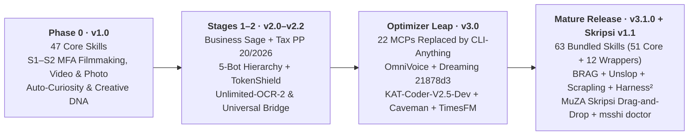
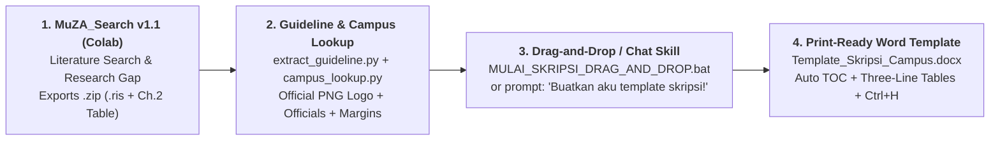

[🇮🇩 Bahasa Indonesia](./README.md) | [🌐 English](./README_EN.md)

<div align="center">


# 🌐 MSSHI v3.1.0 — Mega Semar Sang Hyang Ismaya
### *Hermes Ultimate Optimizer · 5-Bot Sovereign Sage Suite · MuZA Skripsi Drag-and-Drop v1.1*

[](VERSION.json)
[-FF6B1A?style=for-the-badge)](configs/bot_role_and_skill_matrix.json)
[](configs/upstreams.json)
[](skills/muza-skripsi-template/SKILL.md)
[](https://colab.research.google.com/drive/15ckekQcGu4ssHQMQgXyK1gMMgobVZMFv)
[](LICENSE)

> *"A sovereign multi-agent ecosystem for Hermes Agent, Google Antigravity, Claude Code, Codex CLI, OpenClaw & ChatGPT — engineered to run smoothly on 4 GB RAM Windows 10 laptops and `$1` API budgets across S1–S3 academic research, MFA filmmaking, BBA/MBA advisory, and full-stack cybersecurity engineering."*

</div>

---

<table>
<tr>
<td width="245" align="center" valign="middle">
  
  <br><sub><b>Sovereign Orchestrator</b><br>Zero Model Override · Adaptive C:/D:</sub>
</td>
<td valign="top">
  <h3>🎭 Turn Plain AI Chat into a 5-Specialist Cyber-Noir Command Suite</h3>
  <p>Tired of watching a <b>4 GB RAM Windows 10 laptop freeze (Grey Screen)</b> under 22 background local MCP servers — or having scripts break on <b><code>C:</code>-drive-only machines</b>?</p>
  <p><b>MSSHI v3.1.0</b> overhauls agent reliability while keeping your personal LLM providers and models untouched (<code>jev_model_routing: false</code> locked):</p>
  <ul>
    <li>⚡ <b>CLI-Anything Universal Bridge</b> — Replaces 22 heavyweight MCP processes with lazy on-demand app tickets (<code>msshi runtime ticket</code> / <code>run</code>).</li>
    <li>🛡️ <b>$1 Zero-Waste Token Shield + Auto-Trim + Caveman</b> — Lossless JSON compression via <code>transform_tool_result</code> plus hard budget stops below a <b>$1.00</b> projected reserve.</li>
    <li>🎓 <b>MuZA Skripsi Starter v1.1 (Drag-and-Drop + Colab)</b> — Drop a <code>MuZA_Search .zip</code> and/or campus guideline PDF onto <code>MULAI_SKRIPSI_DRAG_AND_DROP.bat</code>, or ask in chat: <i>"Buatkan aku template skripsi!"</i></li>
    <li>💾 <b>Adaptive C: / D: Storage Detection</b> — Uses <code>D:\HermesData</code> if available or falls back seamlessly to <code>%USERPROFILE%\HermesData</code> and <code>Documents\MuZA_Skripsi_Output</code>.</li>
  </ul>
</td>
</tr>
</table>

---

<div align="center">

## 📥 Versioned PDF Handbooks & Reports (1-Click Auto-Download)

*Prefer an end-to-end handbook or release audit report? Click any download badge below for a direct raw PDF download, or read online in GitHub.*

| Version / Channel | Document Title &amp; Scope | Details | 1-Click Auto-Download | View Online |
| :---: | :--- | :---: | :---: | :---: |
| **`v3.1.0` (Client Handbook)** | **Hermes &amp; MSSHI v3.1.0 Client Master Handbook** — Complete beginner-to-pro guide covering 63 skills, 5 bots, CLI-Anything, OmniVoice, Skripsi v1.1 &amp; adaptive paths. | 130 pp · ~3.65 MB | [](https://github.com/zidanaisar624/MSSHI-Mega-Semar-Sang-Hyang-Ismaya/raw/v3.1.0/docs/pdf-guides/Buku_Panduan_Master_Klien_Hermes_dan_MSSHI_v3.1.0.pdf) | [Open on GitHub](docs/pdf-guides/Buku_Panduan_Master_Klien_Hermes_dan_MSSHI_v3.1.0.pdf) |
| **`v3.1.0` (Execution Report)** | **MSSHI v3.1.0 Hydrogen Execution Report (Memeable &amp; Skripsi)** — Full audit of repo restructuring, 19 standardized visuals, Skripsi `.docx` integration &amp; release verification. | Official Report | [](https://github.com/zidanaisar624/MSSHI-Mega-Semar-Sang-Hyang-Ismaya/raw/v3.1.0/docs/pdf-guides/Laporan_Eksekusi_Hydrogen_MSSHI_v3.1.0_Memeable_dan_Skripsi.pdf) | [Open on GitHub](docs/pdf-guides/Laporan_Eksekusi_Hydrogen_MSSHI_v3.1.0_Memeable_dan_Skripsi.pdf) |
| **`v3.0` (Optimizer Spec)** | **MSSHI v3.0 Full Settings Specification — Hermes Ultimate Optimizer** — Architecture blueprint for 22-MCP removal, `hermes-dreaming`, OmniVoice &amp; Caveman. | 50 pp · ~1.47 MB | [](https://github.com/zidanaisar624/MSSHI-Mega-Semar-Sang-Hyang-Ismaya/raw/v3.1.0/docs/pdf-guides/Spesifikasi_Lengkap_Settings_MSSHI_v3.0_Hermes_Ultimate_Optimizer.pdf) | [Open on GitHub](docs/pdf-guides/Spesifikasi_Lengkap_Settings_MSSHI_v3.0_Hermes_Ultimate_Optimizer.pdf) |
| **`latest` (Auto-Track)** | **Stable `latest` Channel (Always Tracks Newest Release)** — Used automatically by `msshi manual download --version latest` &amp; interactive installers. | 130 pp · ~3.65 MB | [](https://raw.githubusercontent.com/zidanaisar624/MSSHI-Mega-Semar-Sang-Hyang-Ismaya/main/docs/manuals/latest/Buku_Panduan_Master_Klien_Hermes_dan_MSSHI_v3.1.0_Edisi_Sabtu_Zoom.pdf) | [View in `manuals/`](docs/manuals/latest/Buku_Panduan_Master_Klien_Hermes_dan_MSSHI_v3.1.0_Edisi_Sabtu_Zoom.pdf) |

> 💡 **Interactive Installer Support:** Running `install.ps1`, `install.sh`, `MULAI_DI_SINI_PEMULA.bat`, `UPDATE_OTOMATIS_KE_V3.bat`, `msshi setup`, or `msshi update` offers a built-in prompt (`--download-pdf` / `--no-pdf`), or run `msshi manual download --version v3.1.0`. Machine catalog: [`docs/manuals/pdf_catalog.json`](docs/manuals/pdf_catalog.json) · Compact v3.1 link: [`docs/pdf-guides/Panduan_Master_MSSHI_v3.1.0.pdf`](docs/pdf-guides/Panduan_Master_MSSHI_v3.1.0.pdf) · Version archives: [`docs/manuals/v3.1.0/`](docs/manuals/v3.1.0/Buku_Panduan_Master_Klien_Hermes_dan_MSSHI_v3.1.0_Edisi_Sabtu_Zoom.pdf) &amp; [`docs/manuals/v3.0/`](docs/manuals/v3.0/Spesifikasi_Lengkap_Settings_MSSHI_v3.0_Hermes_Ultimate_Optimizer.pdf).

</div>

---

## 🕰️ Evolution Timeline (`v1.0` → `v3.1.0`): From Early Experiments to Drag-and-Drop Thesis Assembly

<div align="center">

<table>
<tr>
<td width="50%" align="center" valign="top">
  
  <br><b>Phase 1 · Early Experiments (<code>v1.0</code>)</b>
  <br><sub>Started with <b>47 core skills</b> for S1–S2 MFA Filmmaking, Videography, Photography &amp; <code>Auto-Curiosity</code> — back when 22 local MCP servers cooked laptops alive.</sub>
</td>
<td width="50%" align="center" valign="top">
  
  <br><b>Phase 2 · Stage 1 &amp; 2 Sovereign Suite (<code>v2.0 – v2.2</code>)</b>
  <br><sub>Introduced <b>Business Sage</b> (BBA/MBA + Indonesian Tax <code>PP 20/2026</code>), the <b>5-Bot Hierarchy</b>, <code>TokenShield</code>, <code>Unlimited-OCR-2</code>, <code>humanizer-indonesia</code> &amp; <code>Universal Bridge</code>.</sub>
</td>
</tr>
<tr>
<td width="50%" align="center" valign="top">
  
  <br><b>Phase 3 · The Optimizer Leap (<code>v3.0</code> · Tag <code>a8400c8</code>)</b>
  <br><sub><b>Eliminated 22 heavy MCPs</b> in favor of <b>CLI-Anything</b> + native lossless <code>msshi-auto-trim</code> + <code>caveman</code>! Added <b>OmniVoice</b> prosody, <b>Hermes-Dreaming</b> (<code>21878d3</code>), <b>KAT-Coder-V2.5-Dev</b>, <b>Hyperframes</b> &amp; <b>TimesFM</b>. Pure 4 GB RAM bliss.</sub>
</td>
<td width="50%" align="center" valign="top">
  
  <br><b>Phase 4 · Mature Release (<code>v3.1.0 + Skripsi v1.1</code>)</b>
  <br><sub>Now <b>63 bundled skills (51 core + 12 wrappers) + 49 upstreams</b>: featuring <b>MuZA Skripsi Drag-and-Drop v1.1</b>, <code>BRAG</code>, <code>Unslop</code>, <code>Scrapling</code>, <code>Harness²</code>, Opt-in <code>REA</code>, <code>msshi doctor</code>, <code>msshi choices</code>, <code>msshi skripsi</code>, <code>msshi manual</code> &amp; adaptive <code>C:/D:</code> paths.</sub>
</td>
</tr>
</table>

</div>



---

## 🎭 Meet the 5-Bot Hierarchy (Disciplined Specialist Team)

Every bot carries its own persona instructions, domain guardrails, local **`OmniVoice`** prosody, and verified skill allocation audited in [`docs/AUDIT_SKILLS_PER_BOT.md`](docs/AUDIT_SKILLS_PER_BOT.md):

| Avatar | Bot &amp; Title | Core Mandate | Signature `v3.1.0` Stack |
| :---: | :--- | :--- | :--- |
|  | **1. Yukino Yukinoshita**<br>*(Idea Sparring Partner)* | Stress-tests raw user prompts, structures energy budgets, and crystallizes actionable briefs for Shizuka. | [`configs/personas/yukino.md`](configs/personas/yukino.md) · `brainstorming-research-ideas`, `focus-my-energy`, `idea-generation`, `muza-skripsi-template`, `business-sage`. |
|  | **2. Sensei Shizuka Hiratsuka**<br>*(Mastermind Orchestrator)* | Leads execution strategy, Business/MBA/Tax advisory, enforces `TokenShield` (`$1.00`), routes tasks, and synthesizes final client decisions. | [`configs/personas/shizuka.md`](configs/personas/shizuka.md) · `wise-judgment-and-sovereign-orchestrator`, `business-sage`, `cli-anything-business-sage`, `muza-skripsi-template`. |
|  | **3. Val**<br>*(Deep Research &amp; S1–S3 Thesis)* | Drives literature discovery, 8 academic thesis engines, automatic Word template assembly, CPU **`TimesFM`** forecasting, and `hermes-dreaming`. | [`configs/personas/val.md`](configs/personas/val.md) · **`muza-skripsi-template` (Engine #8)**, `timesfm-forecasting`, `scrapling`, `unslop`, `harness2`. |
|  | **4. Kiki-Chii**<br>*(One-Woman Creative Studio)* | Directs **Concepting First** workflows, 10–40 min chaptered film timelines, **`BRAG`** (**Hyperframes**) launch videos, and **`UI/UX Pro Max`**. | [`configs/personas/kiki-chii.md`](configs/personas/kiki-chii.md) · `brag`, `unslop`, `motion-graphics-suite`, `filmmaking-videography-photography-s2`, `higgsfield-skills`. |
|  | **5. Shikaku Nara**<br>*(Principal Architect &amp; Cybersec)* | Full-stack vibecoding (`KAT-Coder-V2.5-Dev`), Next.js/Go/Python/Flutter, **`Harness²`** evals, local **`Scrapling`**, defensive security, and **Opt-in `REA`**. | [`configs/personas/shikaku.md`](configs/personas/shikaku.md) · `antigravity-webdev-cybersec`, `harness2`, `scrapling`, `unslop`, `evaluating-code-models`, `rea` (opt-in). |

> 🦀 **Shared Foundation Across All 5 Bots:** Every persona inherits [`cli-anything-universal-bridge`](skills/cli-anything-universal-bridge/SKILL.md), `humanizer-indonesia`, `humanizer-en`, `unlimited-ocr-2`, and lossless JSON compression via [`msshi-auto-trim`](hermes_plugins/msshi-auto-trim/README.md).

---

## 🎓 Spotlight Feature v3.1.0: MuZA Skripsi Starter v1.1 (Drag & Drop + Colab)

<table>
<tr>
<td width="42%" align="center" valign="middle">
  
  <br><sub><i>Your brain before <b>MuZA Skripsi Drag-and-Drop v1.1</b> — now margins, official university logos &amp; Chapter 2 synthesis tables assemble in seconds!</i></sub>
</td>
<td valign="top">
  <h3>🚀 Print-Ready University Thesis <code>.docx</code> Assembly With Zero Terminal Friction</h3>
  <ol>
    <li><b>Step 1 — Scholarly Discovery in Google Colab:</b><br>
      Open [](https://colab.research.google.com/drive/15ckekQcGu4ssHQMQgXyK1gMMgobVZMFv) (<a href="notebooks/skripsi/MuZA_Search.ipynb"><code>MuZA_Search.ipynb</code></a>), query OpenAlex/CrossRef/Semantic Scholar, and export your <b><code>.zip</code> bundle</b> containing Zotero <b><code>.ris</code></b> and Chapter 2 synthesis tables.
    </li>
    <li><b>Step 2 — Pick Cloud Colab or Windows Drag-and-Drop:</b>
      <ul>
        <li><b>Cloud Colab:</b> Launch [](https://colab.research.google.com/drive/1rrl38cwQZ0CA00cMyQvfjJUf1CSEtJpS) (<a href="notebooks/skripsi/MuZA_Skripsi_Builder.ipynb"><code>MuZA_Skripsi_Builder.ipynb</code></a>).</li>
        <li><b>Local Windows Drag-and-Drop:</b> Simply <b>drag &amp; drop</b> your <code>.zip</code> + campus guideline <code>.pdf</code> onto <a href="MULAI_SKRIPSI_DRAG_AND_DROP.bat"><code>MULAI_SKRIPSI_DRAG_AND_DROP.bat</code></a> (or run <code>msshi skripsi</code>)!</li>
      </ul>
    </li>
    <li><b>Step 3 — Campus Lookup + Guideline Extraction + 5 Presets:</b><br>
      Powered by <a href="skills/muza-skripsi-template/SKILL.md"><code>muza-skripsi-template</code></a> (11 files): extracts PDF paper/margin rules (<code>extract_guideline.py</code>), retrieves official PNG university crests &amp; verified leadership names (<code>campus_lookup.py</code>), applies methodology presets, and outputs adaptively to <code>D:\HermesData\Skripsi_Output</code> or <code>%USERPROFILE%\Documents\MuZA_Skripsi_Output</code>.
    </li>
  </ol>
</td>
</tr>
</table>



> 🤖 **Contextual Activation in Any Connected AI Chat:** Simply ask naturally (*"Buatkan aku template skripsi!"* / `/muza-skripsi-template`) and [`muza-skripsi-template`](skills/muza-skripsi-template/SKILL.md) walks you through its **5-stage verified process**, clearly tagging `[Dari Pedoman]` vs `[*Default]` rules and never inventing unverified campus officials.

---

## 💰 $1 Zero-Waste Token Shield &amp; Adaptive `C:` vs `D:` Storage

<table>
<tr>
<td valign="top">
  <h3>🔥 Built for Tight Budgets &amp; Real Student Hardware</h3>
  <ul>
    <li><b><code>TokenShield</code> `$1.00` Floor Guard:</b> Checks projected balances before paid multi-step operations so quotas never drain silently.</li>
    <li><b>Lossless <code>msshi-auto-trim</code> + <code>caveman</code>:</b> Compresses large JSON tool responses in-place only when exact data equivalence holds.</li>
    <li><b>Personal Provider &amp; Model Preservation:</b> Never alters your DataByte, YupiAI, Gemini, Claude, DeepSeek, Kimi, Qwen, or GPT settings (<code>jev_model_routing: false</code> locked).</li>
    <li><b>Zero Hardcoded <code>D:\</code> Failures:</b> Automatically selects <code>D:\HermesData</code> when present or falls back cleanly to <code>%USERPROFILE%\HermesData</code> on single-drive <code>C:</code> laptops.</li>
  </ul>
</td>
<td width="40%" align="center" valign="middle">
  
  <br><sub><i>When your API balance is down to <b>$1</b> on a 4 GB RAM <code>C:</code>-drive laptop — "Pasrah aku... yet MSSHI v3.1.0 makes it work!"</i></sub>
</td>
</tr>
</table>

---

## 🖼️ Showcase Gallery &amp; Standardized Meme Collection

<details>
<summary><b>👉 Click to Expand Architecture Showcases &amp; Extra Reaction Memes</b></summary>
<br>

<div align="center">
  
  
  <br><sub><b>Left:</b> <i>Auto-Curiosity</i> Loop (Discover &rarr; Deconstruct &rarr; Verify &rarr; Hand Off) · <b>Right:</b> Creative Convergence Studio.</sub>
</div>

<br>

<div align="center">
<table>
<tr>
<td align="center" width="25%"><br><sub>Code review mode</sub></td>
<td align="center" width="25%"><br><sub>Reading the 130-page PDF</sub></td>
<td align="center" width="25%"><br><sub>Vibecoding on modest hardware</sub></td>
<td align="center" width="25%"><br><sub><i>"Cozy chaos, my favorite."</i></sub></td>
</tr>
</table>
</div>

</details>

---

## 🚀 30-Second Quick Start

**Fastest Option (Paste into Agent Chat):**

> `Read https://raw.githubusercontent.com/zidanaisar624/MSSHI-Mega-Semar-Sang-Hyang-Ismaya/main/docs/guides/INSTALL_FOR_AGENTS.md, then install and configure MSSHI v3.1.0 for me without overriding my existing LLM provider/model!`

- **Windows Beginners:** Double-click [`MULAI_DI_SINI_PEMULA.bat`](MULAI_DI_SINI_PEMULA.bat) (includes Option 5 for versioned PDF manuals), or drag `.zip`/`.pdf` onto [`MULAI_SKRIPSI_DRAG_AND_DROP.bat`](MULAI_SKRIPSI_DRAG_AND_DROP.bat).
- **v2.x Upgrade:** Run [`UPDATE_OTOMATIS_KE_V3.bat`](UPDATE_OTOMATIS_KE_V3.bat) once (backs up `SOUL.md` &amp; `Creative DNA` automatically).
- **Windows PowerShell** *(add `-DownloadPdf` to fetch the v3.1.0 manual)*:
  ```powershell
  irm https://raw.githubusercontent.com/zidanaisar624/MSSHI-Mega-Semar-Sang-Hyang-Ismaya/main/install.ps1 | iex
  ```
- **macOS / Linux Bash** *(supports `--download-pdf` / `--no-pdf`)*:
  ```bash
  curl -fsSL https://raw.githubusercontent.com/zidanaisar624/MSSHI-Mega-Semar-Sang-Hyang-Ismaya/main/install.sh | bash
  ```

| Agent / Host | Fast Install Route |
| :--- | :--- |
| **Hermes Agent** | `npx skills add https://github.com/zidanaisar624/MSSHI-Mega-Semar-Sang-Hyang-Ismaya/tree/main/skills --global --agent hermes-agent` or `hermes skills tap add zidanaisar624/MSSHI-Mega-Semar-Sang-Hyang-Ismaya` |
| **OpenClaw** | `openclaw skills install git:zidanaisar624/MSSHI-Mega-Semar-Sang-Hyang-Ismaya --global` or `npx skills add .../skills --global --agent openclaw` |
| **Claude Code** | `/plugin marketplace add zidanaisar624/MSSHI-Mega-Semar-Sang-Hyang-Ismaya` then `/plugin install msshi@msshi-marketplace` |
| **Claude.ai Web / Desktop** | Open **Customize &rarr; Skills &rarr; + &rarr; Upload a skill** and upload [`portable/msshi.zip`](portable/msshi.zip) |
| **ChatGPT Projects / Custom GPT** | Upload [`portable/MSSHI_ChatGPT_Knowledge_Bundle.md`](portable/MSSHI_ChatGPT_Knowledge_Bundle.md) and paste [`portable/CHATGPT_CUSTOM_INSTRUCTIONS.md`](portable/CHATGPT_CUSTOM_INSTRUCTIONS.md) |
| **Codex CLI** | `npx skills add https://github.com/zidanaisar624/MSSHI-Mega-Semar-Sang-Hyang-Ismaya/tree/main/skills --global --agent codex` |
| **Google Antigravity IDE** | `msshi setup --platform antigravity` ([Agent Setup Guide](docs/guides/INSTALL_FOR_AGENTS.md#google-antigravity-ide)) |

> Run `msshi choices` anytime before installing to inspect modes, packs, skills, REA, KAT &amp; apps, and run `python scripts/msshi_cli.py doctor` for full C:/D: health verification. Further reading: [Choice Guide EN](docs/OPTION_GUIDE_EN.md) · [Platforms](docs/platforms.md) · [CLI &amp; Recovery](docs/CLI.md) · [Managed Updates](docs/MANAGED_UPDATES.md).

---

## ⚙️ Contextual Integrations &amp; Architecture Diagrams

| Component | Role Owners | Scope &amp; Guardrails |
| :--- | :--- | :--- |
| [**`muza-skripsi-template` (`v1.1`)**](skills/muza-skripsi-template/SKILL.md) | Val, Shizuka, Yukino, Solo, Antigravity | Contextual &amp; drag-and-drop thesis `.docx` generator (`extract_guideline.py`, `campus_lookup.py`, `build_template.py`, `MuZA_Search` injection). |
| [**`CLI-Anything` Universal Bridge**](docs/CLI_ANYTHING_BRIDGE.md) | All 5 Bots | Replaces 22 local MCPs with lazy profile-scoped app tickets (`msshi runtime ticket` &rarr; `msshi runtime run`). |
| [**`Unslop`**](docs/UNSLOP.md) | Kiki-Chii, Val, Shikaku | Scoped UI polish; Val checks scientific metric &amp; unit clarity. Distinct from prose humanizers. |
| [**`BRAG`**](docs/BRAG.md) | Kiki-Chii | **Hyperframes** HTML/MP4 launch-video workflow behind concept &amp; human review gates. |
| [**`Scrapling`**](docs/SCRAPLING.md) | Val, Shikaku | Fast local HTML CSS/XPath parsing without network crawlers or Chrome profile access. |
| [**`Harness²`**](docs/HARNESS2.md) | Val, Shikaku | Deterministic harness evaluation &amp; proposals without live auto-promotion. |
| [**`Opt-in REA`**](docs/REA.md) | Shikaku *(opt-in)* | Local JS/archive inspection in `optional/rea/`. **Default OFF** (`--with-rea` / `msshi optional enable rea`). |
| [**`OmniVoice`, `Auto-Trim`, `TimesFM` &amp; `Steel`**](docs/TIMESFM.md) | 5 Bots &amp; Val | Prosody TTS, [lossless JSON trimming](hermes_plugins/msshi-auto-trim/README.md), CPU forecasting, [Steel policy](docs/STEEL_BROWSER_POLICY.md) &amp; [OAuth service sharing](docs/SERVICE_CONNECTIONS.md). |

<details>
<summary><b>📊 Click to View All 8 Technical Architecture SVG Diagrams</b></summary>
<br>


</details>

---

## 📁 Clean Root Architecture

- **Root (`/`)**: Core repository files &amp; 1-click launchers (`README.md`, `README_EN.md`, [`VERSION.json`](VERSION.json), [`CHANGELOG.md`](CHANGELOG.md), [`LICENSE`](LICENSE), [`CREDITS.md`](CREDITS.md), [`THIRD_PARTY_NOTICES.md`](THIRD_PARTY_NOTICES.md), [`SKILL.md`](SKILL.md), `package.json`, `install.ps1`, `install.sh`, [`MULAI_DI_SINI_PEMULA.bat`](MULAI_DI_SINI_PEMULA.bat), [`MULAI_SKRIPSI_DRAG_AND_DROP.bat`](MULAI_SKRIPSI_DRAG_AND_DROP.bat), [`UPDATE_OTOMATIS_KE_V3.bat`](UPDATE_OTOMATIS_KE_V3.bat)).
- **`notebooks/skripsi/`**: Official Google Colab notebooks (`MuZA_Search.ipynb`, `MuZA_Skripsi_Builder.ipynb`).
- **`docs/pdf-guides/` &amp; `docs/manuals/`**: Release-versioned PDF handbooks, Hydrogen execution report PDF, `latest/`, and [`pdf_catalog.json`](docs/manuals/pdf_catalog.json).
- **`assets/`**: Standardized `avatars/`, `memes/`, `showcases/`, 8 SVG [`diagrams/`](assets/README.md), and [`configs/visual_assets_manifest.json`](configs/visual_assets_manifest.json).
- **`scripts/`**: CLI (`msshi_cli.py`, `msshi_doctor.py`, `msshi_skripsi_drop.py`), visual builder (`prepare_github_visuals.py`), `secret_scan.py`, `generate_hydrogen_report_pdf.py`, and release auditors (`check_release*.py`).
- **`skills/` &amp; `optional/rea/`**: **63 bundled active skill folders (`51 core + 12 wrappers`)** including 11-file `muza-skripsi-template/`, plus opt-in `rea`.

---

## 💻 Windows Hermes Desktop Gray-Screen Recovery

If the gateway is running cleanly but **Hermes Desktop** opens with a gray screen, quit Desktop completely and run:

```powershell
msshi desktop --software-rendering
```

This sets `HERMES_DESKTOP_DISABLE_GPU=1` exclusively for the Hermes Desktop process and saves `{"software_rendering": true}` in `<HERMES_HOME>/tools/msshi/desktop-preferences.json`.

---

## 🤝 Credits &amp; License

- **Muhammad Zidan Aisar (MuZA)** — Creator, System Visionary &amp; Chief Architect.
- **Google Gemini** — Co-Architect for S1–S3 curriculum research, core skill synthesis, CLI-Anything, TokenShield &amp; 5-bot topology.
- **OpenAI ChatGPT** — Co-Architect for SVG architecture maps, Stage 1–2 packaging, upstream manifests &amp; v3 migration implementation.
- **Google Antigravity** — Development environment, agent orchestration, Cyber-Noir editorial restructuring &amp; MuZA Skripsi Drag-and-Drop v1.1 integration.

Original MSSHI materials are licensed under the [**MIT License**](LICENSE). Third-party components retain their respective terms documented in [THIRD_PARTY_NOTICES.md](THIRD_PARTY_NOTICES.md) and [docs/PROVENANCE.md](docs/PROVENANCE.md). Related docs: [Creative DNA Guide](docs/ALUR_PRESET_MUZA.md) · [49-Upstream Catalog](docs/INTEGRASI.md) · [Visual Review](adapters/msshi-visual-review/README.md) · [Publication Checklist](docs/STATUS_PUBLIKASI.md).
