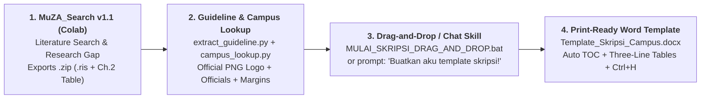
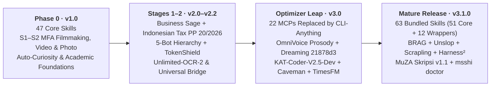

[🇮🇩 Bahasa Indonesia](./README.md) | [🌐 English](./README_EN.md)

# 🌐 MSSHI v3.1.0 — Mega Semar Sang Hyang Ismaya: Hermes Ultimate Optimizer & Sovereign Sage

> *63 Modular AI Agent Skills (51 Core + 12 Wrappers) + 49 Verified Upstreams + 5 Role Personas + Low-RAM CLI-Anything Bridge + MuZA Skripsi Starter v1.1 (Drag-and-Drop) for Hermes Agent, Google Antigravity, Claude Code, Codex CLI, OpenClaw & ChatGPT.*

[](VERSION.json)
[-0ea5e9?style=for-the-badge)](configs/bot_role_and_skill_matrix.json)
[](configs/upstreams.json)
[](skills/muza-skripsi-template/SKILL.md)
[](docs/PROVENANCE.md#kredit-kolaborasi)
[](LICENSE)

| | |
| :---: | :--- |
|  | **MSSHI v3.1.0** turns plain single-prompt chat into a **five-role sovereign specialist suite** plus the **Hermes Ultimate Optimizer** engineered to stay responsive even on modest **4 GB RAM Windows 10** machines.<br><br>Now featuring **MuZA Skripsi Starter v1.1 (Drag-and-Drop + Google Colab)**: automate academic literature synthesis in `MuZA_Search`, look up official university logos and leadership (`campus_lookup.py`), extract campus PDF formatting rules, and generate ready-to-use `.docx` thesis templates in one click — alongside **MFA Filmmaking, BBA/MBA & Indonesian Tax (`PP 20/2026`), `KAT-Coder-V2.5-Dev`, Defensive Cybersec, and `OmniVoice` TTS.** |

---

## 📥 Versioned PDF Handbooks (1-Click Auto-Download)

Prefer reading an end-to-end handbook before installing? Click any download badge below for an immediate raw file download, or read online directly on GitHub:

| Version / Channel | Handbook Title & Coverage | Size | 1-Click Auto-Download | View Online |
| :---: | :--- | :---: | :---: | :---: |
| **`latest`** | **Hermes & MSSHI v3.1.0 Client Master Handbook (Latest)** — Always tracks the newest release PDF. | 130 pp · ~3.65 MB | [](https://raw.githubusercontent.com/zidanaisar624/MSSHI-Mega-Semar-Sang-Hyang-Ismaya/main/docs/manuals/latest/Buku_Panduan_Master_Klien_Hermes_dan_MSSHI_v3.1.0_Edisi_Sabtu_Zoom.pdf) | [Open on GitHub](docs/manuals/latest/Buku_Panduan_Master_Klien_Hermes_dan_MSSHI_v3.1.0_Edisi_Sabtu_Zoom.pdf) |
| **`v3.1.0` (`pdf-guides`)** | **MSSHI v3.1.0 Master PDF Guide (`v3.1.0` Tag Direct Link)** — 63 skills, MuZA Skripsi v1.1, BRAG, Unslop, Scrapling, Harness², Opt-in REA & adaptive `C:`/`D:` paths. | 130 pp · ~3.65 MB | [](https://github.com/zidanaisar624/MSSHI-Mega-Semar-Sang-Hyang-Ismaya/raw/v3.1.0/docs/pdf-guides/Panduan_Master_MSSHI_v3.1.0.pdf) | [Open on `v3.1.0` Tag](https://github.com/zidanaisar624/MSSHI-Mega-Semar-Sang-Hyang-Ismaya/blob/v3.1.0/docs/pdf-guides/Panduan_Master_MSSHI_v3.1.0.pdf) |
| **`v3.1.0` (`manuals`)** | **Hermes & MSSHI v3.1.0 Master Client Guide (Saturday Zoom Edition)** — Complete client & Zoom archive. | 130 pp · ~3.65 MB | [](https://raw.githubusercontent.com/zidanaisar624/MSSHI-Mega-Semar-Sang-Hyang-Ismaya/main/docs/manuals/v3.1.0/Buku_Panduan_Master_Klien_Hermes_dan_MSSHI_v3.1.0_Edisi_Sabtu_Zoom.pdf) | [Open on GitHub](docs/manuals/v3.1.0/Buku_Panduan_Master_Klien_Hermes_dan_MSSHI_v3.1.0_Edisi_Sabtu_Zoom.pdf) |
| **`v3.0`** | **MSSHI v3.0 Full Settings Specification — Hermes Ultimate Optimizer** — Optimizer architecture, 22-MCP to CLI-Anything migration, Hermes-Dreaming (`21878d3`), OmniVoice & Caveman. | 50 pp · ~1.47 MB | [](https://raw.githubusercontent.com/zidanaisar624/MSSHI-Mega-Semar-Sang-Hyang-Ismaya/main/docs/manuals/v3.0/Spesifikasi_Lengkap_Settings_MSSHI_v3.0_Hermes_Ultimate_Optimizer.pdf) | [Open on GitHub](docs/manuals/v3.0/Spesifikasi_Lengkap_Settings_MSSHI_v3.0_Hermes_Ultimate_Optimizer.pdf) |

> **💡 Interactive Installer Option:** Running `install.ps1`, `install.sh`, `MULAI_DI_SINI_PEMULA.bat`, `UPDATE_OTOMATIS_KE_V3.bat`, `msshi setup`, or `msshi update` offers an optional prompt to save the PDF handbook for your installed version (`--download-pdf` / `--no-pdf`), or download anytime via `msshi manual download --version v3.1.0`. Machine-readable catalog: [pdf_catalog.json](docs/manuals/pdf_catalog.json).

---

## 🎓 MuZA Skripsi Starter v1.1 (Drag-and-Drop & Google Colab Edition)

Introducing MSSHI's **63rd bundled skill**: [`muza-skripsi-template`](skills/muza-skripsi-template/SKILL.md) — a zero-friction academic thesis (`.docx`) assembly pipeline:

| Stage & Tool | 1-Click Google Colab & Repo Files | Key Capabilities |
| :--- | :---: | :--- |
| **1. `MuZA_Search v1.1`** *(Literature & Research Gap)* | [](https://colab.research.google.com/drive/15ckekQcGu4ssHQMQgXyK1gMMgobVZMFv)<br>[`notebooks/skripsi/MuZA_Search.ipynb`](notebooks/skripsi/MuZA_Search.ipynb) | Discovers scholarly literature across OpenAlex/CrossRef/Semantic Scholar, generates Research Gap matrices, and exports **Zotero `.ris`**, **Chapter 2 synthesis tables (`.csv`/`.xlsx`)**, and a ready-to-inject **`.zip` research package**. |
| **2. `MuZA_Skripsi_Builder v1.1`** *(OOXML `.docx` Builder)* | [](https://colab.research.google.com/drive/1rrl38cwQZ0CA00cMyQvfjJUf1CSEtJpS)<br>[`notebooks/skripsi/MuZA_Skripsi_Builder.ipynb`](notebooks/skripsi/MuZA_Skripsi_Builder.ipynb) | Extracts formatting rules from campus PDF/DOCX guidelines (`extract_guideline.py`), retrieves official **university PNG logos & verified leadership names/IDs** via Wikipedia/Wikidata/ROR/`*.ac.id` (`campus_lookup.py`), applies **5 methodology presets**, injects `MuZA_Search` citations, and produces **`Template_Skripsi_<Campus>.docx`**. |
| **3. Local Drag-and-Drop Launcher** *(Windows & CLI)* | [`MULAI_SKRIPSI_DRAG_AND_DROP.bat`](MULAI_SKRIPSI_DRAG_AND_DROP.bat)<br>`msshi skripsi` | **Drag & drop** a `MuZA_Search .zip` and/or campus guideline `.pdf`/`.docx` directly onto `MULAI_SKRIPSI_DRAG_AND_DROP.bat`! Outputs adaptively to `D:\HermesData\Skripsi_Output` or falls back cleanly to `%USERPROFILE%\Documents\MuZA_Skripsi_Output`. |



> **🤖 Contextual or Direct Invocation in Agent Chat:** In Antigravity, Hermes, Claude Code, or OpenClaw, asking naturally (*"Buatkan aku template skripsi!"* / `/muza-skripsi-template`) triggers [`muza-skripsi-template`](skills/muza-skripsi-template/SKILL.md) and walks you through its **5-stage gated process** without skipping campus rule checks or fabricating officials.

---

## 😭 Before vs 😎 After MSSHI v3.1.0

| 😭 Without Optimizer (*Legacy Overload*) | 😎 With MSSHI v3.1.0 (*CLI-Anything + Auto-Trim*) |
| :---: | :---: |
|   |   |
| **95% RAM saturation & Hermes Desktop Grey Screen** from 22 heavyweight local MCP servers running continuously. | **Low-RAM responsive execution** via lazy **CLI-Anything** task tickets (`msshi runtime ticket` / `run`) and `msshi desktop --software-rendering`. |
| **Bloated JSON payloads & token burn** blowing past your API balance silently. | **Native `msshi-auto-trim` + `caveman`** compresses eligible JSON tool outputs with exact equality verification while **`TokenShield`** guards a strict `$1.00` minimum reserve. |
| **Hardcoded `D:\` path failures** on `C:`-drive-only student or client laptops. | **Adaptive directory detection:** uses `D:\HermesData` if present or falls back seamlessly to `%USERPROFILE%\HermesData` / `%USERPROFILE%\Documents\MuZA_Skripsi_Output`. |

| 22 Heavyweight MCPs vs CLI-Anything Bridge | Guardrails Always On |
| :---: | :---: |
|  |  |
| **22 heavy background MCP servers** vs **MSSHI v3.1.0 on-demand CLI tickets + lossless auto-trim**! | **Safety First:** `jev_model_routing: false` protects user providers/models, TokenShield pauses paid steps below `$1.00`, Steel blocks silent fallbacks, and **`REA` stays OFF by default**. |


---

## 📈 Evolution Timeline (`v1.0` → `v3.1.0`)



| Version | Release Stage | Key Milestones |
| :--- | :--- | :--- |
| **`v1.0`** | *Early Experiments* | S1–S2 MFA Filmmaking, Videography & Photography curriculum, `Auto-Curiosity`, `Creative DNA`, and 47 foundational research/creative skills. |
| **`v2.0 – v2.2`** | *Stage 1 & 2 Sovereign Suite* | `Business Sage` (BBA/MBA, Indonesian Tax `PP 20/2026`, zero-capital playbooks), 5-Bot Command Hierarchy, `TokenShield`, `Unlimited-OCR-2`, `humanizer-indonesia`, `Universal Bridge`, and cross-host packaging (`v2.1.0`). |
| **`v3.0`** | *Hermes Ultimate Optimizer* (`a8400c8`) | Eliminated 22 local desktop/utility MCPs in favor of **`CLI-Anything`** + **`Hersona CLI`** + **`msshi-auto-trim`**, integrated **`hermes-omnivoice`**, **`hermes-dreaming`** (`21878d3`), **`KAT-Coder-V2.5-Dev`**, **`caveman`**, **`hyperframes`**, **`ui-ux-pro-max-skill`**, **`TimesFM`**, and **`Steel`**. |
| **`v3.1.0`** | *Contextual Integrations + MuZA Skripsi v1.1* | Expanded to **63 bundled skills (51 core + 12 wrappers) + 49 upstreams**, adding **MuZA Skripsi Starter v1.1 (Drag-and-Drop + Colab)**, **`BRAG`**, **`Unslop`**, **`Scrapling`**, **`Harness²`**, **`Opt-in REA`**, `msshi doctor`, `msshi skripsi`, `msshi choices`, `msshi services --share-oauth`, `msshi managed`, `msshi manual`, clean root layout, and adaptive `C:`/`D:` paths. |

> **Still stuck on an older v2 setup?** <br>
>  <br>
> Run [`UPDATE_OTOMATIS_KE_V3.bat`](UPDATE_OTOMATIS_KE_V3.bat) once from this release to migrate safely while backing up `SOUL.md` and `user_creative_dna.json`.

---

## 🚀 30-Second Quick Start (Choose Your Agent)

**Start directly in agent chat** — paste this into Hermes Agent, OpenClaw, Claude Code, or Antigravity:

> Read https://raw.githubusercontent.com/zidanaisar624/MSSHI-Mega-Semar-Sang-Hyang-Ismaya/main/docs/guides/INSTALL_FOR_AGENTS.md, then install and configure MSSHI for me!

**Or install via CLI (includes optional PDF handbook download):**

**Windows PowerShell** *(add `-DownloadPdf` to auto-download the v3.1.0 handbook)*

```powershell
irm https://raw.githubusercontent.com/zidanaisar624/MSSHI-Mega-Semar-Sang-Hyang-Ismaya/main/install.ps1 | iex
```

**macOS / Linux** *(pass `--download-pdf` or `--no-pdf` when invoking directly)*

```bash
curl -fsSL https://raw.githubusercontent.com/zidanaisar624/MSSHI-Mega-Semar-Sang-Hyang-Ismaya/main/install.sh | bash
```

**Windows Beginners:**
- Double-click [`MULAI_DI_SINI_PEMULA.bat`](MULAI_DI_SINI_PEMULA.bat) (includes Option 5 to download versioned PDF manuals!).
- Want an instant university thesis `.docx`? Drag your `MuZA_Search .zip` and/or campus `.pdf` onto [`MULAI_SKRIPSI_DRAG_AND_DROP.bat`](MULAI_SKRIPSI_DRAG_AND_DROP.bat)!
- Prior v2.1 users run [`UPDATE_OTOMATIS_KE_V3.bat`](UPDATE_OTOMATIS_KE_V3.bat) once, and check system readiness anytime via **`python scripts/msshi_cli.py doctor`**.

| Agent | Install Route |
| :--- | :--- |
| **Hermes Agent** | `npx skills add https://github.com/zidanaisar624/MSSHI-Mega-Semar-Sang-Hyang-Ismaya/tree/main/skills --global --agent hermes-agent` or `hermes skills tap add zidanaisar624/MSSHI-Mega-Semar-Sang-Hyang-Ismaya` |
| **OpenClaw** | `openclaw skills install git:zidanaisar624/MSSHI-Mega-Semar-Sang-Hyang-Ismaya --global` or `npx skills add .../skills --global --agent openclaw` |
| **Claude Code** | `/plugin marketplace add zidanaisar624/MSSHI-Mega-Semar-Sang-Hyang-Ismaya` then `/plugin install msshi@msshi-marketplace` |
| **Claude.ai Web / Desktop** | Open **Customize → Skills → + → Upload a skill** and upload [`portable/msshi.zip`](portable/msshi.zip) |
| **ChatGPT Projects / Custom GPT** | Upload [`portable/MSSHI_ChatGPT_Knowledge_Bundle.md`](portable/MSSHI_ChatGPT_Knowledge_Bundle.md) and paste [`portable/CHATGPT_CUSTOM_INSTRUCTIONS.md`](portable/CHATGPT_CUSTOM_INSTRUCTIONS.md) |
| **Codex CLI** | `npx skills add https://github.com/zidanaisar624/MSSHI-Mega-Semar-Sang-Hyang-Ismaya/tree/main/skills --global --agent codex` |
| **Google Antigravity IDE** | `msshi setup --platform antigravity` after installing the CLI ([IDE & Skills CLI notes](docs/guides/INSTALL_FOR_AGENTS.md#google-antigravity-ide)) |

> Run `msshi choices` anytime to inspect every mode, pack, skill, REA, KAT, or app route before installing. See [Choice Guide](docs/OPTION_GUIDE_EN.md) · [Agent Install Guide](docs/guides/INSTALL_FOR_AGENTS.md) · [Platforms & OpenClaw](docs/platforms.md) · [CLI & Recovery](docs/CLI.md).

---

## 🎭 Meet the 5-Bot Hierarchy & Sub-Agent Optimizer

|  | **Coordinated Specialist Flow:**<br>Raw ideas enter via **Yukino** &rarr; routed by **Sensei Shizuka** &rarr; researched & templated by **Val** &rarr; built by **Kiki-Chii** or **Shikaku Nara** &rarr; synthesized back by **Shizuka** for human approval! |
| :---: | :--- |

| Character | Persona & Role | Core Mandate & v3.1 Stack |
| :---: | :--- | :--- |
|  | **1. Yukino Yukinoshita** &<br>**2. Sensei Shizuka Hiratsuka**<br>*(Idea Sparring & Sovereign Orchestrator)* | **Yukino** stress-tests raw ideas into sharp briefs. **Shizuka** leads client synthesis, **Business Sage** (BBA/MBA/Tax), `TokenShield` budget gating, coordinates **`muza-skripsi-template`**, and delivers final human-ready summaries. |
|  | **3. Val**<br>*(S1–S3 Thesis Research, TimesFM & `hermes-dreaming`)* | Handles `Auto-Curiosity`, 8 thesis workflows including **`muza-skripsi-template`** (`campus_lookup.py` + `MuZA_Search`), CPU **`TimesFM`** forecasting, local HTML parsing (**`Scrapling`**), dashboard evidence review (**`Unslop`**), and **`hermes-dreaming`** (`21878d3`). |
|  | **4. Kiki-Chii**<br>*(MFA Film, Video, Photo & Motion Lead)* | Owns **Concepting First**, short-form to 10–40 min multi-chapter timelines, **`BRAG`** (**`Hyperframes`** launch videos), **`UI/UX Pro Max`**, **`Unslop`** polish, and `Creative DNA`. |
|  | **5a. Shikaku Nara & `KAT-Coder-V2.5-Dev`**<br>*(Principal Architecture & Vibecoding)* | Full-stack engineering, Next.js/Go/Python/Flutter, iterative UI refinement (**`Unslop`**), **`Harness²`** verification, **`Scrapling`**, and optional **`Opt-in REA`**. |
|  | **5b. Shikaku Cybersec Guardian**<br>*(Defensive Security & Session Guard)* | Authorized security auditing, dependency/script verification, OAuth isolation (`msshi services --share-oauth`), and personal-browser boundary checks. |
|  | **CLI-Anything Universal Bridge**<br>*(Shared Across All 5 Bots)* | Replaces 22 heavyweight MCPs with lazy profile-scoped app routes invoked explicitly via `msshi runtime ticket` &rarr; `msshi runtime run` ([Bridge Guide](docs/CLI_ANYTHING_BRIDGE.md)). |

<p align="center">
  
  
  
  
</p>


---

## ⚙️ v3.1 Contextual Integrations & Workflows


| Integration | Assigned Roles | Scope & Guardrails |
| :--- | :--- | :--- |
| [**`muza-skripsi-template` (`v1.1`)**](skills/muza-skripsi-template/SKILL.md) | Val, Shizuka, Yukino, Solo, Antigravity | Contextual & explicit thesis Word template builder (`extract_guideline.py`, `campus_lookup.py`, `build_template.py`, `MuZA_Search` injection) following a strict 5-stage process. |
| [**Unslop**](docs/UNSLOP.md) | Kiki-Chii, Val, Shikaku | Scoped UI polish; Val audits scientific dashboard clarity. Separate from prose humanizers. |
| [**BRAG**](docs/BRAG.md) | Kiki-Chii | **Hyperframes** HTML/MP4 launch-video workflow with concept and human-review gates. |
| [**Scrapling**](docs/SCRAPLING.md) | Val, Shikaku | Local HTML CSS/XPath parsing without network crawlers, stealth browsers, or Chrome profile access. |
| [**Harness²**](docs/HARNESS2.md) | Val, Shikaku | Deterministic harness evaluation & reviewable proposals without auto-promotion or unbudgeted eval runs. |
| [**Opt-in REA**](docs/REA.md) | Shikaku *(opt-in only)* | Local reverse engineering in `optional/rea/`. Stays **OFF by default** unless enabled via `--with-rea` or `msshi optional enable rea`. |


| Workflow Diagram | Guide |
| :--- | :--- |
| Creative Production (`Concepting First` + 10–40 min chapters) |  · [Creative DNA Guide](docs/ALUR_PRESET_MUZA.md#concepting-first-dan-creative-dna) |
| Eight Academic Thesis Engines (`S1–S3` + `MuZA Skripsi v1.1`) |  · [Academic Workflows](docs/TUJUH_MESIN_AKADEMIK.md) |
| Five Context Layers (Long Projects) |  · [Context Layering](docs/LIMA_LAPIS_KONTEKS.md) |
| Bundled vs Local vs Account Boundaries |  · [49-Upstream Catalog](docs/INTEGRASI.md) · [Public Setup Guide](docs/guides/PANDUAN_KUSTOMISASI_USER_PUBLIK.md) |

---

## 📁 Clean Root Architecture

- **Root (`/`)**: Standard repository core (`README.md`, `README_EN.md`, `LICENSE`, `CHANGELOG.md`, `CREDITS.md`, `THIRD_PARTY_NOTICES.md`, `VERSION.json`, `SKILL.md`, `package.json`, `install.ps1`, `install.sh`, `MULAI_DI_SINI_PEMULA.bat`, `MULAI_SKRIPSI_DRAG_AND_DROP.bat`, `UPDATE_OTOMATIS_KE_V3.bat`).
- **`notebooks/skripsi/`**: Official Google Colab notebooks (`MuZA_Search.ipynb`, `MuZA_Skripsi_Builder.ipynb`).
- **`docs/pdf-guides/` & `docs/manuals/`**: Release-linked PDF handbooks (`Panduan_Master_MSSHI_v3.1.0.pdf`, `v3.1.0/`, `v3.0/`, `latest/`) + [`pdf_catalog.json`](docs/manuals/pdf_catalog.json).
- **`docs/guides/`**: Extended setup guides (`INSTALL_FOR_AGENTS.md`, `PANDUAN_KUSTOMISASI_USER_PUBLIK.md`, `00_PANDUAN_INSTAL_AUTO_UPDATE_DAN_PROMPT_MULTI_AGENT.md`).
- **`scripts/installers/`**: Legacy/specialized platform installers (`Install_Overhaul_Hermes_dan_Antigravity.ps1`, `install_business_sage.ps1`, `install_business_sage.sh`).
- **`configs/manifests/`**: Cross-platform schemas (`openai_custom_gpt_schema.json`, `openclaw_manifest.json`, `skill_activation_matrix.json`) + `configs/github_about.txt`.
- **`assets/`**: [`diagrams/`](assets/README.md) (8 SVG architecture maps), `visuals/` (10 curated showcase images), `pp-tiktok/` (9 character portraits), `memes/` (10 reaction memes).
- **`skills/` & `optional/rea/`**: **63 bundled active skill folders (`51 core + 12 wrappers`)** including 11-file `muza-skripsi-template/`, plus 1 opt-in `rea`.

---

## 💻 Windows Hermes Desktop Recovery

If the gateway is running but Hermes Desktop displays a gray screen, quit Desktop completely and run:

```powershell
msshi desktop --software-rendering
```

This applies `HERMES_DESKTOP_DISABLE_GPU=1` exclusively to the Hermes Desktop child process and remembers `{"software_rendering": true}` in `<HERMES_HOME>/tools/msshi/desktop-preferences.json`.

---

## 🤝 Credits & License

- **Muhammad Zidan Aisar (MuZA)** — Creator, System Visionary & Chief Architect.
- **Google Gemini** — Co-Architect for S1–S3 curriculum research, core skill synthesis, CLI-Anything, TokenShield & 5-bot topology.
- **OpenAI ChatGPT** — Co-Architect for SVG architecture maps, Stage 1–2 packaging, upstream manifests & v3 migration implementation.
- **Google Antigravity** — IDE environment, agent orchestration & v3.1.0 + MuZA Skripsi Drag-and-Drop v1.1 engineering.

Original MSSHI assets are licensed under the [**MIT License**](LICENSE). Third-party components retain their respective terms documented in [THIRD_PARTY_NOTICES.md](THIRD_PARTY_NOTICES.md) and [docs/PROVENANCE.md](docs/PROVENANCE.md). Related docs: [Auto-Trim Plugin](hermes_plugins/msshi-auto-trim/README.md) · [Steel Policy](docs/STEEL_BROWSER_POLICY.md) · [Managed Updates](docs/MANAGED_UPDATES.md) · [Bot Skill Audit](docs/AUDIT_SKILLS_PER_BOT.md) · [Visual Review](adapters/msshi-visual-review/README.md) · [Publication Checklist](docs/STATUS_PUBLIKASI.md).
