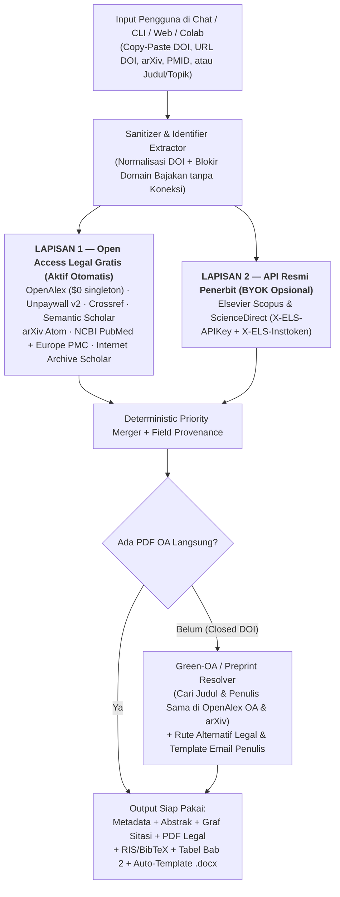

# Riset Teknis & Rancangan Arsitektur 2-Lapis Engine Riset Akademik (Bot Val — MSSHI)

> **Status Dokumen:** Riset & Spesifikasi Arsitektur Lokal (Siap Integrasi ke `MSSHI-Mega-Semar-Sang-Hyang-Ismaya`, **Belum Di-push ke GitHub** sesuai instruksi).

---

## 1. Ringkasan Arsitektur 2-Lapis



---

## 2. Detail Lapisan 1 — Jalur Open Access Gratis (Tanpa API Key Wajib)

| Sumber Resmi | Endpoint Utama | Autentikasi & Kuota Terbaru | Data Utama yang Diambil |
| :--- | :--- | :--- | :--- |
| **OpenAlex API** | `https://api.openalex.org/works/doi:{doi}` & `/works` | **Singleton lookup DOI = `$0` (Gratis)** tanpa kurangi budget harian. Tanpa key: `$0.10`/hari (`10 req/s`). Dengan key gratis (`openalex.org/settings/api`): `$1.00`/hari (`30 req/s`, ~1.000 search atau ~10.000 filtered list/hari). *(Catatan: parameter lama `mailto` sudah dideprekasi OpenAlex dan diganti `?api_key=`.)* | Judul, penulis + afiliasi + ORCID, abstrak (`abstract_inverted_index`), `oa_status`, `best_oa_location`, graf sitasi (`cited_by_count`, `referenced_works`, `filter=cites:W...`). |
| **Unpaywall REST API v2** | `https://api.unpaywall.org/v2/{doi}?email={email}` | Tanpa API key; wajib parameter `email` valid. Batas s.d. **100.000 panggilan/hari** per alamat email. | Status OA presisi (`gold`, `green`, `hybrid`, `bronze`, `closed`), `best_oa_location.url_for_pdf`, lisensi CC, dan tipe host (`publisher` vs `repository`). |
| **Crossref REST API** | `https://api.crossref.org/works/{doi}` | Gratis tanpa key (etika `User-Agent` + `mailto`). | Metadata kanonik penerbit: `volume`, `issue`, `page` / `article-number`, `ISSN`, `publisher`, jumlah referensi, abstrak JATS XML. |
| **Semantic Scholar Graph API** | `https://api.semanticscholar.org/graph/v1/paper/DOI:{doi}` | Gratis tanpa key (shared pool) atau header opsional `x-api-key`. | Abstrak bersih, ringkasan `tldr`, `openAccessPdf`, `externalIds` (`ArXiv`, `PubMed`), metrik sitasi. |
| **arXiv Atom API** | `https://export.arxiv.org/api/query` | Gratis tanpa key (batas wajar ~1 req / 3 detik untuk batch besar). | Metadata & tautan PDF langsung pra-cetak (`https://arxiv.org/pdf/{id}.pdf`) + pencocokan preprint berjudul sama. |
| **NCBI PubMed E-utilities & Europe PMC** | `eutils.ncbi.nlm.nih.gov/entrez/eutils/efetch.fcgi` & `ebi.ac.uk/europepmc/webservices/rest/search` | Gratis (`3 req/s` tanpa key di NCBI, `10 req/s` dengan `NCBI_API_KEY` gratis). | Abstrak terstruktur biomedis/kesehatan, `PMID`, `PMCID`, dan tautan PDF penuh di PubMed Central (`pmc.ncbi.nlm.nih.gov`). |
| **Internet Archive Scholar (Fatcat)** | `https://api.fatcat.wiki/v0/release/lookup?doi={doi}&expand=files` | Gratis tanpa key. | Salinan PDF jurnal Open Access legal yang diarsipkan permanen di `web.archive.org`. |

---

## 3. Hasil Riset Lapisan 2 — Elsevier Developer API (`dev.elsevier.com`) & Penerbit Lain

### A. Cara Koneksi Resmi Elsevier (`Scopus` & `ScienceDirect`)
1. **Registrasi Key Pribadi:** Pengguna masuk ke https://dev.elsevier.com → klik **My API Key** → **Create API Key** (isi label aplikasi mis. `MSSHI-Val-Personal-Research`, tidak wajib memiliki website publik untuk riset akademik non-komersial).
2. **Header Autentikasi HTTP:**
   ```http
   X-ELS-APIKey: <API_KEY_PENGGUNA>
   X-ELS-Insttoken: <INSTTOKEN_OPSIONAL_DARI_PERPUSTAKAAN_KAMPUS>
   Accept: application/json
   ```
3. **Batas Kuota Mingguan (Reset Tiap 7 Hari / 168 Jam) & Pelacakan Otomatis:**
   - **Scopus Search API (`/content/search/scopus`):** Kuota default **20.000 request / minggu** (~9 req/detik).
   - **Scopus Abstract Retrieval API (`/content/abstract/doi/{doi}`):** Kuota default **10.000 request / minggu**.
   - **ScienceDirect Article Retrieval API (`/content/article/doi/{doi}`):** Hingga **50.000 request / minggu** untuk institusi dengan hak *Text and Data Mining (TDM)*.
   - Setiap respons HTTP mengembalikan header real-time yang dibaca otomatis oleh `doi_engine.py`:
     - `X-RateLimit-Limit` (batas kuota endpoint)
     - `X-RateLimit-Remaining` (sisa kuota minggu berjalan)
     - `X-RateLimit-Reset` (timestamp Unix epoch saat kuota di-reset)
     - Jika habis: `HTTP 429` (`QUOTA_EXCEEDED`).

### B. Perbedaan Krusial: Akses `META` vs `FULL Abstract` vs `Full-Text` (`Entitlement Wall`)
Memiliki `X-ELS-APIKey` gratis **tidak otomatis membuka seluruh abstrak tertutup maupun PDF/XML penuh**:
- **Tanpa Langganan Kampus (IP Rumah biasa, tanpa `InstToken`):**
  - Endpoint Scopus hanya mengembalikan view dasar (`META`: judul, penulis, jurnal, tahun, jumlah sitasi `citedby-count` Scopus, dan artikel Open Access). View `FULL` (abstrak lengkap terkunci & detail afiliasi mendalam) dapat mengembalikan `HTTP 401/403` untuk artikel non-OA.
- **Dengan Jaringan IP Kampus / VPN Kampus ATAU `X-ELS-Insttoken`:**
  - Kampus di Indonesia yang melanggan Scopus/ScienceDirect (mis. UNDIP, UNNES, UGM, UI, ITB, dsb.) dikenali lewat IP kampus. Bila peneliti bekerja dari rumah/Colab di luar VPN kampus, pustakawan universitas dapat memintakan **`InstToken`** ke Elsevier (`integrationsupport@elsevier.com`) agar `X-ELS-APIKey` terikat dengan langganan kampus.
  - Sebelum menarik teks penuh ScienceDirect, `doi_engine.py` selalu memanggil `/content/article/entitlement/doi/{doi}` terlebih dahulu; unduhan XML penuh `/content/article/doi/{doi}` hanya dijalankan jika `entitled == true`.

### C. Rancangan Konektor Penerbit Lain (Tahap Desain — Belum Dieksekusi Sesuai Mandat)
Sesuai instruksi Bagian 1 (*"cukup cari cara & rancang dulu sebelum eksekusi integrasi penerbit lain"*), berikut spesifikasi konektor BYOK berikutnya yang sudah disiapkan slotnya pada arsitektur `ResearchEngine`:

| Penerbit | Portal Registrasi | Endpoint & Auth | Perbedaan Metadata/Abstrak vs Full-Text |
| :--- | :--- | :--- | :--- |
| **Springer Nature** | `https://dev.springernature.com` | `GET https://api.springernature.com/meta/v2/json?q=doi:{doi}&api_key={KEY}` dan `/openaccess/jats` | **Meta API v2** (gratis ~500–5.000 call/hari) memberi metadata + abstrak untuk mayoritas artikel Springer/Nature/BMC. **OpenAccess API** memberi full-text JATS XML khusus artikel OA; full-text berlangganan membutuhkan kontrak TDM institusi. |
| **IEEE Xplore** | `https://developer.ieee.org` | `GET https://ieeexploreapi.ieee.org/api/v1/search/articles?doi={doi}&apikey={KEY}` | Key gratis (default ~200 call/hari setelah aktivasi) mengembalikan abstrak lengkap, indeks istilah IEEE, nomor standar, & metadata konferensi/jurnal. Full-text HTML/PDF tetap dibatasi untuk artikel Open Access atau token langganan institusi. |
| **Wiley TDM** | `https://onlinelibrary.wiley.com/library-info/resources/text-and-datamining` | `GET https://api.wiley.com/onlinelibrary/tdm/v1/articles/{doi}` dengan header `Wiley-TDM-Client-Token` | Khusus pengunduhan PDF teks penuh untuk artikel Open Access atau artikel yang dilanggan perpustakaan kampus (dibatasi ~3 req/detik). Metadata/abstrak Wiley sudah tercakup penuh melalui Crossref + OpenAlex di Lapisan 1. |

---

## 4. Penanganan Bagian 4 (Copy-Paste DOI & Kebijakan atas `sci-hub.box`)

- **Pengalaman Copy-Paste 1-Langkah:** Pengguna cukup menempel DOI mentah (`10.1038/nature12373`), tautan `https://doi.org/...`, beberapa DOI sekaligus dalam satu chat, atau bahkan bila pengguna telanjur menempel tautan `http://sci-hub.box/10.xxxx/...` — fungsi `extract_identifiers()` dan `ResearchEngine.resolve()` langsung mengenali dan memproses DOI-nya secara otomatis.
- **Batasan Legal & Keamanan:** Engine **tidak melakukan koneksi HTTP, scraping, maupun meneruskan tautan unduhan ke `sci-hub.box`** karena situs tersebut mem-bypass kontrol akses penerbit atas karya berhak cipta (serta konsisten dengan modul `Anti-Piracy & Quality Guard` di MSSHI).
- **Solusi Alternatif Legal Otomatis saat Artikel Tertutup Paywall:**
  1. **Green-OA / Preprint Resolver Otomatis:** Mencari salinan *accepted manuscript* atau *preprint* berjudul & penulis pertama identik di **OpenAlex (`is_oa:true`)** dan **arXiv** sehingga banyak paper konferensi/jurnal berbayar tetap dapat dibaca PDF resminya.
  2. **Tautan Pencarian 1-Klik ke Arsip Legal:** **Internet Archive Scholar**, **CORE**, **OpenAIRE Explore**, **Google Scholar ("Semua Versi")**, **PubMed Central**, **Garuda Kemdiktisaintek**, dan **Profil ORCID Penulis**.
  3. **Generator Email Permintaan Salinan Penulis (`author_request_template`):** Draf surat akademik sopan siap kirim ke penulis korespondensi untuk penggunaan riset pribadi/skripsi yang sah secara hukum hak cipta akademik.
