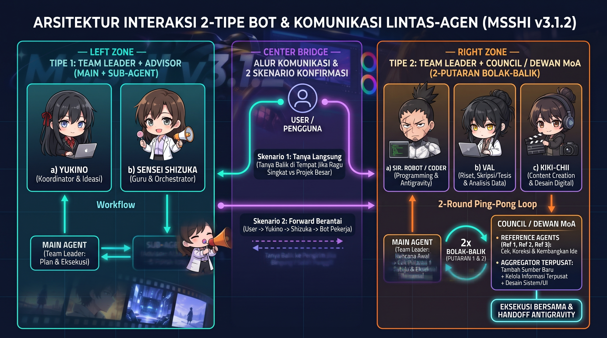

# Interaksi dua tipe - MSSHI v3.1.2

Sistem memisahkan jabatan kerja dari mesin model. Pengguna memilih sendiri model/provider dan kredensial pada host; SOUL dan protokol tidak mengunci nama model. Academic Mahasiswa, Academic Dosen, dan MuZA memakai alur dasar yang sama dengan peran/paket sesuai kebutuhannya.

Diagram adalah acuan konsep dari Pengguna. Kemampuan runtime harus diperiksa tersendiri; gambar bukan bukti bahwa panggilan Dewan atau tools telah berhasil.

## Memulai percakapan tanpa memanggil semua agen

Sapaan, candaan, pertanyaan cepat, koreksi kecil dan status dijawab Main secara langsung. Menyebut satu kata seperti riset atau video tidak otomatis berarti proyek besar. Bila maksud/skala belum jelas, bot menanyakan hal yang diperlukan sebelum menjalankan proses berat.

Jika Pengguna menghubungi bot langsung, bot bertanya di percakapan itu. Jika tugas diteruskan melalui Yukino atau Shizuka, pekerja yang ragu menanyakan kembali kepada pengirim terdekat. Pengirim meluruskan dari konteks yang ada atau meneruskan pertanyaan kepada Pengguna. Salah panggil dapat dibatalkan. Jangan membuat loop konfirmasi tanpa batas atau berpura-pura mendapat jawaban.

## Tipe 1: Main Agent dan Sub-Agent Advisor

**Yukino** menata ide, jadwal, kesiapan meeting dan tindak lanjut. **Sensei Shizuka** mengajar, menyusun strategi dan mengoordinasikan tim. Main berkomunikasi dan menyusun rencana; Advisor menilai kekurangan, alternatif dan perbaikan; Main memilih rencana yang diperbaiki lalu memimpin eksekusi. Tidak ada Dewan MoA pada jalur Tipe 1.

Untuk diskusi singkat, Advisor tidak perlu dipanggil. Untuk tugas penuh, gunakan Advisor yang telah disiapkan pada host. Jika belum tersedia, jelaskan prasyarat dan jangan mengaku konsultasi sudah terjadi. Pengaturan penasihat tidak boleh diisi dengan model bawaan yang tidak dipilih Pengguna.

## Tipe 2: Main Agent dan Council / Dewan MoA

**Sir. Robot** mengutamakan programming, arsitektur, debugging, riset teknis dan handoff. **Val** mengutamakan penelitian, skripsi/tesis/disertasi, literatur, data dan analisis. **Kiki-Chii** mengutamakan konten, film/video/foto, presentasi dan desain. Dewan terdiri atas Reference Agents dan Aggregator; jalur ini tidak menambahkan Sub-Agent terpisah.

1. **Rencana awal Main.** Tetapkan tujuan, batas, input, hasil, sumber yang diperlukan, biaya/izin dan cara verifikasi.
2. **Putaran 1.** Reference Agents memeriksa, mengoreksi dan memperluas rencana. Aggregator menyatukan bukti, menghapus duplikasi, menandai celah, meminta sumber yang kurang dan merancang blueprint terpusat.
3. **Audit Main.** Main memeriksa hasil terhadap proyek/perangkat/sumber nyata. Catatan audit menjadi input wajib putaran kedua; dua putaran berturut-turut tanpa pemeriksaan Main bukan alur ini.
4. **Putaran 2.** Reference Agents menilai ulang catatan audit. Aggregator memperbaiki blueprint, sumber dan rancangan akhir. Tidak ada putaran ketiga otomatis.
5. **Persetujuan Main dan pelaksanaan.** Main menerima atau menolak hasil dan memimpin pekerjaan dengan masukan Dewan. Persetujuan internal Main tidak menggantikan persetujuan Pengguna untuk penggunaan berbayar, pengiriman data, perubahan berisiko, review kreatif atau publikasi.

Aggregator tidak sekadar merangkum. Ia mengelola sumber dan merancang struktur kode/API, matriks riset, analisis atau desain visual. Jika panggilan penasihat tidak mempunyai tools, ia mengembalikan permintaan sumber terstruktur; Main memakai alat yang benar-benar tersedia dan diizinkan, lalu membawa bukti kembali. Menulis URL dalam jawaban tidak membuktikan sumber sudah dibaca. Sumber yang belum diperiksa tetap ditandai.

## Mesin yang benar-benar tersedia

MoA bawaan host dapat mempunyai semantik satu putaran atau menjadikan Aggregator sebagai pelaksana. Jangan menyamakan pengaturan itu dengan dua putaran yang dikendalikan Main. Pengendali interaksi MSSHI membedakan state rencana, hasil pertama, audit Main, hasil kedua dan persetujuan. Konfigurasi model berasal dari pilihan Pengguna yang sudah ada; tidak menulis ulang provider/model utama.

Jika Reference Agents atau Aggregator belum diatur, tampilkan status belum dikonfigurasi dan berhenti sebelum panggilan berbayar. Jawaban singkat Main tetap dapat digunakan. Peran yang identik tidak menjamin kualitas/biaya identik pada seluruh model dan host. Pengujian pengendali dengan respons tiruan membuktikan urutan dan batas panggilan, bukan kualitas jawaban model riil.

## Kapan skill, plugin dan aplikasi bekerja?

| Komponen | Pemicu | Yang dilakukan | Cara memakainya |
| --- | --- | --- | --- |
| Persona/SOUL | Profil dipakai | Menetapkan mandat, triase, konfirmasi dan format kerja | Bercakap pada bot yang sesuai; pilih singkat atau proyek jika diminta klarifikasi. |
| Skill sesuai konteks | Tugas cocok dan instruksi tersedia | Memberi panduan spesialis; tidak menjalankan seluruh katalog | Sebut hasil yang ingin dibuat atau panggil nama skill secara eksplisit. |
| Advisor/Dewan | Proyek jelas, konfigurasi dan izin tersedia | Telaah rencana serta blueprint sesuai tipe | Minta tugas penuh; periksa status bila komponen belum dikonfigurasi. |
| MSSHITrim | Hasil tool yang memenuhi syarat | Memadatkan JSON secara lokal setelah memeriksa kesetaraan | Berjalan sebagai hook; cek status/counter. Tidak mengganti proxy/provider. |
| CLI-Anything | Tugas aplikasi yang diizinkan dan tiket valid | Memanggil program sesuai rute peran | Minta pekerjaan konkret; pendaftaran rute bukan pembukaan aplikasi. |
| Planner | Permintaan menyusun jadwal dan data waktu tersedia | Membuat usulan berdasarkan batas waktu/sibuk | Berikan rentang waktu setiap rencana bila tidak memakai jam rutin. |
| Plugin rekaman/transkripsi | Pilihan terpisah dengan dukungan host/izin | Mengolah audio yang diizinkan | Periksa OS, data yang dikirim dan saldo layanan sebelum mengaktifkan. |
| Suara/generasi media | Permintaan keluaran media dan alat tersedia | Memanggil jalur media terpisah dari penasihat teks | Pilih suara/aset sesuai kebutuhan; tidak otomatis berbunyi pada setiap chat. |

Keterangan setiap skill, perintah dan plugin tersedia dalam modul pelanggan. Instruksi tersedia, program terpasang, login berhasil dan keluaran nyata teruji dilaporkan sebagai keadaan yang berbeda.

## Belajar, desain dan review Pengguna

Semua bot dapat memakai mode Sensei: jelaskan konsep, alasan pemilihan, langkah kerja dan pola yang dapat ditiru. Kedalaman mengikuti tujuan belajar Pengguna. Pilihan desain awal memakai layout rapi, whitespace, grid, tipografi terbaca, 3-4 warna harmonis serta aksen anime/kartun yang berizin. Pedoman kampus, identitas merek, aksesibilitas dan perubahan yang diminta Pengguna tetap menjadi batas proyek.

Kiki memulai dengan Concepting First. Pengguna meninjau konsep, naskah/storyboard, rough cut, preview dan final. Video 10-40 menit dibagi per bab/segmen. Rencana/hasil Advisor dan Dewan dapat dikritik atau diubah kapan saja; hentikan bagian otomatis yang terdampak lalu perbarui rencana.

## Handoff engineering

Jika pekerjaan akan dilanjutkan di Antigravity, Sir. Robot menghasilkan **MASTER PROMPT HANDOFF UNTUK ANTIGRAVITY**: tujuan, keputusan/blueprint, sumber beserta status verifikasi, struktur berkas, kontrak fungsi/data, desain, langkah eksekusi, tes, batas izin/biaya, hasil yang sudah ada, kendala dan rollback. Jangan menyebut dua putaran riil telah dijalankan apabila baru menyusun rencana atau menguji dengan respons tiruan.

Koneksi pribadi, token, file profil, konfigurasi model dan vault pemilik tidak dimasukkan ke handoff publik. Academic memakai workspace native Hermes; integrasi catatan pribadi tidak dipasang otomatis.
