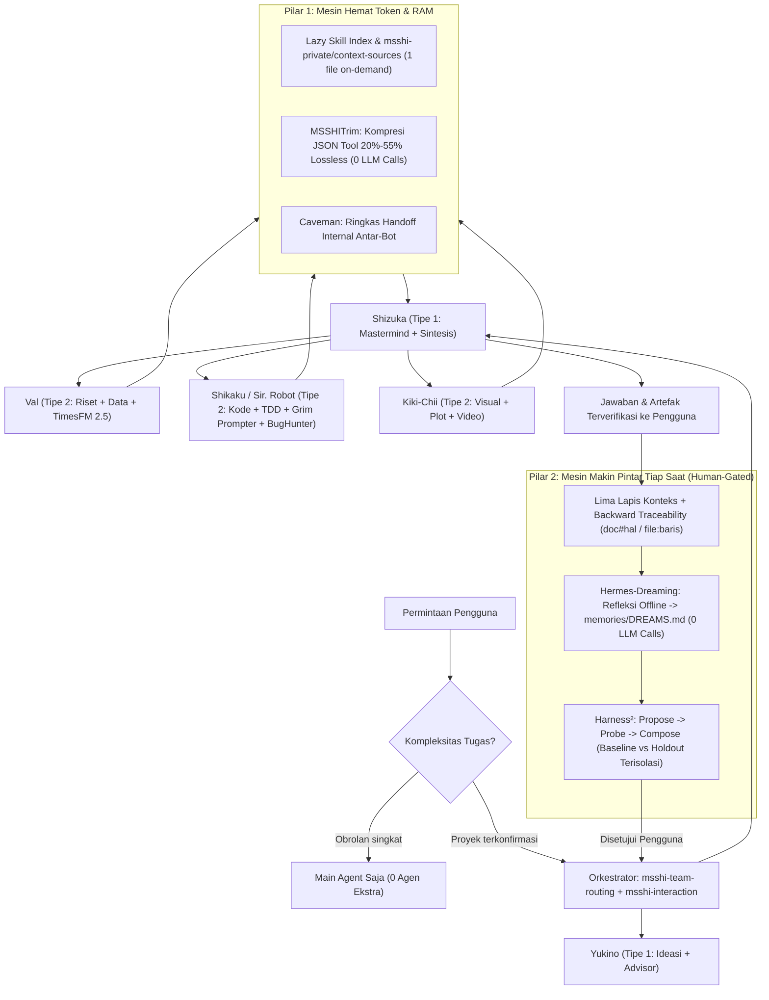

# Sistem Interaksi Cerdas MSSHI (5 Misi Utama + 4 Pilar Terpadu)

Dokumen ini menjelaskan bagaimana seluruh repositori upstream, `69` skill bundel, plugin native Hermes (`MSSHITrim`, `msshi-interaction`, `msshi-team-routing`), cache lokal, **Hermes-Dreaming**, **Google Research Harness²**, dan **TimesFM 2.5** saling berinteraksi dalam **satu sistem tertutup yang hemat token, makin pintar dari waktu ke waktu, serta makin kuat untuk riset dan prediksi** — tanpa mengubah model, provider, endpoint, API key, maupun `SOUL.md` pengguna.

## 5 Misi Utama Sistem AI MSSHI

| # | Misi Utama | Lead & Koordinator | Spesialis Pendukung (On-Demand) | Alur & Skill Inti |
| --- | --- | --- | --- | --- |
| **1** | **Belajar (Jadi Guru / Personal Tutor)** | **Shizuka** (Pedagogi & Kurikulum) + **Yukino** (Pacing & Analogi) | `Val` (teori/matematika), `Shikaku` (latihan kode), `Kiki-Chii` (visual/slide) | Diagnosa level & energi dulu (`parenting-6d-gad-mdd`, `focus-my-energy`), ajarkan 1 konsep bertahap (intuisi → analogi → contoh → formal), uji *active recall* / Socratic check, lalu catat *knowledge gaps* untuk `msshi dream` & `Harness²`. |
| **2** | **Tugas, Skripsi, Tesis & Disertasi** | **Val** (Riset, Data & Prediksi) + **Shizuka** (Sintesis & Naskah) | `Yukino` (ideasi topik), `Kiki-Chii` (plot & slide sidang), `Shikaku` (skrip analisis) | `Lima Lapis Konteks` + `deep-research`, `literature-review`, `novelty-assessment`, `unlimited-ocr-2`, `timesfm-forecasting` (holdout + baseline), `backward-traceability`, `muza-skripsi-template`, `rebuttal-writing`, `humanizer`. |
| **3** | **Konten Kreasi** | **Kiki-Chii** (Sutradara Visual & Produksi) + **Shizuka** (Brief & Review) | `Yukino` (hook/ide), `Val` (fakta/riset), `Shikaku` (motion code / web UI) | *Concepting First* dengan review manusia antar-tahap: `filmmaking-videography-photography-s2`, `motion-graphics-suite`, `rea-video` (`--no-vlm` ringan dulu), `brag`, `unslop`, `better-design`, `slide-generation`, plus opsional **`imagination-studio`** (Slate & antrean Studio lokal bila dipilih; lihat [IMAGINATION_STUDIO.md](IMAGINATION_STUDIO.md)). |
| **4** | **Coding** | **Shikaku / Sir. Robot** (Engineering & Keamanan) + **Shizuka** (Spesifikasi) | `Val` (benchmark empiris), `Kiki-Chii` (polish UI) | `analyze-project` → `explore-code` + `mattpocock-engineering` (TDD) → `grim-prompter` (*read-only threat modeling*) → `claude-bughunter` (khusus target berizin) → `explore-run` / `harness2`. |
| **5** | **Teman Curhat & Daily Basis (Scheduling dll)** | **Yukino** (Main-Only — 0 Bot Ekstra) | *(Tidak membangunkan bot lain kecuali diminta eksplisit)* | Obrolan hangat, empatik, & sangat hemat token (`fast_main_only`): `parenting-6d-gad-mdd`, `focus-my-energy`, `prep-for-meetings`, jadwal & pengingat harian sesuai energi tanpa mengubah akun/kalender eksternal tanpa izin. |

## Arsitektur 4 Pilar Terpadu



---

## 1. Pilar 1 — Bagaimana Sistem Menghemat Token Setiap Sesi
1. **Cache Sumber di Luar Pemindai (`msshi-private/context-sources/`)**:
   - Pustaka besar (`grim-prompter` 357 file, `claude-bughunter` 83 skill / 186 file, `mattpocock-skills`, `career-ops`, `remote-jobs`, `rea-video`) **tidak diletakkan langsung di folder `skills/`**. Bot hanya melihat wrapper `SKILL.md` ringkas, lalu membaca 1 file spesifik saat dibutuhkan lewat `msshi integrations source --name <nama> --skill <slug>`.
2. **Kompresi Output Tool Otomatis (`MSSHITrim` / `msshi-auto-trim`)**:
   - Setiap output tool JSON besar (`>= 2048` karakter) dipadatkan lokal `20%–55%` dengan jaminan kesamaan JSON kanonik 100% (*fail-open*, `0` panggilan LLM, tanpa TLS proxy/CA/daemon).
3. **Handoff Internal Ringkas (`caveman` / `msshi compact`)**:
   - Pesan handoff internal antar-bot (misalnya dossier Val → Shizuka atau laporan Shikaku → Shizuka) memakai format padat (*goal, output, evidence, blockers, next action*) sementara jawaban akhir ke pengguna tetap alami dan seluruh kutipan/kode tetap utuh.
4. **Gating Interaksi (`msshi-interaction`) & Mode Hemat RAM (`msshi light`)**:
   - Pertanyaan singkat cukup dijawab **Main Agent saja (`0` sub-agent/Dewan)**; Advisor (Tipe 1) dan Dewan 2 putaran (Tipe 2) hanya menyala untuk proyek terkonfirmasi.

---

## 2. Pilar 2 — Bagaimana Sistem Makin Pintar Tiap Saat (Tanpa Mengubah Bobot Model)
1. **Jejak Bukti Persisten (`Lima Lapis Konteks` + `backward-traceability`)**:
   - Bot menyimpan keputusan yang disepakati, pola kegagalan nyata, dan penunjuk bukti (`doc#p12:par3` atau `file:line`), bukan menumpuk transkrip mentah.
2. **Refleksi Offline Deterministik (`msshi dream`)**:
   - Menyusun proposal pelajaran dari sesi kerja ke `memories/DREAMS.md` dengan `0` panggilan LLM. Promosi ke memori aktif (`MEMORY.md`) selalu menunggu persetujuan pengguna.
3. **Evolusi Harness Terisolasi (`Harness²` — Google Research, Tersedia di Semua 5 Bot pada Semua Preset)**:
   - Seluruh 5 bot (`yukino`, `shizuka`, `val`, `kiki-chii`, `shikaku`) di `muza-preset`, `academic-mahasiswa`, dan `academic-dosen` memiliki akses ke `harness2`.
   - Siklus **Propose → Probe → Compose** memperbaiki prompt, skill, script, tool guidance, dan guardrails pada **salinan terisolasi** menggunakan uji baseline vs holdout:
     - **Val** mengaudit bukti & metrik perbaikan,
     - **Shikaku** menguji diff secara terisolasi,
     - **Shizuka** merangkum trade-off, risiko, dan rollback untuk **keputusan manusia**.

---

## 3. Pilar 3 — Alur Riset Mendalam & Prediksi Kuantitatif
- **Alur Riset Akademik & Teknis**:
  `Yukino` (ideasi & kebaruan) → `Shizuka` (strategi & seleksi spesialis) → `Val` (`deep-research`, `literature-review`, `unlimited-ocr-2`, `scrapling`, `github-research`, `paper-context-resolver`, `backward-traceability`) → `Shizuka` (sintesis & `muza-skripsi-template` / `humanizer`).
- **Alur Prediksi Kuantitatif (`Val` + `TimesFM 2.5`)**:
  1. `data-analysis` memvalidasi timestamp, satuan, missing values, dan memisahkan *chronological holdout* (mencegah *data leakage*).
  2. `timesfm-forecasting` (`google/timesfm-2.5-200m-pytorch` Apache-2.0 lokal CPU, tersedia pada `val` di semua preset) dibandingkan dengan baseline *naive* dan *seasonal-naive* serta `symbolic-equation` / `math-reasoning`.
  3. Val melaporkan error empiris, interval ketidakpastian (*quantiles*), dan batas asumsi secara transparan.
- **Alur Engineering & Keamanan Terotorisasi (`Shikaku / Sir. Robot`)**:
  `analyze-project` → `explore-code` + `mattpocock-engineering` (TDD) → `grim-prompter` (*read-only threat modeling*) → `claude-bughunter` (triage & validasi kerentanan khusus target berizin) → `explore-run` / `harness2`.

---

## Cakupan Penuh Tanpa Orphan (`0` Orphan Terverifikasi)

Seluruh komponen paket MSSHI terpetakan 100% di [msshi_cognitive_system.json](../configs/msshi_cognitive_system.json) dan diaudit otomatis oleh `msshi system status`:

| Lapisan Komponen | Cakupan Terkelola | Aturan Sistem & Keamanan |
| --- | --- | --- |
| **Skill Bundel** | `69/69` (`skill_registry`) | Setiap skill terikat pada misi utama, pilar, `lead_bot`, dan mode muat (`core_always_light`, `on_demand_skill`, `lazy_context_source`, atau `opt_in_runtime`). |
| **Skill Opsional** | `2/2` (`optional/rea`, `optional/imagination-studio`) | Default `OFF`; `rea` khusus Coder (`--with-rea`), `imagination-studio` khusus Kiki-Chii/Content Creator (`--with-imagination-studio`, bekerja sama dengan Filmmaker bila terpasang). |
| **Plugin Native Hermes** | `4/4` (`plugin_registry`) | `msshi-auto-trim` (hemat token lossless), `msshi-team-routing` (orkestrasi + 5 Misi + KAT opt-in), `msshi-interaction` (gating Tipe 1/Tipe 2/Main-only), dan `msshi-steel-policy` (status *retired*, tidak dipasang). |
| **Repositori Upstream** | `54/54` (`upstream_governance`) | Disimpan di luar pemindai `skills/` (`upstreams/` atau `msshi-private/context-sources/`), diaudit lisensi & pin commit, dibaca 1 file on-demand, tanpa eksekusi otomatis. |
| **Koneksi, Bridge & Runtime** | `5/5` jalur (`connections_and_bridges_registry`) | (1) `CLI-Anything` App Bridge (`tiket tugas`, `auto_open_on_boot: false`), (2) Browser lokal manual (`msshi browser`, tanpa transfer cookie), (3) Layanan eksternal/MCP manual (`BrightData`/`GDrive` OFF), (4) `Coder KAT` opt-in privat, (5) Runtime terisolasi (`harness2`, `timesfm`, `dream`, `brag`, `scrapling`, `voice`, `rea`, `skripsi`, `light`). |

---

## 4. Perintah CLI Sistem Terpadu (`msshi system`)

Semua perintah `msshi system` berjalan **100% lokal & deterministik (`0` panggilan LLM, `0` request jaringan)**:

```powershell
# 1. Lihat kesehatan & keterhubungan 4 pilar di instalasi Hermes Anda
msshi system status --json

# 2. Cari rute bot + skill paling hemat token untuk 5 misi utama
msshi system route --task "Ajari saya statistika regresi dari nol sebagai guru"
msshi system route --task "Prediksi tren penjualan 12 bulan dengan backtesting untuk tesis"
msshi system route --task "Buat konsep dan storyboard konten kreasi video YouTube"
msshi system route --task "Refactor backend Python API dengan TDD dan cek ancaman STRIDE"
msshi system route --task "Aku capek hari ini, mau curhat sebentar dan atur jadwal harian besok"

# 3. Susun rencana siklus Belajar / Riset / Prediksi + Dreaming + Harness2
msshi system cycle --domain learning --goal "Kuasai regresi linier dan uji hipotesis dalam 5 sesi"
msshi system cycle --domain prediction --goal "Bandingkan TimesFM 2.5 vs seasonal-naive pada data bulanan"
```
